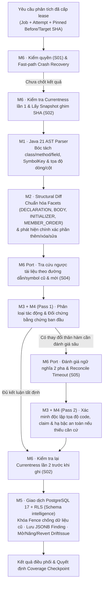

# Source Intelligence Service (S03) — Luồng Phân tích Mã nguồn & Phát hiện Độ lệch Tài liệu (M1–M6)

Module `source-intelligence-service` (**S03**, thuộc phạm vi `LIV-127` / Story `LIV-104`) chịu trách nhiệm phân tích tất định sự thay đổi cấu trúc mã nguồn **Java 21**, đối chiếu với các ràng buộc tài liệu từ **S04**, kết hợp đánh giá ngữ nghĩa có kiểm chứng từ **S05**, và lưu trữ bền vững kết quả phát hiện độ lệch tài liệu (*Documentation Drift*) vào **PostgreSQL 17** có bảo vệ **Row-Level Security (RLS)**.

---

## 1. Bức tranh Tổng thể: Luồng M1 → M6 hoạt động như thế nào?

Khi một nhánh được theo dõi (`TRACKED_BRANCH`) hoặc một Pull Request (`PULL_REQUEST`) có thay đổi mới, S03 không so sánh văn bản thô (line-diff dễ nhiễu bởi format/comment) và cũng không giao toàn quyền phán đoán cho AI. Thay vào đó, S03 xử lý qua **6 tầng rành mạch (M1 → M6)** theo nguyên tắc **Fail-Closed** (thiếu bằng chứng hoặc sai phạm vi thì từ chối suy diễn):



---

## 2. Chi tiết từng Giai đoạn đã Thực hiện (M1 → M6)

### M1 — Phân tích Cú pháp Java 21 (`com.livingdocs.analysis.ast`)
- **Mục tiêu:** Chuyển nội dung file `.java` thành cây thực thể bất biến, chính xác và không phụ thuộc định dạng trình bày.
- **Những gì đã làm:**
  - Sử dụng `javaparser-core` (`3.28.2`) cố định ở mức ngôn ngữ `JAVA_21` (khởi tạo mới mỗi lần gọi, không chia sẻ trạng thái khả biến).
  - Trích xuất đầy đủ `class`, `interface`, `enum`, `record`, `annotation`, `field` (tách bạch khai báo gộp `int a, b;`), `method`, `constructor` (kể cả compact constructor của `record`), `enum constant` và `annotation member`.
  - Tạo **`SymbolKey`** ổn định dựa trên cấu trúc cú pháp của tham số: đổi tên biến tham số, đổi kiểu trả về hay sửa thân hàm vẫn giữ nguyên `SymbolKey` để tầng sau nhận diện đúng cùng một hàm.
  - Ghi nhận tọa độ `SourceRange` (dòng/cột bắt đầu – kết thúc, đánh số từ `1`) và phân biệt rõ `SUCCESS`, `PARTIAL`, `FAILED` (file lỗi cú pháp bị đánh `FAILED` ngay cả khi thư viện phục hồi được cây AST) và `OUT_OF_SCOPE` (file không phải `.java`).

### M2 — Chuẩn hóa & So khớp Cấu trúc Hai Phía (`com.livingdocs.analysis.diff`)
- **Mục tiêu:** So sánh hai bản chụp mã nguồn đã ghim SHA (`REVISION_COMPARISON` giữa `BEFORE` ↔ `AFTER`, hoặc `INITIAL_ASSESSMENT` khi chưa có baseline) để chỉ ra **chính xác thành phần nào thực sự thay đổi**.
- **Những gì đã làm:**
  - Tách mỗi khai báo thành các khía cạnh độc lập (**Facets**):
    - `DECLARATION`: Chữ ký hàm/lớp, kiểu trả về, modifier, annotation (không tính thân hàm).
    - `BODY`: Nội dung thực thi bên trong hàm/constructor.
    - `INITIALIZER`: Biểu thức khởi tạo của field hoặc khối `static {}` / `{}`.
    - `MEMBER_ORDER`: Thứ tự thành viên trực tiếp bên trong lớp.
  - Chuẩn hóa dòng token cấu trúc (loại bỏ khoảng trắng/comment ở luồng cấu trúc nhưng giữ nguyên nội dung chuỗi/số literal và lưu riêng sự kiện đổi khoảng trắng/comment ở `FileComparison`), sau đó băm SHA-256 có gắn phiên bản.
  - Phân biệt chặt chẽ giữa **file thực sự bị xóa/thêm mới** (`Absent` có lý do xác thực từ S02) với **lỗi không lấy được dữ liệu** (`Unavailable` → đánh dấu `INCOMPLETE`, tuyệt đối không suy diễn nhầm thành xóa code).
  - Bắt cả các thay đổi ngoài danh mục thực thể (đổi `package`, `import`, `module-info`, khối khởi tạo, gộp/tách khai báo field hoặc vùng dư `RESIDUAL_STRUCTURAL_CHANGE`).

### M3 — Phân loại Tác động Tất định (`com.livingdocs.analysis.impact`)
- **Mục tiêu:** Quyết định xem một thay đổi mã nguồn có làm tài liệu bị sai lệch hay không dựa trên liên kết tài liệu (S04) và kết quả ngữ nghĩa (S05).
- **Những gì đã làm:**
  - Sinh tập khóa tra cứu tất định `ImpactClassifier.buildLookupKeys(...)` cho **cả phía cũ (`BEFORE`) và phía mới (`AFTER`)** ở cấp `FILE` và `SYMBOL` (bao gồm cả trường hợp đổi tên/di chuyển file hoặc xóa symbol).
  - Xếp loại từng đơn vị thay đổi vào 3 kết quả (`ImpactOutcome`):
    1. **`ACTIONABLE`** — Đã có đủ bằng chứng khẳng định lệch tài liệu, gán phân loại cụ thể:
       - `REFERENTIAL`: Symbol hoặc file mà tài liệu đang tham chiếu đã bị xóa/đổi đường dẫn không còn khớp.
       - `SIGNATURE`: Chữ ký khai báo (`DECLARATION`) thay đổi trái với mô tả trong tài liệu.
       - `SEMANTIC`: Thân thực thi (`BODY`/`INITIALIZER`) thay đổi làm sai lệch hành vi nghiệp vụ mà tài liệu cam kết.
    2. **`NO_IMPACT`** — Xác nhận an toàn không ảnh hưởng tài liệu: S04 xác nhận tra cứu đầy đủ nhưng không có tài liệu gắn kèm, claim vẫn nhất quán, chỉ thay đổi khoảng trắng khi bật cờ cho phép, hoặc thuộc vùng được loại trừ hợp lệ (`EXCLUDED`: non-Java, caller exclusion, controlled export).
    3. **`INCONCLUSIVE`** — Chưa đủ căn cứ kết luận cuối cùng (ví dụ: thân hàm đổi nhưng chờ S05, S04 trả kết quả thiếu/lỗi, hoặc chỉ gắn liên kết yếu cấp file). Tách rõ hai mức xét duyệt:
       - `SUPPORTED_BY_INITIAL_EVIDENCE`: Có bằng chứng ban đầu đáng tin → được phép mở cảnh báo sớm ở trạng thái `DETECTED`.
       - `INSUFFICIENT_EVIDENCE`: Chỉ lưu lịch sử finding, **không** mở issue giả.
  - Chỉ gán mức độ nghiêm trọng (`LOW`, `MEDIUM`, `HIGH`, `CRITICAL`) khi có `VerifiedImpactContext`; không tự đoán mức độ (`SEVERITY_NOT_EVALUATED`).

### M4 — Đối chứng Bằng chứng Thật & Hạ bậc An toàn (`com.livingdocs.analysis.evidence`)
- **Mục tiêu:** Đảm bảo mọi kết luận từ M3 đều trỏ tới đúng đoạn code thật trên đúng commit SHA đã ghim và không làm rò rỉ dữ liệu ngoài phạm vi quyền.
- **Những gì đã làm:**
  - Kiểm chứng lại từng bằng chứng (`WitnessSelector`) trên nội dung nguồn gốc (`SnapshotProof`): tọa độ `SourceRange` phải nằm trong giới hạn dòng/cột hợp lệ và khớp băm nội dung (chặn các trường hợp lệch dòng, tab/ký tự đặc biệt làm sai lệch cột, hoặc sai SHA).
  - Kiểm chứng chéo kết quả S05: phải khớp đúng `jobId`, `attemptId`, trong hạn `deadline`, đúng `evaluatedTargetSha`, đúng phiên bản tài liệu và đúng tọa độ `BODY` của M2.
  - **Cơ chế hạ bậc 2 tầng (Two-Tier Downgrade):**
    - Nếu bằng chứng tác động sâu (ví dụ S05) không đạt nhưng bằng chứng ban đầu vẫn hợp lệ → hạ từ `ACTIONABLE` xuống `INCONCLUSIVE` nhưng giữ `SUPPORTED_BY_INITIAL_EVIDENCE`.
    - Nếu bằng chứng bắt buộc ban đầu cũng không xác minh được → hạ xuống `INSUFFICIENT_EVIDENCE`.
    - Nếu chỉ thiếu một bằng chứng phụ tùy chọn (*optional witness*) → giữ nguyên kết luận và đánh dấu trạng thái bằng chứng `PARTIAL`.
  - Lọc bỏ toàn bộ mã nguồn thô và thông tin nhạy cảm khỏi kết quả đầu ra (`EvidenceInput`/`SnapshotProof` tự động ẩn nội dung trong `toString()`).

### M5 — Lưu trữ Giao dịch, RLS & Vòng đời Drift (`entity`, `repository`, `security`, `service`)
- **Mục tiêu:** Ghi nhận kết quả vào PostgreSQL 17 một cách an toàn đa thuê bao (*multi-tenant*), chống ghi đè bởi sự kiện đến muộn (*out-of-order*) và tuân thủ chặt vòng đời nghiệp vụ của `DriftIssue`.
- **Những gì đã làm:**
  - **Flyway `V1` + `V2` trên schema `intelligence`:**
    - `V1__create_analysis_job_tables.sql`: Bảng `analysis_jobs` quản lý khóa job, binding snapshot bất biến, `current_attempt_id`, `lease_expires_at` và kết quả tổng hợp.
    - `V2__create_drift_analysis_tables.sql`: Bốn bảng `target_analysis_fences`, `drift_issues`, `analysis_findings`, `drift_evidence`.
  - **Bảo mật cấp cơ sở dữ liệu (RLS & Least Privilege):**
    - Toàn bộ 5 bảng bật `ENABLE ROW LEVEL SECURITY` theo biến giao dịch `current_setting('app.tenant_id', true)::UUID` thông qua `S03TenantContext` (tự động giải phóng theo từng giao dịch, an toàn tuyệt đối khi tái sử dụng kết nối HikariCP).
    - Role ứng dụng `ld_s03_app` không có `BYPASSRLS`, bị thu hồi hoàn toàn quyền đọc `flyway_schema_history`, và chỉ có quyền `SELECT, INSERT` (**append-only**) trên bảng `drift_evidence`.
  - **Lưu JSONB 1 lần & Chống gắn chéo:**
    - Dữ liệu bằng chứng đã lọc (`m5-finding-evidence-v1`) chỉ lưu **1 lần duy nhất** trên `analysis_findings.evidence_payload`.
    - `drift_evidence` chỉ lưu liên kết quan sát nhẹ giữa `drift_issue_id` và `finding_id`, có khóa ngoại tổ hợp `(tenant_id, finding_id, drift_issue_id)` chặn cứng việc gắn nhầm bằng chứng giữa hai issue khác nhau.
  - **Hàng rào chống dữ liệu cũ (`target_analysis_fences`) & Idempotent Retry:**
    - Khóa `SELECT ... FOR UPDATE` theo từng đích `(tenant, repo, targetKind, targetRef)`, kiểm tra lại hạn dùng của `ValidationReceipt` ngay dưới khóa trước khi nâng `latest_source_revision`. Job có revision cũ hơn bị chặn sửa issue (`SUPPRESSED_STALE`).
    - Job gặp trạng thái `UNKNOWN` tạm hoãn (`DEFERRED_UNKNOWN_CURRENTNESS`), khi chạy lại bằng `attempt_id` mới sẽ tái sử dụng `finding_id` đã lưu mà không tạo bản ghi trùng.
  - **Vòng đời `DriftIssue` & Revert (R2):**
    - `INCONCLUSIVE + SUPPORTED_BY_INITIAL_EVIDENCE` mở `DETECTED`; `ACTIONABLE` mở hoặc nâng `DETECTED → ANALYZED` (không bao giờ hạ ngược `SUGGESTED/ANALYZED` về trạng thái thấp hơn, và không bao giờ tự động đóng `RESOLVED`/`DISMISSED`).
    - Khi một commit sau đó sửa code quay lại khớp đúng claim của một issue đang mở (**R2 Revert**), hệ thống ghi thêm quan sát `CONSISTENCY_REVERTED` và bật cờ `revert_observed = true` (`last_consistent_sha`), đồng thời giữ nguyên trạng thái issue và `last_observed_sha` để người phụ trách chủ động xét duyệt.

### M6 (Mức 1) — Cổng Nội bộ & Bộ Điều phối Không Giữ Giao dịch (`port`, `DriftAnalysisOrchestratorService`)
- **Mục tiêu:** Kết nối hoàn chỉnh đường ống `S01 → S02 → M2 → S04 → M3/M4 → S05 → M5` mà không bị phụ thuộc sớm vào các hợp đồng REST/Kafka còn đang ở trạng thái nháp (`CANDIDATE`), đồng thời không bao giờ giữ kết nối DB trong lúc chờ gọi mạng.
- **Những gì đã làm:**
  - **4 Cổng nội bộ (`M6.1` trong `com.livingdocs.analysis.port`):**
    1. `ScopeAuthorizationPort`: Kiểm tra quyền thực thi của worker / người dùng (tương ứng S01).
    2. `SourceAuthorityPort`: Kiểm tra tính thời sự (`validateCurrentness` kèm `ValidationReceipt`) và phân giải cặp snapshot ghim SHA (`resolveSnapshots`, tương ứng S02).
    3. `DocumentMappingPort`: Tra cứu ngược binding/claim theo danh sách khóa nguồn (tương ứng S04).
    4. `SemanticAssessmentPort`: Đánh giá ngữ nghĩa có hạn giờ và đối soát phiên quá hạn `reconcileTimedOutExecution` (tương ứng S05).
  - **Bộ điều phối `DriftAnalysisOrchestratorServiceImpl` (`M6.2`):**
    - Chặn cứng nếu bị gọi bên trong một giao dịch DB đang mở (`TransactionSynchronizationManager.isActualTransactionActive()`).
    - **Fast-path Crash Recovery:** Nếu worker bị sập ngay sau khi M5 đã commit nhưng chưa kịp cập nhật checkpoint, lần chạy lại đọc nhanh trạng thái đã chốt trong DB và trả `IDEMPOTENT_REPLAY` ngay lập tức mà không cần gọi lại S02/S04/S05.
    - **Kiểm tra Currentness 2 đầu & Kiểm tra Ghim SHA:** Kiểm tra S02 trước khi tải dữ liệu và kiểm tra lại lần 2 ngay trước khi ghi DB; từ chối ngay (`FAILED_CONTRACT_VIOLATION`) nếu snapshot trả về lệch SHA yêu cầu.
    - **Đánh giá S05 hai pha (Two-Pass Grounding):** Chỉ gửi sang S05 những ứng viên đã vượt qua bước đối chứng nguồn & tài liệu ở Pass 1; nếu có `priorTimedOutSemanticExecutionId`, ưu tiên gọi `reconcileTimedOutExecution` trước khi tạo lượt chạy mới.
    - **Quyết định Checkpoint (`CheckpointDecision`):** Chỉ trả `ADVANCE_CHECKPOINT` khi kết quả được áp dụng hiện hành, độ phủ đầy đủ (`completeCoverage == true`) và không bị nhảy cóc qua commit trung gian (`REQUIRES_CATCH_UP_RECONCILIATION` nếu `previousCheckpointSha != comparisonBeforeSha`).
  - **Ranh giới cổng chờ (`M6.3` — `BLOCKED_FOR_INTEGRATION`):** Các HTTP/Kafka adapters thật nối sang S02, S04, S05, worker consumer `LIV-125` và các Read Controllers (`API-078..085`) được giữ sau cổng chờ cho đến khi các hợp đồng `CANDIDATE` liên quan được phê duyệt chính thức.

---

## 3. Cấu trúc Thư mục Chính

```text
backend/source-intelligence-service/
├── pom.xml
└── src/
    ├── main/
    │   ├── java/com/livingdocs/analysis/
    │   │   ├── ast/          # M1: Java 21 AST Parser & M2 Structural Representation
    │   │   ├── diff/         # M2: Deterministic Structural Diff Engine
    │   │   ├── impact/       # M3: Deterministic Impact Classifier
    │   │   ├── evidence/     # M4: Grounded Source/Document Evidence Mapper
    │   │   ├── entity/       # M5: JPA Entities (intelligence schema)
    │   │   ├── repository/   # M5: Spring Data JPA Repositories & Row Locks
    │   │   ├── security/     # M5: Transaction-local RLS Tenant Context
    │   │   ├── model/        # M5: Persistence Commands & Versioned JSONB Payloads
    │   │   ├── port/         # M6.1: Internal Domain Ports (S01, S02, S04, S05)
    │   │   └── service/      # M5 Writer Service & M6.2 Pipeline Orchestrator
    │   └── resources/
    │       ├── application.yaml
    │       ├── application-db.yaml
    │       └── db/migration/
    │           ├── V1__create_analysis_job_tables.sql
    │           └── V2__create_drift_analysis_tables.sql
    └── test/
        ├── java/com/livingdocs/analysis/
        │   ├── ast/          # JavaSourceParserTest (32), JavaStructuralRepresentationTest (7)
        │   ├── diff/         # StructuralDiffTest (15)
        │   ├── impact/       # ImpactClassifierTest (13)
        │   ├── evidence/     # SourceEvidenceMapperTest (15)
        │   ├── persistence/  # AnalysisResultWriterIntegrationTest (12 - PG17 + RLS)
        │   ├── service/      # DriftAnalysisOrchestratorIntegrationTest (10 - PG17 + Ports)
        │   └── SourceIntelligenceServiceApplicationTests.java (1 - Flyway V1->V2 + Hibernate validate)
        └── resources/
            └── s03-test-schema.sql
```

---

## 4. Chạy Kiểm thử & Xây dựng Module

Yêu cầu **JDK 21** và **Docker** đang chạy (để Testcontainers tự động khởi tạo container `postgres:17` cô lập cho các bài kiểm thử tích hợp M5 và M6).

### macOS / Linux
```bash
cd backend/source-intelligence-service
./mvnw -B -ntp clean verify
```

### Windows PowerShell
```powershell
cd backend/source-intelligence-service
.\mvnw.cmd -B -ntp clean verify
```

**Tổng hợp bộ kiểm thử hiện tại (`105/105` PASS):**

| Nhóm kiểm thử | Lớp test | Số lượng | Môi trường |
|---|---|---:|---|
| **M1 · Parser** | `JavaSourceParserTest` | 32 | Pure Java 21 |
| **M2 · Normalization** | `JavaStructuralRepresentationTest` | 7 | Pure Java 21 |
| **M2 · Structural Diff** | `StructuralDiffTest` | 15 | Pure Java 21 |
| **M3 · Impact Classifier** | `ImpactClassifierTest` | 13 | Pure Java 21 |
| **M4 · Grounded Evidence** | `SourceEvidenceMapperTest` | 15 | Pure Java 21 |
| **M5.1 · Context & Flyway** | `SourceIntelligenceServiceApplicationTests` | 1 | PostgreSQL 17 Testcontainers |
| **M5.4 · Persistence & RLS** | `AnalysisResultWriterIntegrationTest` (`M5-RV-01..12`) | 12 | PostgreSQL 17 Testcontainers (`ld_s03_app`) |
| **M6.2 · Orchestrator** | `DriftAnalysisOrchestratorIntegrationTest` (`M6-RV-01..10`) | 10 | PostgreSQL 17 Testcontainers + Port Doubles |
| **Tổng cộng** | | **105** | **`BUILD SUCCESS`** |

---

## 5. Cấu hình Chạy Local với PostgreSQL (`profile = db`)

Khi chạy trực tiếp ứng dụng S03 kết nối vào PostgreSQL 17 local (sau khi đã khởi tạo role `ld_s03_app`, `ld_s03_migrator` và schema `intelligence`), tạo file `backend/source-intelligence-service/.env` (file này đã được `.gitignore` loại trừ, **không commit mật khẩu thật lên Git**):

```properties
SERVER_PORT=8083
SPRING_PROFILES_ACTIVE=db
DB_URL=jdbc:postgresql://127.0.0.1:5432/livingdocs
DB_SCHEMA=intelligence
DB_USERNAME=ld_s03_app
DB_PASSWORD=<your_app_role_password>
FLYWAY_USERNAME=ld_s03_migrator
FLYWAY_PASSWORD=<your_migrator_role_password>
```
