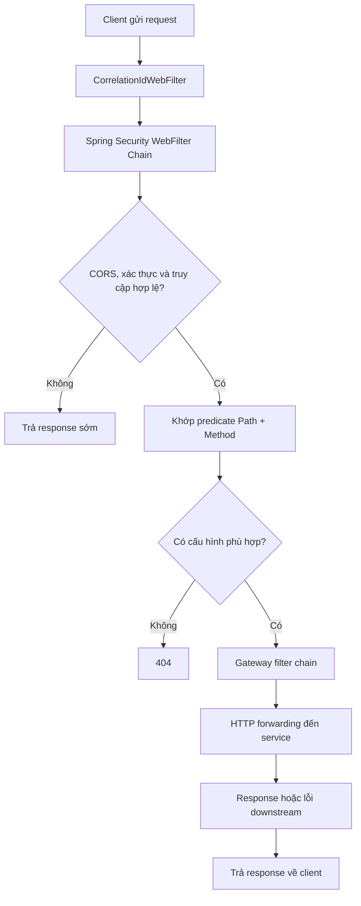

# Nội dung thuyết trình API Gateway — LivingDocs

Thời lượng gợi ý: 12–15 phút, gồm 8 slide. Phần security và luồng request chiếm khoảng một nửa thời lượng.

Tài liệu này phát triển phần API Gateway từ khung kịch bản được cung cấp: giữ phần lựa chọn công nghệ của Slide 8, chuyển nội dung Slide 9 sang giải thích predicate, tách Slide 10 thành các slide về filter/security và response processing. Bỏ slide riêng về service discovery/load balancing. Chỉ nhắc việc chọn backend ở mức cần thiết để hiểu luồng request.

Nội dung được đối chiếu với README, cấu hình, mã nguồn và các bài kiểm thử hiện có trong repository. Ví dụ nghiệp vụ là tình huống minh họa; không phải kết quả chạy E2E với các service thật.

## Slide 1. API Gateway đảm nhiệm những gì trong LivingDocs? — 1 phút

### Nội dung trên slide

- Điểm truy cập thống nhất cho các public API được cho phép của S01, S02 và S04.
- Công nghệ: **Spring Cloud Gateway Server WebFlux**, tích hợp Spring Security.
- Các cơ chế chính:
  1. Predicate: kiểm tra request có khớp API được khai báo không.
  2. Filter và security: correlation ID, CORS, JWT và kiểm soát truy cập tại biên.
  3. Response processing: chuyển phản hồi và xử lý lỗi kết nối downstream.
- Quyền nghiệp vụ theo tenant, workspace và tài nguyên thuộc trách nhiệm domain service.

### Lời thuyết trình

“Sau phần kiến trúc tổng quan, em sẽ theo dõi một request từ người dùng đi vào LivingDocs. Điểm tiếp nhận request là API Gateway, được xây dựng bằng Spring Cloud Gateway Server WebFlux.

Gateway cung cấp một địa chỉ truy cập chung cho các API công khai của Identity & Organization, Repository Integration và Document Governance. Trong phần này, em tập trung vào ba cơ chế: điều kiện nhận request, chuỗi filter và bảo mật, cuối cùng là xử lý response.

WebFlux hỗ trợ xử lý I/O theo mô hình reactive, non-blocking, phù hợp với vai trò tiếp nhận và chuyển tiếp HTTP của Gateway. Đây là đặc tính kiến trúc; muốn kết luận về hiệu năng vẫn cần đo tải thực tế.

Gateway kiểm soát request tại biên, còn các quyết định như người dùng có được xem tài liệu hoặc phê duyệt phiên bản hay không vẫn do service nghiệp vụ kiểm tra.”

**Nguồn:** [README Gateway, mục 1](../infrastructure/api-gateway/README.md); [pom.xml](../infrastructure/api-gateway/pom.xml).

## Slide 2. Predicate: điều kiện để request khớp API công khai — 1,5 phút

### Nội dung trên slide

Ví dụ lấy nguyên từ cấu hình hiện tại:

```yaml
- id: s04-document-details
  uri: ${S04_SERVICE_URI:http://127.0.0.1:8084}
  predicates:
    - Path=/api/v1/documents/{documentId}
    - Method=GET
```

```text
GET    /api/v1/documents/doc-1          → khớp ví dụ này
DELETE /api/v1/documents/doc-1          → không khớp ví dụ này
GET    /api/v1/documents/doc-1/private  → không khớp ví dụ này
```

- `Path`: kiểm tra mẫu đường dẫn; `{documentId}` là một đoạn biến trong URL.
- `Method`: kiểm tra HTTP method.
- Hai predicate trong ví dụ phải cùng thỏa mãn: **Path AND Method**.
- Predicate chỉ kiểm tra điều kiện khớp request; không xác nhận quyền sở hữu tài liệu.

### Lời thuyết trình

“Predicate trả lời câu hỏi: request này có khớp một API mà Gateway đã khai báo hay không?

Ở ví dụ này, request phải có đường dẫn theo mẫu documents/documentId và có method GET. Hai điều kiện được kết hợp bằng AND. Vì vậy GET để lấy chi tiết tài liệu phù hợp, còn DELETE trên cùng đường dẫn không được cấu hình này chấp nhận.

LivingDocs sử dụng danh sách Path và Method cụ thể, thay vì mở toàn bộ /api/v1/**. Cách này giúp hạn chế việc vô tình đưa những endpoint chưa được duyệt ra bên ngoài.

Tuy nhiên, khớp đường dẫn không có nghĩa người dùng được phép đọc tài liệu. Predicate không kiểm tra tài liệu có tồn tại, documentId có đúng định dạng nghiệp vụ hay tài liệu thuộc tenant nào. Những bước đó thuộc service đích.

Trong luồng hiện tại, security được xử lý trước bước khớp predicate. Do đó, với API được bảo vệ, thiếu JWT có thể bị trả 401 trước khi Gateway kiểm tra có cấu hình phù hợp hay không. Khi request đã vượt qua security nhưng không có cấu hình Path và Method phù hợp, kết quả là 404.”

**Nguồn:** [application.yaml](../infrastructure/api-gateway/src/main/resources/application.yaml); [GatewayRoutingIntegrationTest](../infrastructure/api-gateway/src/test/java/com/livingdocs/gateway/GatewayRoutingIntegrationTest.java).

## Slide 3. Một request đi qua những lớp filter nào? — 1,5 phút

### Nội dung trên slide



| Lớp xử lý | Thành phần trong dự án | Vai trò |
|---|---|---|
| WebFlux `WebFilter` | `CorrelationIdWebFilter`, Spring Security | Xử lý trước khi request đến handler định tuyến |
| Gateway `GlobalFilter` | `GatewayDownstreamErrorFilter` | Áp dụng trong chuỗi Gateway khi đã khớp cấu hình; bao quanh xử lý downstream |

Preflight CORS hợp lệ có thể được trả lời ngay tại lớp security, không đi đến service.

### Lời thuyết trình

“Để hiểu đúng luồng xử lý, cần phân biệt hai lớp filter.

Lớp thứ nhất là WebFilter của WebFlux. CorrelationIdWebFilter của dự án chạy ở lớp này, trước security. Spring Security cũng xử lý request trong chuỗi WebFilter, bao gồm CORS, xác thực và kiểm soát truy cập.

Sau khi request đi qua các kiểm tra đó, Gateway mới khớp predicate. Nếu khớp, request tiếp tục vào Gateway filter chain và được chuyển đến service.

Lớp thứ hai là filter của Spring Cloud Gateway. Dự án có GatewayDownstreamErrorFilter triển khai GlobalFilter để xử lý một số lỗi khi gọi service đích.

Cả hai filter tự viết đều có HIGHEST_PRECEDENCE, nhưng chúng thuộc hai chuỗi khác nhau. Không thể chỉ so sánh giá trị order rồi xem chúng là hai filter chạy cạnh nhau trong cùng một danh sách. Vì thế lỗi xác thực 401 không đi qua bộ chuẩn hóa lỗi downstream.”

**Nguồn:** [README, luồng request](../infrastructure/api-gateway/README.md); [CorrelationIdWebFilter](../infrastructure/api-gateway/src/main/java/com/livingdocs/gateway/filter/CorrelationIdWebFilter.java); [GatewaySecurityConfig](../infrastructure/api-gateway/src/main/java/com/livingdocs/gateway/config/GatewaySecurityConfig.java); [GatewayDownstreamErrorFilter](../infrastructure/api-gateway/src/main/java/com/livingdocs/gateway/filter/GatewayDownstreamErrorFilter.java).

## Slide 4. Trước xác thực: correlation ID và CORS — 2 phút

### Nội dung trên slide

**Bước 1 — Gắn mã theo dõi request**

- Đọc `X-Correlation-ID` do client gửi.
- Giữ lại nếu hợp lệ: 1–64 ký tự; bắt đầu bằng chữ hoặc số; các ký tự sau cho phép thêm `.`, `_`, `-`.
- Nếu thiếu hoặc sai định dạng: tạo UUID mới.
- Đặt ID vào request gửi tiếp và response trả về.
- Giúp đối chiếu request giữa client, Gateway và downstream; không dùng làm bằng chứng xác thực.

**Bước 2 — Kiểm tra CORS cho `/api/**`**

| Thuộc tính | Cấu hình hiện tại |
|---|---|
| Origin | Danh sách từ biến môi trường; mặc định `http://localhost:3000` |
| Method | `GET, POST, PUT, PATCH, DELETE, OPTIONS` |
| Request header cho phép | `Authorization`, `Content-Type`, `Accept`, `X-Correlation-ID` |
| Response header expose | `X-Correlation-ID` |
| Credentials | `false` |
| Preflight max-age | `3600` giây |

### Lời thuyết trình

“Bước đầu tiên là chuẩn bị correlation ID. Filter kiểm tra X-Correlation-ID của client. Nếu giá trị hợp lệ thì giữ lại; nếu thiếu hoặc sai định dạng thì tạo UUID. ID này được gắn vào request chuyển tiếp và cả response, kể cả trường hợp request bị security từ chối sau đó.

Tiếp theo là CORS, phục vụ tình huống frontend trên trình duyệt gọi Gateway từ một origin khác. Với request cần preflight, trình duyệt gửi OPTIONS để hỏi origin, method và các header dự kiến có được cho phép hay không.

Nếu preflight hợp lệ, Gateway trả lời tại đây mà không yêu cầu JWT và không chuyển OPTIONS đến service. Sau đó trình duyệt mới gửi request nghiệp vụ; request này vẫn phải qua xác thực nếu API được bảo vệ. Origin không được phép sẽ bị CORS từ chối.

Một điểm cần phân biệt là CORS cho phép method DELETE không có nghĩa mọi API DELETE đều được mở. CORS chỉ là một bước kiểm tra; predicate và security vẫn có điều kiện riêng.

Cấu hình hiện tại expose X-Correlation-ID để JavaScript phía frontend đọc được header này. Credentials đang là false, nên chưa cấu hình hỗ trợ luồng cookie cross-origin. CORS cũng không thay thế xác thực người dùng hoặc cơ chế CSRF.”

**Nguồn:** [CorrelationIdWebFilter](../infrastructure/api-gateway/src/main/java/com/livingdocs/gateway/filter/CorrelationIdWebFilter.java); [GatewayCorsConfig](../infrastructure/api-gateway/src/main/java/com/livingdocs/gateway/config/GatewayCorsConfig.java); [GatewayFoundationTest](../infrastructure/api-gateway/src/test/java/com/livingdocs/gateway/GatewayFoundationTest.java).

## Slide 5. Security: xác thực JWT và kiểm soát truy cập tại biên — 2,5 phút

### Nội dung trên slide

Request minh họa:

```http
GET /api/v1/documents/doc-1
Authorization: Bearer <access-token>
X-Correlation-ID: demo-doc-001
```

**Bước 3 — Authentication: người gọi là ai?**

1. Spring Security tiếp nhận Bearer token từ `Authorization`.
2. Resource Server sử dụng JWT decoder để xác minh token.
3. Kiểm tra chữ ký, hiệu lực thời gian và các giá trị `iss`, `aud` theo cấu hình/hợp đồng JWT.
4. Token hợp lệ → tạo ngữ cảnh xác thực để tiếp tục xử lý.
5. Với endpoint được bảo vệ: thiếu hoặc sai token → `401`.

**Bước 4 — Authorization: request có được qua cổng không?**

| Nhóm request | Quy tắc hiện tại |
|---|---|
| `POST /api/v1/auth/register`, `POST /api/v1/auth/login` | `permitAll()` |
| `/internal/v1/**`, `/actuator/**`, `/v3/api-docs/**`, `/swagger-ui/**` và các đường dẫn gốc tương ứng | `denyAll()` |
| Các request còn lại | `authenticated()` |

### Lời thuyết trình

“Với request lấy tài liệu, sau correlation ID và CORS, security đọc Bearer token từ Authorization.

Gateway đóng vai trò OAuth2 Resource Server: nhận và xác minh access token. Gateway không phát token và không tự kiểm tra mật khẩu trong request đăng nhập. API đăng nhập được cho phép đi qua để S01 xử lý.

Việc xác minh JWT do Spring Security và JWT decoder đảm nhiệm. Theo cấu hình và hợp đồng mà README yêu cầu, token phải có chữ ký hợp lệ, còn hiệu lực, đúng issuer và audience. Issuer là bên phát hành token được tin cậy; audience là đối tượng nhận mà token được cấp để sử dụng. Cấu hình hiện tại lấy hai giá trị này từ JWT_ISSUER_URI và JWT_AUDIENCE.

Sau authentication là authorization. Hai API POST đăng ký và đăng nhập được public. Các đường dẫn nội bộ, actuator và tài liệu kỹ thuật bị chặn tại public Gateway. Các request khác phải được xác thực.

Ví dụ, request không có token vào API tài liệu bị trả 401. Request có token hợp lệ nhưng gọi đường dẫn internal bị trả 403. Không nên nói mọi request internal đều trả 403: nếu token thiếu hoặc sai, security có thể trả 401 trước.

Hiện Gateway chưa có quy tắc phân quyền chi tiết theo role, tenant hoặc tài liệu. authenticated chỉ xác nhận request đã được xác thực. Nó chưa chứng minh người dùng có quyền đọc doc-1.

Một chi tiết khác là permitAll cho phép gọi login mà không cần token. Nếu client chủ động gửi một Bearer token sai lên endpoint public, lớp xác thực vẫn có thể từ chối token đó.”

**Ghi chú cho người trình bày:** Cấu hình tắt HTTP Basic, form login và CSRF. Không diễn giải rằng tắt CSRF là an toàn cho mọi mô hình; README yêu cầu hoàn thiện cơ chế CSRF/session trước khi mở các luồng refresh/logout dùng cookie. README cũng ghi JWT issuer thật chưa được nghiệm thu E2E; các test hiện tại dùng decoder mock.

**Nguồn:** [GatewaySecurityConfig](../infrastructure/api-gateway/src/main/java/com/livingdocs/gateway/config/GatewaySecurityConfig.java); [application.yaml, cấu hình JWT](../infrastructure/api-gateway/src/main/resources/application.yaml); [README, mục 3–5](../infrastructure/api-gateway/README.md).

## Slide 6. Theo dõi request hợp lệ từ Gateway đến service — 1,5 phút

### Nội dung trên slide

Ví dụ xuyên suốt: `GET /api/v1/documents/doc-1`.

| Bước | Xử lý | Kết quả để tiếp tục |
|---|---|---|
| 1 | Correlation filter | Có ID hợp lệ cho request và response |
| 2 | CORS, nếu là request CORS | Origin và điều kiện CORS được chấp nhận |
| 3 | JWT authentication | Có danh tính được xác thực |
| 4 | Authorization tại Gateway | Endpoint được phép truy cập tại biên |
| 5 | Khớp predicate | Path đúng và Method là GET |
| 6 | Gateway filter chain và HTTP client | Chuyển request sang S04 |
| 7 | Domain authorization tại S04 theo thiết kế | Xác minh JWT, tenant/workspace/resource và quy tắc nghiệp vụ |
| 8 | Response processing | Trả phản hồi hoặc xử lý lỗi downstream |

### Lời thuyết trình

“Ghép các bước lại, request lấy doc-1 được gắn correlation ID, vượt qua CORS nếu có, sau đó được xác thực JWT và kiểm tra quyền truy cập tại biên.

Gateway tiếp tục kiểm tra Path và Method. Request phù hợp sẽ đi vào Gateway filter chain. GatewayDownstreamErrorFilter gọi chain.filter để cho các bước tiếp theo chạy, đồng thời đăng ký nhánh xử lý nếu chuỗi downstream phát sinh lỗi.

HTTP client chuyển request sang S04. Ở cấu hình hiện tại, đường dẫn /api/v1 được giữ nguyên; không có StripPrefix như trong các tài liệu PoC cũ. Integration test cũng kiểm tra correlation ID đi đến downstream.

Theo thiết kế, S04 vẫn phải xác minh JWT và kiểm tra quyền trên tài liệu. Chẳng hạn, một người dùng có token hợp lệ vẫn không được đọc tài liệu thuộc tenant khác nếu không có quyền. Đây là trách nhiệm nghiệp vụ mà Gateway không thay thế.

Các kiểm tra nghiệp vụ vừa nêu là trách nhiệm theo kiến trúc và README. Bộ test Gateway sử dụng HTTP stub nên không chứng minh S04 đã thực hiện đầy đủ các kiểm tra đó.”

**Nguồn:** [README, mục 1](../infrastructure/api-gateway/README.md); [GatewayRoutingIntegrationTest](../infrastructure/api-gateway/src/test/java/com/livingdocs/gateway/GatewayRoutingIntegrationTest.java); [GatewayDownstreamErrorFilter](../infrastructure/api-gateway/src/main/java/com/livingdocs/gateway/filter/GatewayDownstreamErrorFilter.java).

## Slide 7. Response processing: thành công, bị từ chối và lỗi downstream — 2 phút

### Nội dung trên slide

**Nhánh A — Downstream có HTTP response**

- Gateway chuyển tiếp status và body của service về client.
- Response mang `X-Correlation-ID`; có CORS header phù hợp khi áp dụng.
- Chưa có filter tự viết để chuyển đổi body thành công hoặc gom dữ liệu nhiều service.

**Nhánh B — Request bị từ chối trước downstream**

- `401`: không đáp ứng xác thực ở endpoint được bảo vệ.
- `403`: ví dụ CORS bị từ chối hoặc request đã xác thực gọi path bị cấm.
- `404`: request vượt security nhưng không khớp cấu hình Path + Method.
- Các lỗi này không do `GatewayDownstreamErrorFilter` chuẩn hóa.

**Nhánh C — Chuỗi gọi downstream phát sinh lỗi được nhận diện**

| Lỗi | HTTP status | Mã ứng dụng |
|---|---|---|
| Kết nối bị từ chối, không phân giải được host, không có đường đến host | `503` | `UPSTREAM_UNAVAILABLE` |
| Connect/read timeout, `TimeoutException`, hoặc `ResponseStatusException` 504 | `504` | `UPSTREAM_TIMEOUT` |

Response lỗi do filter tạo có `Content-Type: application/problem+json`:

```json
{
  "type": "about:blank",
  "title": "Gateway Timeout",
  "status": 504,
  "detail": "Downstream service did not respond in time",
  "instance": "urn:uuid:05464120-8f17-4787-b55c-e814a504caa8",
  "code": "UPSTREAM_TIMEOUT",
  "correlationId": "demo-doc-001"
}
```

### Lời thuyết trình

“Ở chiều trả về, trước hết cần phân biệt service đã trả một HTTP response với trường hợp Gateway gặp lỗi khi gọi service.

Nếu service trả response, Gateway chuyển phản hồi đó về client. Ví dụ, nếu service từ chối quyền nghiệp vụ bằng một HTTP 403, đó vẫn là response của service. Dự án hiện chưa có filter tự viết để bọc lại tất cả response thành công hoặc đổi mọi lỗi nghiệp vụ về một định dạng chung.

Nếu việc gọi downstream phát sinh exception, GatewayDownstreamErrorFilter xử lý bằng onErrorResume. Filter duyệt cả nguyên nhân lồng bên trong để phân loại. Các lỗi kết nối được nhận diện trả 503; timeout trả 504.

Filter sau đó tạo body application/problem+json gồm status, code và correlationId. Trường instance là một URN UUID để định danh lần lỗi mà không đưa địa chỉ nội bộ vào body. Client có thể dùng code để phân biệt loại lỗi và correlationId để đối chiếu khi tra cứu.

Cấu hình mặc định là connect timeout 2.000 mili giây và response timeout 5 giây. Đây là giá trị ban đầu, chưa phải SLA và không nên mô tả thành một giới hạn tổng thời gian tuyệt đối cho mọi request.

Filter chỉ ghi lại response nếu nhận diện được lỗi và response chưa được commit. Nếu lỗi không thuộc nhóm đã xử lý hoặc response đã bắt đầu gửi, filter chuyển lỗi tiếp cho cơ chế còn lại. Vì vậy không nên khẳng định mọi lỗi của Gateway đều có body giống ví dụ này.”

**Nguồn:** [GatewayDownstreamErrorFilter](../infrastructure/api-gateway/src/main/java/com/livingdocs/gateway/filter/GatewayDownstreamErrorFilter.java); [application.yaml, timeout](../infrastructure/api-gateway/src/main/resources/application.yaml); [GatewayDownstreamFailureIntegrationTest](../infrastructure/api-gateway/src/test/java/com/livingdocs/gateway/GatewayDownstreamFailureIntegrationTest.java).

## Slide 8. Kết luận bằng các tình huống kiểm chứng — 1 phút

### Nội dung trên slide

| Tình huống | Kỳ vọng được thể hiện trong test hiện có |
|---|---|
| API bảo vệ không có token hoặc có token sai | `401` |
| Token mock hợp lệ gọi path internal | `403` |
| Preflight từ origin được phép | `200`, không cần JWT |
| Preflight từ origin không được phép | `403` |
| Không gửi correlation ID, request bị 401 | Response vẫn có `X-Correlation-ID` |
| Token mock hợp lệ, gọi API tài liệu đã khai báo | Request tới stub S04, giữ path và correlation ID |
| Token mock hợp lệ, path chưa được khai báo | `404` |
| Downstream từ chối kết nối | `503`, `UPSTREAM_UNAVAILABLE` |
| Downstream phản hồi quá chậm | `504`, `UPSTREAM_TIMEOUT` |

### Lời thuyết trình

“Các test hiện có thể hiện ba nhóm hành vi chính: bảo vệ request ở đầu vào, chuyển tiếp đúng request đã được cho phép và xử lý một số lỗi downstream.

Thông điệp chính của phần này là Gateway kiểm soát điểm vào chung: correlation ID phục vụ truy vết, CORS phục vụ chính sách truy cập từ trình duyệt, JWT xác thực danh tính, predicate giới hạn các API được khai báo và error filter xử lý lỗi kết nối hoặc timeout.

Đây là mức kiểm thử độc lập Gateway với JWT decoder mock và HTTP stub. README hiện vẫn ghi nhận cần tích hợp issuer JWT thật của S01 để xác nhận E2E. Các kết quả này cũng chưa chứng minh phân quyền nghiệp vụ hoặc cân bằng tải nhiều replica.

Từ điểm vào Gateway, phần tiếp theo có thể đi sâu vào cách các domain service phối hợp để xử lý yêu cầu nghiệp vụ.”

**Nguồn:** [GatewayFoundationTest](../infrastructure/api-gateway/src/test/java/com/livingdocs/gateway/GatewayFoundationTest.java); [GatewayRoutingIntegrationTest](../infrastructure/api-gateway/src/test/java/com/livingdocs/gateway/GatewayRoutingIntegrationTest.java); [GatewayDownstreamFailureIntegrationTest](../infrastructure/api-gateway/src/test/java/com/livingdocs/gateway/GatewayDownstreamFailureIntegrationTest.java); [README, phạm vi nghiệm thu](../infrastructure/api-gateway/README.md).

## Ghi chú điều chỉnh so với khung kịch bản ban đầu

1. Không làm slide riêng về route, discovery hoặc load balancing. Giữ ví dụ cấu hình nhỏ để giải thích predicate. Kubernetes Service/DNS và phân phối traffic thuộc định hướng triển khai sau; Gateway vẫn có trách nhiệm cấu hình API và backend đích khi chạy trên Kubernetes.
2. Thay ví dụ `review-queue`/`review-context` bằng `GET /api/v1/documents/{documentId}` vì ví dụ mới có trong `application.yaml` hiện tại.
3. Không trình bày `If-Match`, `Idempotency-Key`, `ETag` là cấu hình CORS đã có: hiện chúng chưa nằm trong allowed/exposed headers của `GatewayCorsConfig`.
4. Không dùng cấu hình TECH-05/TECH-06 như cấu hình hiện tại: đó là PoC lịch sử với demo services và `StripPrefix`.
5. Phân biệt authentication tại Gateway với domain authorization. Mã Gateway hiện tại không có kiểm tra role/tenant/resource chi tiết.
6. Không nói mọi lỗi đều được chuẩn hóa thành Problem JSON: filter tự viết chỉ xử lý các lỗi downstream được nhận diện, khi response chưa commit.
7. Các bài test được đọc để đối chiếu nội dung; tài liệu này không báo cáo một lần chạy test mới hoặc nghiệm thu E2E mới.

## Câu hỏi có thể được hỏi khi bảo vệ

**Tại sao service vẫn cần xác minh JWT và kiểm tra quyền?**

Gateway chỉ kiểm soát tại biên. Service sở hữu dữ liệu và ngữ cảnh để quyết định người dùng có quyền thao tác trên tenant, workspace hay tài nguyên cụ thể hay không. README yêu cầu các domain service tự xác minh JWT theo hợp đồng.

**Đúng Path và Method có đủ để truy cập tài liệu không?**

Chưa đủ. Request còn phải vượt security tại Gateway và các kiểm tra nghiệp vụ tại service. Biến `{documentId}` trong Path không xác nhận tài liệu tồn tại hoặc thuộc người gọi.

**GlobalFilter có bắt được lỗi 401 không?**

Trong luồng này, security có thể trả 401 trước khi request vào Gateway filter chain. `GatewayDownstreamErrorFilter` không bao quanh toàn bộ WebFilter chain và không chuẩn hóa lỗi đó.

**Một service trả HTTP 500 có tự đổi thành 503 không?**

Filter hiện tại phân loại exception trong chuỗi gọi downstream. Một HTTP response 500 thông thường từ service được chuyển tiếp; không có logic chuyển mọi 500 thành 503.

**Có tự động retry khi service lỗi không?**

Không có Retry filter được khai báo trong các cấu hình hiện tại đã đọc. README cũng nhắc không retry tự động các POST nhạy cảm khi chưa có chính sách idempotency rõ ràng.

**Vì sao bỏ phần load balancing khỏi nội dung chính?**

Phạm vi trình bày tập trung vào các cơ chế đang có ở Gateway. README định hướng sử dụng Kubernetes Service/DNS trong tương lai; cấu hình hiện tại chưa chứng minh cân bằng tải giữa nhiều replica.
