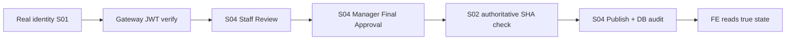
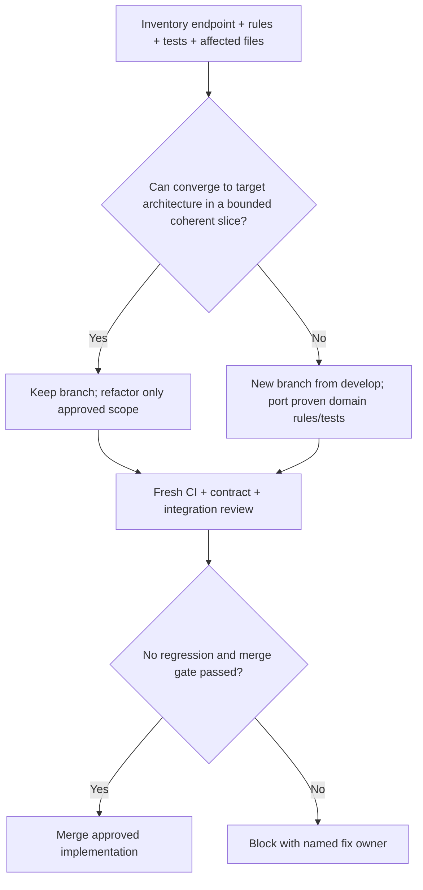
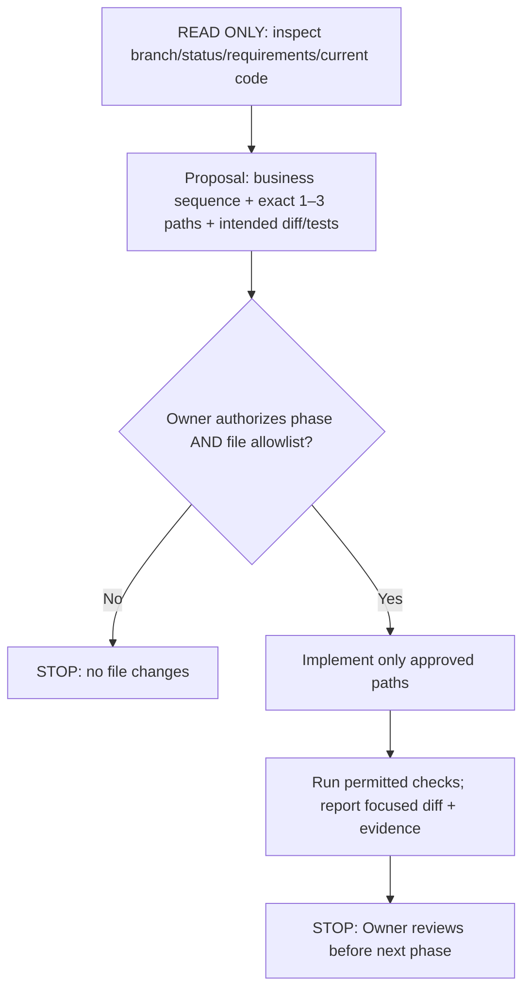

# LivingDocs — Master Decision Log, Technical Standards & Team/AI-Agent Handoff

> **Bản tổng hợp để team đọc, học, review/refactor và dùng làm context cho Codex**  
> **Snapshot:** 13/11/2026 (Asia/Ho_Chi_Minh)  
> **Chủ sở hữu quyết định:** Project Owner / Project Leader của LivingDocs  
> **Trạng thái:** **BẢN BÀN GIAO ĐỂ OWNER REVIEW** — không tự động là ADR, không thay thế tài liệu được phê duyệt và **không cấp quyền cho agent sửa repo**.  
> **Phạm vi:** các quyết định, yêu cầu/chấn chỉnh của Owner và tình trạng kỹ thuật đã trao đổi đến 13/11/2026. Các trạng thái GitHub/Jira được ghi theo *snapshot quan sát*, không phải khẳng định code local, build hoặc E2E hiện đã chạy.

---

## 0. Đọc phần này trước khi bắt đầu bất kỳ task nào

**Thông điệp duy nhất cần nhớ:** LivingDocs phải giải quyết **nghiệp vụ thật bằng công nghệ thật**. Không đánh đồng demo/skeleton/CI xanh với một business flow đã hoàn thành. Viết code theo kiến trúc Spring Boot có trách nhiệm rõ ràng, test đúng ranh giới và bảo vệ repository khỏi sửa đổi ngoài phạm vi.

### Phân loại mức độ quyết định

| Ký hiệu | Nghĩa | Cách xử lý |
|---|---|---|
| **[ĐÃ CHỐT]** | Owner đã xác nhận/chấn chỉnh rõ trong các cuộc trao đổi | Mặc định tuân thủ khi thực hiện task tương ứng. Nếu xung đột với approved contract, dừng và báo. |
| **[BASELINE]** | Yêu cầu đề tài, Confluence/ADR/OpenAPI/Jira hoặc tiêu chuẩn đã được dẫn chiếu | Kiểm tra **phiên bản được phê duyệt và source hiện tại** trước khi code. |
| **[ĐỀ XUẤT]** | Phương án đã bàn nhưng Owner/chủ sở hữu contract chưa phê duyệt đầy đủ | Không tự mở rộng sang implementation hoặc thay đổi public API. |
| **[ĐANG TRIỂN KHAI]** | Có mã/PR/commit hoặc Jira In Progress, chưa có đủ evidence để tính Done | Tiếp tục theo gate và kiểm chứng cụ thể. |
| **[CHƯA XÁC MINH]** | Chưa đọc trạng thái local/runtime/CI của thời điểm sử dụng báo cáo | Không nói đã hoàn thành; kiểm tra rồi cập nhật. |

**Thứ tự ưu tiên khi xung đột:** Quyết định Owner/requirements đã được phê duyệt → ADR/Confluence hiện hành → approved OpenAPI/event contracts → quy tắc engineering/`AGENTS.md` đã review → tài liệu tổng hợp này → ví dụ VoltNexus/các đoạn code mẫu. **Không tự ý “hòa giải” hai contract đang mâu thuẫn.**

### 10 nguyên tắc điều hành không được quên

1. **Business-first:** actor → FR/NFR → HLD/sequence → contract → rules/DB → code → negative test/evidence.
2. **Real-first:** service/DB/Gateway/Kafka/AI/K8s/observability phải thật trên đúng flow tuyên bố nghiệm thu; mock chỉ phục vụ unit/component test và phải ghi nhãn.
3. **Review-first đối với agent:** đề xuất diff và exact file allowlist trước; được Owner duyệt mới được ghi file. Không tự nhảy phase.
4. **Scope-first:** không tự sửa dependency, API contract, migration, `.env`, port, cấu trúc package hoặc file ngoài task.
5. **Contract-first:** service boundary rõ, không đoán JWT claims, DTO, event schema, status codes hay success envelope.
6. **Spring Boot chuẩn:** S01–S04 dùng Layered Architecture + JPA/Hibernate/Flyway, DI, validation, security và Lombok có chọn lọc; không viết Java thủ công kiểu minh họa thiếu framework.
7. **Security-by-default:** tenant/workspace/repository authorization, RLS, no-self-approval, fail-closed khi source/permission không được xác minh.
8. **PR PASS ≠ FLOW PASS:** code review/CI đủ điều kiện merge có kiểm soát; Story Done chỉ khi business acceptance end-to-end đạt.
9. **Không refactor vô hạn:** PR legacy lệch chuẩn cần đánh giá *reuse vs replace* có thời hạn; giữ business rules/test hữu ích, bỏ cấu trúc khiến tích hợp khó.
10. **Nói thật về bằng chứng:** `PASS / FAIL / BLOCKED / NOT RUN`, kèm môi trường/lệnh/kết quả/DB/log/metrics; không tự tuyên bố E2E.

---

## 1. Những thay đổi trọng tâm sau buổi báo cáo với giảng viên (08/11/2026)

**[ĐÃ CHỐT]** Sau buổi báo cáo, Owner yêu cầu điều chỉnh cách triển khai: không tập trung vào những đầu việc chỉ có tính đại diện; phải triển khai các **business outcomes thật**, có thử lỗi, tính nhất quán dữ liệu và chứng cứ sử dụng công nghệ thực sự.

| Cách hiểu cũ — không đủ | Chuẩn phải đạt từ đây |
|---|---|
| `/health` 200 hoặc module chạy độc lập | Request đi qua các service thật, dữ liệu đúng, có guard và audit sau restart |
| Gateway định tuyến được đến stub/route demo | JWT do S01 cấp thật; Gateway và service xác thực/ủy quyền đúng |
| API CRUD và hình minh họa UI | Role, state transition, scope, ETag/idempotency, lỗi và rollback đúng nghiệp vụ |
| Có Kafka trong Compose | Webhook ký HMAC → durable outbox → broker → inbox/consumer → job có thể truy vết, retry/replay/dedupe |
| Có FastAPI hoặc output LLM giả | Source diff/AST, drift evidence, Data Gate, grounded LLM result thật và failure path |
| Có Kubernetes manifest, 2 mock Pod | Service thật, DNS discovery, routing/LB, readiness, replicas, failover quan sát được |
| Có `/metrics` hoặc Grafana container | Prometheus scrape thực, business metrics, dashboards, alerts, per-Pod evidence |
| Unit tests/mock hoặc CI xanh | Unit + PostgreSQL integration + contract + Newman + cross-service E2E + negative/failure tests |
| Mỗi task Done riêng vì có PR | Flow qua FE/Gateway/S01/S02/S04/DB (và Kafka/S03/S05 khi thuộc scope) được QA/Owner nghiệm thu |

**Không hạ yêu cầu bằng cách gọi mock là thực tế.** Nếu thiếu thời gian, thu hẹp *phạm vi nghiệp vụ được tuyên bố hoàn thành* nhưng giữ tiêu chí đúng/đủ của phạm vi đó. Task khác được ghi là Blocked/Partial và có dependency rõ ràng.

### Hai Golden Flows của MVP

**Flow A — Sprint 3: Governed Review & Safe Publish**



**Flow B — Sprint 4: Source Change → Governed AI Draft**

```mermaid
flowchart LR
    GH[GitHub signed webhook] --> O[S02 receipt/outbox]
    O --> K[Kafka]
    K --> J[S03 inbox + persisted AnalysisJob]
    J --> AST[AST/diff + Drift Evidence]
    AST --> AI[S05 RAG/LLM + Data Gate]
    AI --> D[S04 Draft candidate]
    D --> H[Staff + Manager]
    H --> V[S02 revalidate SHA]
    V --> P[S04 Publish + audit/event]
```



**Mục tiêu sản phẩm:** LivingDocs tự phát hiện tài liệu lệch với source, tạo đề xuất cập nhật có bằng chứng và đưa con người kiểm soát việc xuất bản. **AI không tự final approve/publish.** Proposal còn có chức năng rộng hơn (GitHub OAuth, template management, drift dashboards, lifecycle, integrations); Golden Flows là lát ưu tiên để tích hợp thật, **không phải toàn bộ FR đã hoàn thành**.

---

## 2. Nhật ký quyết định (Decision Register)

| ID | Quyết định/chấn chỉnh | Mức độ | Hệ quả khi triển khai |
|---|---|---|---|
| LD-D01 | Không nhận demo/mock/skeleton là nghiệp vụ đã xong; failure-first E2E thật | **[ĐÃ CHỐT]** | Jira acceptance và PR evidence phải thay đổi theo business flow. |
| LD-D02 | Tổ chức Java S01–S04 theo **Layered Architecture** tham khảo tinh thần VoltNexus | **[ĐÃ CHỐT]** | `controller`, `dto/request`, `dto/response`, `service`, `entity`, `repository`, `exception`, `security`, `config`… tạo khi cần. |
| LD-D03 | **Spring Data JPA + Hibernate** là mặc định cho CRUD/aggregate trong S01–S04 | **[ĐÃ CHỐT]** | Đổi hướng JDBC-only cũ; native SQL/JDBC cho locking/outbox/inbox/batch/RLS đặc biệt có lý do và test. |
| LD-D04 | **Flyway** là nguồn DDL; Hibernate `ddl-auto: validate`, `open-in-view: false` | **[ĐÃ CHỐT]** | Không `ddl-auto: update` và không sửa migration đã triển khai tùy tiện. |
| LD-D05 | PostgreSQL **RLS/tenant isolation thật**, service-owned schema & transactions | **[ĐÃ CHỐT]** | Transaction-local tenant context, fail closed, pool-reuse tests, không cross-service joins. |
| LD-D06 | Java DTO dùng **class**, field **private**, Lombok thích hợp; DI bằng constructor | **[ĐÃ CHỐT]** | Không `record` mặc định cho DTO, không viết getter/setter thủ công vô ích; không lạm dụng `@Data`. |
| LD-D07 | Mọi tính năng phải có **business flow + HLD/sequence + error & test** trước khi code | **[ĐÃ CHỐT]** | Reviewer cần hiểu class/method/annotation/pattern chứ không chỉ xem số file. |
| LD-D08 | Chuẩn hóa **port** Gateway 8080; S01 8081; S02 8082; S03 8083; S04 8084; S05 8000 | **[ĐÃ CHỐT]** | Port baseline được Owner cập nhật vào cấu hình; check lại các môi trường/nhánh trước khi sửa. |
| LD-D09 | Gateway management 9091; Prometheus 9090; Grafana 3001 theo kế hoạch | **[BASELINE/ĐỀ XUẤT cho Grafana]** | Không nhầm control-plane port với business port; không coi Grafana đã chạy. |
| LD-D10 | S01 cấp JWT thật; Gateway xác thực, domain service enforce scope/guards; quyền nhạy cảm cần fresh validation | **[ĐÃ CHỐT]** | Không tin client role header, self-issued JWT hoặc token grants hết hiệu lực. |
| LD-D11 | Lỗi API **RFC 9457 `application/problem+json`** + stable `code` + `correlationId` | **[ĐÃ CHỐT theo API baseline]** | `@RestControllerAdvice` + Spring Security entry-point/denied handlers; không leak secrets. |
| LD-D12 | **`ApiResponse<T>` success wrapper** được Owner yêu cầu bàn cách chuẩn hóa nhưng **chưa duyệt thay contract** | **[ĐỀ XUẤT]** | Chưa bọc đồng loạt success; phải chốt OpenAPI/FE/Login/201-204 trước. |
| LD-D13 | Kafka là **pipeline thật** với outbox/inbox/idempotency/retry/replay | **[ĐÃ CHỐT]** | S02→Kafka→S03 phải có persisted job và recovery evidence. |
| LD-D14 | Kubernetes thực hiện **native service discovery/LB/failover** trên service thật | **[ĐÃ CHỐT]** | Jira `LIV-111` còn chữ “Conditional” cần Owner chấp thuận rebaseline; **Eureka không mặc nhiên bắt buộc**. |
| LD-D15 | **Prometheus + Grafana bắt buộc** trên Gateway/S01–S05 và K8s | **[ĐÃ CHỐT]** | Jira `LIV-135`; `/metrics` 200 không đủ, cần time-series/dashboard/alerts/failure evidence. |
| LD-D16 | **Redis chỉ khi có use case và giá trị chứng minh được** | **[ĐÃ CHỐT điều kiện]** | Không ép Redis vào business flow chỉ vì có container; task `LIV-110` cần value-test. |
| LD-D17 | Postman/Newman + unit/integration/contract/E2E + negative/failure scenarios bắt buộc | **[ĐÃ CHỐT]** | Tests có assertion state, security, idempotency, RLS; không chỉ status 200. |
| LD-D18 | **Agent read-only mặc định**, exact file allowlist, Owner review trước khi viết và trước phase kế | **[ĐÃ CHỐT]** | Không overwrite, auto-refactor, auto-commit/push/merge/deploy/Jira update. |
| LD-D19 | **PR PASS khác FLOW PASS**, không merge chỉ vì CI xanh | **[ĐỀ XUẤT quy trình quản trị gần nhất, Owner cần ban hành cho team]** | Code-review + tests + compatibility để merge; Story Done yêu cầu Golden Flow thật. |
| LD-D20 | Legacy PR: phân loại **reuse/refactor có giới hạn** hoặc **replace** | **[ĐỀ XUẤT quy trình]** | Không mất tuần dọn PR sai kiến trúc; giữ tests/business rules tốt. |

> **Lưu ý:** Những gì được gắn [ĐÃ CHỐT] ở đây là quyết định thảo luận với Owner; **không suy ra mọi hạng mục đã được commit, deploy hoặc Jira cập nhật**.

---

## 3. Kiến trúc hệ thống: ownership, boundary và các công nghệ

### 3.1 Ownership của từng service

| Service / nền tảng | Runtime và nhiệm vụ chính | Ranh giới không được vi phạm |
|---|---|---|
| **API Gateway** | Spring Cloud Gateway **WebFlux**, ingress, route, JWT coarse authentication, correlation, CORS, rate controls/metrics | Không lưu document hay quyết định approve/publish. Không bypass JWT để chạy demo. |
| **S01 Identity & Organization** | Spring Boot/Java; register/login, password hash, JWT/JWKS, identity, tenant membership, RBAC/resource grants, fresh scope/permission | Register không được tự cấp tenant/role. Không tin role header client. |
| **S02 Repository Integration** | Spring Boot; GitHub connection, webhook HMAC, tracked repo/ref, authoritative SHA, outbox producer | Webhook ACK không phải job completed; SHA phải được xác minh từ nguồn có thẩm quyền. |
| **S03 Source Intelligence** | Spring Boot; Kafka inbox/consumer, persisted AnalysisJob, AST/diff, drift/evidence, orchestration S05 | Không ghi/publish document như nguồn chính S04. Không mất job khi retry/restart. |
| **S04 Document Governance** | Spring Boot; DocumentVersion, ReviewDecision, ApprovalDecision, Publish, audit/history, guard, document event | Không bỏ qua no-self-approval, state transitions, current-source check hay fresh authorization. |
| **S05 AI Service** | **FastAPI/Python**, retrieval/RAG, data gate, LLM/provider request, grounded/structured response | Không tự approve/publish; không coi mẫu tĩnh là AI thực. |
| **PostgreSQL** | Service-owned schemas, transactions, unique/constraints, Flyway, RLS | Không cross-service SQL JOIN hoặc shared JPA entity. |
| **Kafka** | Durable async event transport, consumer groups, retry/DLQ/replay theo contract | Producer ACK không tương đương business state hoàn tất. |
| **Kubernetes** | Real service pods, K8s Service DNS, readiness/liveness, replicas, failover, native LB | Không dùng mock pods để chứng minh hệ thống thật. |
| **Prometheus + Grafana** | Scrape/metrics/dashboard/alerts của Gateway, S01–S05 và hạ tầng | Không đẩy PII/tenantId/correlationId/secret vào metrics labels. |

**Microservice boundaries:** mỗi service sở hữu schema/API/event contract của mình; không truy cập bảng domain của service khác bằng JDBC/JPA, không chia sẻ JPA Entity giữa service, không tạo distributed transaction ảo qua HTTP/Kafka. Sử dụng typed HTTP client và versioned event contracts cho tương tác.

### 3.2 Port baseline đã thống nhất

| Thành phần | Port local đã thống nhất | Trạng thái/ghi chú |
|---|---:|---|
| Gateway business HTTP | `8080` | Entry point client/FE/Postman |
| S01 Identity & Organization | `8081` | Đã đổi từ các cấu hình cũ không thống nhất |
| S02 Repository Integration | `8082` | Không nhầm với port cũ của S01 |
| S03 Source Intelligence | `8083` | Theo cấu hình thống nhất |
| S04 Document Governance | `8084` | Theo cấu hình thống nhất |
| S05 FastAPI AI | `8000` | Python runtime |
| Gateway management | `9091` | Actuator/metrics **private** |
| Prometheus | `9090` | Hạ tầng monitoring, **chưa mặc định triển khai xong** |
| Grafana | `3001` | **Port đề xuất/quy ước**, cần check Compose/K8s thực tế |
| PostgreSQL | `5432` | Database |
| Kafka | `9092` | Broker endpoint theo môi trường local; DNS trong container/K8s có thể khác |
| Redis | `6379` | Chỉ có giá trị nếu use case Redis được duyệt |

**[ĐÃ CHỐT]** Owner đã cập nhật chuẩn port trong cấu hình và từng commit thay đổi, đồng thời loại bỏ backend baseline demo dư thừa. **Không tự chạy lại script đổi port** hay sửa `.env` trên máy chỉ dựa vào báo cáo. Sau thay đổi port phải đối chiếu Gateway service URIs, Docker/Compose, frontend Vite proxy, Postman environments, CI smoke, JWKS/issuer settings và K8s manifests (nếu tồn tại). Port local ≠ bắt buộc trùng internal DNS trong Kubernetes.

**`docs/ai-agent/` đã được Owner hỏi cách ignore:** nếu cả folder bị `.gitignore` thì thành viên khác **không thể lấy report qua `git pull`**. Nếu đây là rule chung của nhóm, nên để trong thư mục được Git theo dõi sau khi Owner review, ví dụ `docs/engineering/` hoặc `docs/handoff/`; tránh đặt toàn bộ quy tắc chia sẻ trong thư mục local bị ignore.

### 3.3 Cái gì *bắt buộc* và cái gì *có điều kiện*?

| Công nghệ | Quyết định | Thế nào là “đã áp dụng thật”? |
|---|---|---|
| Java 21 / Spring Boot 4.x | Baseline cho S01–S04 hiện tại | Business use case chạy qua Spring, đầy đủ validation/security/transaction/test |
| Spring Data JPA / Hibernate | **Bắt buộc mặc định** cho domain CRUD S01–S04 | `@Entity` + `JpaRepository` + PostgreSQL thật, Flyway `validate`, test transaction/RLS |
| Flyway + PostgreSQL RLS | **Bắt buộc** | Migration versioned, tenant deny-by-default, test connection reuse/cross-tenant |
| Spring Security/JWT | **Bắt buộc** | Real credential, signed JWT, validated issuer/audience/signature, fresh authorization |
| Kafka / Outbox / Inbox | **Bắt buộc cho event-driven pipeline** | Actual broker, persistence, consumer, idempotency, broker/consumer outage + recovery |
| FastAPI + source-grounded AI | **Bắt buộc cho AI flow** | Real data gate/model invocation hoặc provider thực được phép, grounded structured output, failure handling |
| Kubernetes discovery/LB/HA | **Bắt buộc theo Owner** | Service DNS + ≥2 real replicas ở bài thử + readiness + failover/recovery evidence |
| Prometheus / Grafana | **Bắt buộc** | Scrape real pod/service, queries, dashboards, alerts và data từ business requests |
| Postman/Newman | **Bắt buộc** | Collections/environments/scripts, token + negative cases, recorded command/results |
| Redis | **Có điều kiện** | Được chứng minh qua cache/use case có correctness/invalidation/timeout/metrics |
| Eureka | **Không mặc định dùng** | Chỉ xem xét nếu owner phê duyệt nhu cầu discovery ngoài K8s |
| GitHub OAuth/Actions/App/LLM details | **Chọn theo approved business contract và sprint slice** | Không fake provider response rồi tuyên bố scope tích hợp đã Done |

---

## 4. Chuẩn viết backend bắt buộc S01–S04: Layered Architecture

**[ĐÃ CHỐT]** Chọn kiến trúc **Layered Architecture theo service**, tham khảo cách chia trách nhiệm từ VoltNexus, **không copy nguyên code/pattern sai** của VoltNexus.

```text
backend/<service-name>/
├── pom.xml
└── src/
    ├── main/
    │   ├── java/com/livingdocs/<service>/
    │   │   ├── <Service>Application.java
    │   │   ├── controller/           # HTTP endpoints: thin adapters
    │   │   ├── dto/
    │   │   │   ├── request/          # Input DTO + Bean Validation
    │   │   │   └── response/         # Output DTO theo OpenAPI
    │   │   ├── service/              # Business use cases, transaction
    │   │   ├── entity/               # JPA entity + persistence mappings
    │   │   ├── repository/           # JpaRepository, scoped queries
    │   │   ├── model/                # Enum/domain policy/value object khi cần
    │   │   ├── mapper/               # DTO/Entity mapping khi cần
    │   │   ├── exception/            # Business error & RFC 9457 handlers
    │   │   ├── security/             # Security & scoped authorization
    │   │   ├── config/               # @Configuration, typed properties
    │   │   ├── client/               # Typed HTTP clients nếu có external call
    │   │   ├── messaging/            # Kafka producer, consumer, contracts
    │   │   └── scheduler/            # Outbox poller/reconciliation nếu cần
    │   └── resources/
    │       ├── application.yaml
    │       └── db/migration/V<N>__<description>.sql
    └── test/java/...                # Unit/Integration/API tests
```

**Không bắt buộc tạo tất cả folder.** Tạo khi use case cần; không sinh `BaseController`, `CommonUtils`, `ServiceInterface` + `ServiceImpl`, `Mapper` rỗng hoặc shared business `common-lib` chỉ để “đủ layer”. **Gateway WebFlux và S05 FastAPI không bị ép theo cây Java JPA**.

### 4.1 Trách nhiệm và dependency boundaries

| Layer | Được làm | Không được làm |
|---|---|---|
| `controller` | `@RestController`, routes, `@Valid @RequestBody`, response HTTP status/header, mapping | SQL/JPA trực tiếp, hash password, business approval logic |
| `dto/request` | Java class private fields, Bean Validation transport-level | Transaction, repository, quyết định quyền |
| `dto/response` | Public API shape theo contract; không rò Entity/secret | Trả raw JPA Entity, phơi passwordHash/grants nội bộ |
| `service` | `@Service`, use case, domain guards, `@Transactional`, orchestration | Trả `ResponseEntity`/`HttpServletRequest` vô cớ, tự thao tác `JdbcClient` thay Repository |
| `entity` | `@Entity`, `@Table`, `@Id`, `@Column`, domain state mutation có chủ đích | Setter tự do làm mất invariant, `@Data` với relationship/lazy loading |
| `repository` | `JpaRepository`, query có scope, locking, SQL adapter đặc biệt nếu cần | Ra quyết định approve/publish, gọi AI |
| `model` | Domain enums, value objects/policies | Phụ thuộc servlet, JSON transport nếu không cần |
| `mapper` | DTO↔domain mapping rõ; MapStruct nếu thật sự giảm độ phức tạp | Business decision hoặc DB queries |
| `security` | Spring Security config, `JwtDecoder`, trusted principal, scoped permission | Tin client-supplied role header, tự mặc định tenant membership |
| `exception` | Typed exception/error codes, Problem Details, security filter handlers | Nuốt lỗi hoặc trả HTTP 200 cho lỗi |
| `client/messaging` | Typed HTTP/event boundary + timeout/retry/dedupe adapters | Biến remote call thành DB transaction cross-service giả |
| `config` | Typed config/beans | Dồn nghiệp vụ vào file cấu hình |

**Call-flow điển hình:** `HTTP → Controller → Service → (domain policy, repository, typed client) → DB/external → Response DTO`. Kafka listener cũng **gọi Service**, không nhúng use case vào listener. Giữ các class liên quan với nhau theo trách nhiệm, không chia thành hàng chục interface không cần thiết.

### 4.2 Coding conventions cụ thể — sửa các lỗi Owner đã từng phê bình

- **Encapsulation:** object state phải `private`, ưu tiên `private final` cho dependency và response immutable. Tránh public/package-private mutable fields không có lý do.
- **Java class cho DTO:** ưu tiên `class`, không chuyển sang `record` chỉ vì tiện. Bean Validation qua `jakarta.validation` và `@Valid` tại Controller.
- **Lombok có chủ đích:** request dùng `@Getter`, `@Setter`, `@NoArgsConstructor`; `@AllArgsConstructor` nếu cần. Service/Controller dùng `@RequiredArgsConstructor` cho `private final` dependency. Không viết boilerplate getter/setter vô ích.
- **Không lạm dụng `@Data`:** nhất là Entity JPA và DTO chứa password; auto `toString()` có thể đưa mật khẩu ra log, `equals/hashCode` trên Entity dễ sai lazy-loading/identity.
- **Spring đúng chỗ:** `@Service`, `@Repository` khi cần, `@Entity`, `@Transactional` ở use-case boundary, `@ConfigurationProperties` cho cấu hình; không annotate chỉ cho đẹp.
- **Dependency Injection:** constructor injection, không tự `new` Spring Service rồi làm mất proxy/lifecycle, không `@Autowired` field theo thói quen nếu constructor tốt hơn.
- **JPA mapping:** Entity khớp schema Flyway; quan hệ/lazy loading kiểm soát; `spring.jpa.hibernate.ddl-auto=validate`, `spring.jpa.open-in-view=false`.
- **Transactions:** service quyết định phạm vi; hiểu self-invocation, flush, optimistic/pessimistic locking, atomic state+audit trong *cùng service DB*; không giữ remote call chậm trong transaction nếu có thể tránh, nhưng phải giữ invariants hợp lệ.
- **RLS:** đặt `SET LOCAL` / `set_config('app.tenant_id', value, true)` trên cùng transaction/connection với Hibernate; test pooled connection không rò tenant. Không cho runtime role `BYPASSRLS`.
- **DB uniqueness/concurrency:** precheck email trùng không đủ; dựa trên unique constraint/index và xử lý conflict đúng. Idempotency key/ETag/If-Match dùng theo contract, không áp dụng tùy tiện.
- **MapStruct/Strategy/Factory** chỉ khi mang lại lợi ích thật; không dùng design pattern như đồ trang trí. SOLID/DRY/KISS/Separation of Concerns áp dụng cho behavior và dependency.
- **Mỗi file phải giải thích được:** Tại sao nó tồn tại, lớp nào gọi, input/output, annotation/pattern và rủi ro tương tác các service.

### 4.3 Ví dụ Register S01 và điều chưa chốt

- `RegisterRequest.java` **đã được Owner xác nhận hoàn thành trong quá trình pair-programming**; normal Java `class`, `private` fields, Lombok, `@Email`, `@NotBlank`, `@Size`, `@Valid` ở Controller.
- Password validation đã đề xuất **12–64 ký tự**, không ép regex chữ hoa/số/ký tự đặc biệt nếu không có policy; **[ĐỀ XUẤT]** chưa thay thế security ADR. BCrypt truyền thống có giới hạn **72 byte** chứ không phải 72 ký tự; kiểm soát Unicode/byte policy và không tự truncate.
- `RegisterResponse` (`identityId`), `AuthController` và generic `ApiResponse<T>` từng được đề xuất trong chat, **không suy ra đã compile/test hay schema đã được duyệt**.
- Register chỉ tạo Identity (hash, normalized email unique), **không tự cấp tenant, workspace, role**. Duplicate phải được DB bảo vệ trong race.
- `LIV-134` vẫn bao gồm Login, signed JWT/JWKS, effective grants/fresh authorization và bảo vệ domain endpoints: không coi Register DTO xong là Auth hoàn tất.

---

## 5. HTTP contract, security, data và tích hợp: yêu cầu hệ thống

### 5.1 API, lỗi và response wrapper

- **Errors:** chuẩn RFC 9457 `Content-Type: application/problem+json`, các field `type`, `title`, `status`, `detail`, opaque per-occurrence `instance`, stable `code`, `correlationId`; không đưa SQL, JWT, password, email nhạy cảm vào error detail.
- **Handler:** `@RestControllerAdvice` cho business/validation/JSON exceptions; Spring Security dùng `AuthenticationEntryPoint` cho 401, `AccessDeniedHandler` cho 403 trong filter chain.
- **Correlation:** Gateway validate hoặc tạo `X-Correlation-ID`, propagate xuyên service/log/error (không dùng metric label).
- **Success:** HTTP status/headers đúng semantics (`201`, `200`, `202`, `204`) và shape theo approved `LD-API-001`/OpenAPI.
- **`ApiResponse<T>`:** Owner mong có mẫu success chung; đề xuất `{code, message, data}` đã được trao đổi. Tuy nhiên baseline OpenAPI hiện không áp dụng bao ngoài mặc định. **[CHƯA CHỐT]** Không tự bọc Register/Login/tất cả endpoints cho tới khi Owner chốt schema và cập nhật consumers/tests.
- **Other contract-sensitive fields:** JWT claim names/TTL, refresh-cookie/CSRF/rotation, `If-Match`, `Idempotency-Key`, event keys/schema, error codes; mọi thay đổi cần API/event review trước khi code hàng loạt.

### 5.2 Authentication, authorization, RLS

- S01 xác minh credential thật, dùng `PasswordEncoder`, lưu password hash an toàn; JWT phải signed và có `issuer`, `audience`, expiry, `sub`; key storage/rotation/JWKS phải được quyết định và cấu hình an toàn.
- Gateway chỉ enforce authentication/coarse policy; S04/S02 vẫn phải kiểm resource scopes, business rule. Không tin `X-User-Role`, `X-Tenant-ID` do client gửi để quyết định đặc quyền.
- Multi-tenant: tenant membership ACTIVE, workspace grant, repository grant; quyền revoke/disabled cần fresh check cho thao tác nhạy cảm. Phân biệt Platform Admin/Tenant Owner/Workspace Manager, không suy vai trò từ một flag tiện lợi.
- S04: Staff PASS/RETURN, Manager Final Approval khác người tạo/chỉnh sửa (no-self-approval), audit append-only, state/version guard; Publish chỉ sau S02 xác minh authoritative SHA hiện hành; lỗi upstream/unknown/stale phải **fail closed**, không mutate trạng thái như thành công.
- RLS và resource-check là **hai lớp bảo vệ bổ sung**, không thay thế lẫn nhau.

### 5.3 Kafka + S03 + S05 AI: thực sự xử lý event và source

1. S02 xác minh GitHub webhook HMAC/delivery, lưu receipt/outbox bền vững cùng transaction với trạng thái sở hữu.
2. Outbox publisher đưa event versioned (`contracts/events`) lên Kafka; broker outage giữ event để retry/replay, không mất thông tin.
3. S03 consumer dùng inbox/dedup + persisted `AnalysisJob`; crash/restart/replay không tạo thêm logical job.
4. AST/diff phân tích source change thật, tạo DriftIssue, category/severity, evidence kèm source path, entity và SHA; không dùng regex giả thay AST nếu scope đã cam kết semantic drift.
5. S05 FastAPI Data Gate kiểm soát dữ liệu đi LLM; prompt/provider timeout/429/error phải có trạng thái job và metrics; response structured, có căn cứ/độ tin cậy theo policy.
6. S03/S04 tạo candidate Draft idempotently; Staff/Manager review, source revalidation, Publish + event/audit. Không tự publish chỉ vì AI đề xuất.

### 5.4 Kubernetes, monitoring và Redis

- **Kubernetes:** `Service` DNS, readiness/liveness, ≥2 replicas thật trong bài thử, rolling recovery, failover; chứng minh traffic từ client tiếp tục hoặc được xử lý có kiểm soát sau Pod failure; không bịa uptime/latency.
- **Prometheus/Grafana:** Micrometer + Actuator + Prometheus registry cho Gateway/S01–S04; `prometheus_client` trên S05; scrape real app/pod, Hikari/HTTP/JVM/job/consumer + business outcomes; provision dashboards/alerts; test target DOWN, auth failure, retry, AI provider errors.
- **Metrics labels:** chỉ dimension bounded như `service`, `route`, `status`, `outcome`, `pod`; cấm `tenantId`, `userId`, email, documentId, jobId, sourceSHA, JWT, correlationId, prompt.
- **Security:** metrics endpoints private, không disable authentication cho cả app để làm scrape pass; monitoring outage không làm nghẽn business request.
- **Redis:** phải có use case đo được, correctness/invalidation, cross-tenant isolation, cache miss/fallback và benchmark; không chỉ chạy container.

---

## 6. “PASS” và chính sách review/merge: đề xuất để Owner áp dụng cho cả nhóm

**[ĐỀ XUẤT QUẢN TRỊ]** Tách ba cổng, tránh hai cực đoan “CI PASS là merge ngay” và “mọi PR phải chạy hết system E2E mới được merge”.

| Gate | PASS khi nào | Hành động cho phép |
|---|---|---|
| **G1 — PR Technical PASS** | Scope/Jira rõ; code đúng kiến trúc/contract; security + data guards; CI, unit/DB integration theo phạm vi; reviewer đã xem diff và không còn blocker | Có thể merge **nếu** không phá `develop`, không bypass security, dependency được quản lý, Owner/reviewer duyệt |
| **G2 — Business Flow PASS** | Business actor thực, HTTP/event flow trên service/DB thật, state/audit đúng, negative/failure assertions, Newman/evidence và observability phù hợp | Có thể chấp nhận Story/Golden Flow Done sau QA/Owner review |
| **G3 — Release PASS** | Các flow MVP đã được chấp nhận và đáp ứng security/deploy/monitoring/recovery theo tiêu chí release | Có thể đánh giá nghiệm thu/release; không suy ra từ số lượng PR merged |

**Cần tránh:** `git merge` khi code không build sau tích hợp, contract chồng chéo, migration phá schema, route/JWT bypass, test giả hoặc ẩn lỗi. Cũng **không cần** chờ toàn bộ S01–S05 xong mới merge một module đã rõ contract, buildable, testable, dependency minh bạch và không nguy hiểm.

### 6.1 Bộ bằng chứng tối thiểu cho một flow thật

| Mặt cần chứng minh | Ví dụ evidence không thể thay bằng ảnh demo |
|---|---|
| Entry/API | Postman collection/env/scripts, method/path, status, response shape, correlation ID |
| Identity/security | JWT do S01 thật phát, Gateway + service verify; wrong signature/expired/role revoked/cross-tenant trả 401/403 thích hợp |
| State/transaction | PostgreSQL readback: trước/sau ReviewDecision, ApprovalDecision, DocumentVersion, Audit; rollback khi lỗi |
| External authority | S02 kiểm tra current SHA hoặc GitHub thật; stale/unavailable fail closed |
| Async | Kafka broker message, outbox/inbox rows, persisted AnalysisJob, retry/replay không duplicate |
| AI | Evidence source/AST, model/provider call, structured proposal, data-gate deny/timeout path |
| Monitoring | Prometheus sample/query, Grafana panel, target per service/pod, event/error metric khớp logs/DB |
| Delivery | CI checks, reviewer approval, PR diff, test command/environment/time, known limitations |

**Golden Flow Sprint 3 được chấp nhận khi:** S01 credential → JWT → Gateway → S04 Staff PASS/RETURN → eligible Manager final approval → S02 source currentness → S04 publish → FE đọc được state từ DB thật; negative cases 401/403/self-approve/stale source/conflict/replay không mutate trái phép. Nếu mới xong Staff PASS, chỉ ghi *Staff slice PASS*, **không** ghi *Golden Flow PASS*.

**Golden Flow Sprint 4 được chấp nhận khi:** ký HMAC GitHub webhook → S02 outbox → Kafka → S03 inbox/AnalysisJob → AST/drift → S05 AI grounded → S04 Draft → Human review → source freshness → publish, gồm broker/consumer/LLM failure và retry evidence. Không tuyên bố toàn luồng chỉ vì Kafka container và FastAPI `/health` đang chạy.

### 6.2 Mẫu PR review ngắn, tránh sa đà đọc từng dòng không trọng tâm

Mỗi PR **phải có**:

1. **Jira/FR/NFR + business outcome** — ai làm gì, input/output, rules và phần cố tình ngoài scope.
2. **API/event inventory** — method/path/operation/schema; endpoint nào đã chạy, còn thiếu, phụ thuộc service nào.
3. **Architecture & changed files** — sequence, layer, DB tables/migrations, tests và các file được phép sửa.
4. **Evidence** — `mvn verify`/frontend tests, Postgres migration/RLS, Postman/Newman, actual requests + DB/audit + metrics; chỉ nhận những bằng chứng đã chạy.
5. **Risk & merge notes** — compatibility với `develop`, S01/S02 dependencies, migration rollback, overlap PR, work còn lại.

Reviewer hỏi: **(a)** business rule đúng chưa; **(b)** flow/contract đúng chưa; **(c)** dữ liệu/guard/transaction ra sao; **(d)** negative/failure cases; **(e)** merge có làm hỏng `develop` không? CI xanh **không thay thế** các câu hỏi này.

---

## 7. PR legacy và refactor: xử lý nhanh, không sửa lê thê

> **Snapshot các PR đã đọc tại thời điểm 12–13/11/2026; chưa khẳng định trạng thái mới trên máy thành viên.**

| PR / Jira | Fact được quan sát | Đề xuất xử lý (chưa thao tác) |
|---|---|---|
| **[#26 — LIV-118, Hải](https://github.com/huutienSE/LivingDocs/pull/26)** | Draft; **44 files**, ~**2.360 dòng thêm**; **8/8 check run** của head tại lúc kiểm tra PASS. Chỉ implement public `POST /api/v1/document-versions/{versionId}/staff-decisions`; thiếu API Staff queue/detail, Manager, Publish; S02 validator thật chưa có; JWT từ S01 thật chưa được xác minh. | **Không merge nguyên trạng**; thực hiện inventory, giữ guards/transaction/idempotency/audit/tests hữu ích; refactor nhỏ có giới hạn hoặc thay thế PR nếu cấu trúc cũ gây thay đổi dây chuyền. |
| **[#15 — LIV-119, Thịnh](https://github.com/huutienSE/LivingDocs/pull/15)** | Draft; Staff Review frontend và test theo contract giả định; E2E thực chờ S01/S04. | Không merge riêng nội dung trùng PR #25; review phần độc đáo rồi xử lý phụ thuộc. |
| **[#25 — LIV-116, Nhân](https://github.com/huutienSE/LivingDocs/pull/25)** | Chứa **cả 4 commit** của #15 + 3 commit bổ sung; FE foundation và shared error/session/client components. | Chọn một nhánh frontend chính để tích hợp; #25 là ứng viên, **không merge #15 + #25 như hai PR độc lập**. |
| **LIV-134 — S01** | Remote branch `feature/LIV-134-s01-real-auth`, commit WIP `1d3d189` về registration DTO/dependencies đã được quan sát. | Tiếp tục S01, review code thật trước; không hiểu nhầm WIP commit = Register/Login/JWT/E2E PASS. |

### 7.1 Trường hợp cụ thể #26: có gì và lệch chuẩn gì?

- **Hiện có:** `DocumentReviewController` gọi `DocumentReviewService`, kiểm `If-Match`, `Idempotency-Key`, Staff PASS/RETURN, decision/audit transaction, tests và Flyway V2/V3 (không sửa V1).
- **Lệch quyết định mới:** `DocumentVersionRepository` dùng **`JdbcClient`**, domain `DocumentVersion` là **`record`**, các model/domain/repository chưa theo **JPA Entity + JpaRepository** mặc định; cần design mới giữ concurrency/RLS/locking semantics.
- **Phụ thuộc thật còn thiếu:** source validator S02 cho repository-bound document; S01 JWT/claims/fresh grants; API Staff Queue/Detail cho frontend. Với repository-bound PASS, không có validator S02 thì response **503 / fail-closed**, không phải PASS.
- **Ý nghĩa của 8/8 CI xanh:** proof build/tests theo PR, **không** proof S01→Gateway→S04→S02→Publish E2E.

### 7.2 Decision tree cứu hay thay PR



**Gợi ý kiểm soát chi phí:** Cho người phụ trách một phiên inventory/đánh giá ngắn, trả lời **có thể cứu không, phạm vi bao nhiêu, test nào dùng lại**, rồi Owner chọn. Không bắt refactor 44 file chỉ để làm đẹp; cũng không chấp nhận JDBC/record mặc định đi ngược quyết định đã chốt chỉ vì có sẵn. Bất kỳ chuyển đổi nào cũng phải giữ state transitions, audit, idempotency, migrations, RLS, error behavior và các test giá trị.

**Git discipline:** Không squash/force-push/đóng PR cũ/di chuyển file trước khi Owner duyệt; PR thay thế phải link PR cũ và Jira, nêu phần logic và tests được kế thừa. Nhánh `develop` phải luôn giữ được build/contract và có đường chạy business flow đang nghiệm thu.

---

## 8. Sprint / Jira: không chỉ giao class hoặc container

### 8.1 Sprint 3 — Real Document Governance

**Outcome phải đạt:** S01 login/JWT thật + Gateway + S04 Staff Review + Manager Final Approval + S02 current SHA + S04 Publish/audit + FE. Tests cho self-approval, cross-tenant, bad token, stale SHA, optimistic conflicts và idempotency.

| Jira | Nội dung cốt lõi | Cần kiểm chứng |
|---|---|---|
| [`LIV-134`](https://huutiense25.atlassian.net/browse/LIV-134) | S01 real Register/Login/JWT + scoped authorization | Token thật được Gateway/domain service chấp nhận, negative JWT và fresh scopes |
| [`LIV-133`](https://huutiense25.atlassian.net/browse/LIV-133) | Chốt OpenAPI S01/S04/S02/FE | Không còn candidate/shape trái nhau khi merge |
| `LIV-118/119` | Staff state, audit, UI queue/detail/PASS/RETURN | DB integration + Staff UI thật |
| `LIV-120/121` | Manager approve + fresh authorization | No-self approval, revocation/cross-scope denied |
| `LIV-122/123` | S02 SHA validation + S04 safe publish | Stale source/S02 down blocked, PUBLISHED + audit bền vững |
| `LIV-100/101/102` | Daily integration, QA/security, reproducible demo | Newman/E2E/negative tests; no fake success |
| [`LIV-135`](https://huutiense25.atlassian.net/browse/LIV-135) | Prometheus/Grafana toàn hệ thống | Các metrics thực có sample/dashboard; phạm vi triển khai dần theo service |

**Snapshot Jira 12/11:** `LIV-134` **In Progress**, `LIV-135` **To Do**, `LIV-133` **In Review**. Nhiều task Staff/Manager/SHA/UI đang In Progress; các task nền tảng `LIV-113/114/115/117` Done trên Jira **không đồng nghĩa** Golden Flow đã PASS. Không tự sửa status/assignee/sprint theo tài liệu này.

### 8.2 Sprint 4 — Real Source-to-AI-to-Governed Draft

**Bắt đầu song song theo contract**, không đợi S01 xong hết mới xây webhook/Kafka/AST/S05. Các việc phụ thuộc security dùng test-issued JWT trong component tests, nhưng **không tính là S01 integrated PASS**.

| Jira | Real capability |
|---|---|
| `LIV-103 / 124–126` | HMAC GitHub webhook, S02 outbox Kafka, S03 inbox/AnalysisJob, job status API/FE |
| `LIV-104 / 127–128` | Deterministic diff/AST, DriftIssue/evidence, UI scoped access |
| `LIV-105 / 129–130` | S05 FastAPI real data gate/provider, S03 orchestration, S04 idempotent Draft |
| `LIV-106 / 131–132` | Governed Draft → Review/Approval → safe Publish → DocumentPublished |
| `LIV-107–109` | Continuous integration, failure recovery, independent QA, live scenario evidence |
| [`LIV-111`](https://huutiense25.atlassian.net/browse/LIV-111) | Kubernetes thật: Jira còn *Conditional*, cần cập nhật sau khi Owner duyệt rebaseline |
| `LIV-110`, `LIV-112` | Redis/Eureka có điều kiện, không ép vào flow nếu không có giá trị riêng |

**Snapshot Jira 12/11:** Sprint 4 tasks `LIV-103–109` và `LIV-124–132` còn To Do/chưa gán assignee. Rebaseline sprint/assignee/deadline cần Owner chốt theo capacity và các dependency, không tự ý thay đổi Jira.

### 8.3 Parallel execution để không làm cả nhóm chờ S01

- **Lane A — Identity + Contract:** Owner/người tiếp nhận `LIV-134`, `LIV-133` chốt JWT/claims, authZ endpoints và register success/error shape.
- **Lane B — Governance + Source:** S04 Staff/Manager/Publish và S02 SHA thực hiện độc lập trên contract đã duyệt; tích hợp S01 JWT ngay khi sẵn sàng.
- **Lane C — Frontend + QA:** thống nhất nhánh frontend (#15/#25), kiểm thử API client, Queue/Detail, Newman/Playwright, quản lý expected failures.
- **Lane D — Pipeline/Observability/Deployment:** Kafka→S03→AI S05 và monitoring/K8s triển khai cùng các feature service; không tách thành PoC không có business request.

**Daily integration checkpoint:** Mỗi ngày có một bảng ngắn *flow step / owner / status PASS|FAIL|BLOCKED|NOT RUN / evidence link / next blocker*. Không để nhiều PR chờ nhau cả Sprint rồi mới thử E2E một lần.

---

## 9. Quy trình AI Agent/Codex: bảo vệ repository và quyền quyết định

**[ĐÃ CHỐT]** Owner muốn agent hỗ trợ *hiểu nghiệp vụ, dạy code đúng, review trước*, không phải tự sửa hàng loạt file. Bản `AGENTS.md` trước đây là **review draft**, không được coi là đã áp dụng vào repository khi chưa xác minh.

### 9.1 Quy trình bắt buộc mỗi micro-phase



1. **Đầu vào:** Jira, actor, FR/NFR, approved API/event contract, current Git branch/status, relevant files/migrations/PR overlap, exact phase.
2. **Trước code:** đưa HLD/sequence, business invariants, API/event request/response, failure cases, **exact list 1–3 files** cho mỗi lượt giải thích/review và proposed content/diff.
3. **Chỉ viết khi được phép:** file allowlist và phase được Owner duyệt là phạm vi cứng; nếu phát sinh dependency/migration/config/new class khác, **STOP hỏi mở rộng scope**.
4. **Sau code:** `git diff --check`, diff tập trung, tests thật đã chạy, report `PASS/FAIL/BLOCKED/NOT RUN`; STOP để review; không tự làm task tiếp.
5. **Remote side effects có quyền riêng:** `git add/commit/push`, merge/rebase/cherry-pick/force, PR/Jira edit, deploy, database writes/load tests cần approval **riêng**. Quyền sửa code không bao gồm những hành động này.

**Cấm:** tự overwrite file cũ, format module không liên quan, đổi port, add dependency/endpoint/contract/migration ngoài allowlist, xóa `.env`/secret/uncommitted work, `git reset --hard`, `git clean`, `rm -rf`, force-push, nhảy Register→Login/JWT/Manager/AI khi chưa duyệt.

**Lưu ý bảo vệ thực tế:** `AGENTS.md` là **chỉ dẫn hành vi**, không phải ACL. Dùng **Codex sandbox `read-only`** khi yêu cầu audit/code-review; khi cho phép ghi, yêu cầu file allowlist và review Git diff/branch protections. Không giả định `workspace-write` luôn hỏi từng file.

### 9.2 Agent phải hiểu yêu cầu tới mức nào trước khi refactor?

Agent phải trình bày được, trước khi đề xuất thay code:

- Endpoint/handler nào thuộc service nào, ai gọi, input/output, business rule cụ thể.
- Dòng dữ liệu từ Controller→Service→Repository→PostgreSQL hoặc webhook→outbox→Kafka→inbox→job; state trước/sau và transaction boundary.
- Nhánh lỗi: duplicate/idempotent replay, stale SHA, no-self-approval, cross-tenant, token invalid/revoked, provider timeout, DB rollback.
- File nào nằm ngoài phạm vi, migration/contract nào cần giữ, các test nào giữ được khi refactor.
- Việc refactor sẽ làm **API contract/behavior đổi không**? Nếu có, phải báo cần quyết định; không tự đưa đổi contract vào code cleanup.

### 9.3 Prompt giao task cho agent (copy & use)

```text
Bạn đang hỗ trợ LivingDocs với vai trò Lead Backend Engineer + Product-minded Code Reviewer.
Chỉ phân tích ở chế độ READ-ONLY cho đến khi tôi phê duyệt cụ thể.

Đọc AGENTS.md đã được review, tài liệu Master Decision Log này,
Jira issue, approved API/event contract, source code/PR/migration hiện có.
Kiểm tra branch, git status, changed files và những thay đổi chưa commit.

1) Nêu business actor, use case, FR/NFR, input/output, data ownership.
2) HLD + sequence ngắn, các lỗi/authorization/rollback/retry cần test.
3) Inventory: hiện có API, class, DB, tests nào; cái gì thực sự đã PASS.
4) Đề xuất micro-phase 1–3 file, exact allowlist, code/diff và lý do dùng Spring annotation/pattern.
5) Nêu impacted contract, test/evidence, dependency và non-goals.
DỪNG để tôi review. KHÔNG sửa/format/xóa file, KHÔNG commit/push/merge,
KHÔNG đổi Jira/sprint, KHÔNG nhảy sang phase hoặc service khác.
```

---

## 10. Cách làm việc giữa Owner — Dev — Reviewer — QA để nhanh nhưng đúng

### 10.1 Human developer khác AI agent

- **Dev được giao Jira** có thể phát triển trên nhánh của mình theo scope đã giao, nhưng **không được merge** khi chưa qua review/CI/compatibility gate. Task mới/đổi contract/DB schema/port/security cần xin Owner quyết định.
- **AI agent** bị giới hạn thêm bởi **read-only-before-approval**, danh sách file và phase. Không đồng nhất việc “dev được giao task” với “agent được phép tự sửa mọi file”.
- **Owner** quyết định scope, API policy, PR replacement/merge, Sprint Done. **QA** xác minh flow thật và negative/failure test, không chỉ nhìn báo cáo PR.

### 10.2 Format báo cáo task mỗi ngày (5 dòng)

```text
Jira + Owner + Branch/PR:
Business step/API đã chạy thật (không phải stub):
PASS / FAIL / BLOCKED / NOT RUN + evidence link:
Dependency/contract đang chặn:
PR decision cần Owner review hôm nay:
```

### 10.3 Hướng review code thực tế

- Review theo **use case/endpoint và invariants**, không bắt đầu bằng đọc 44 file không có bản đồ.
- Yêu cầu tác giả mô tả **Controller → Service → Entity/Repository → DB** và *sơ đồ trạng thái* trước khi soi annotation, naming, helper.
- Trước merge, diff phải giới hạn scope; static checks/CI và tests thật; đối chiếu OpenAPI; reviewer kiểm tra auth, RLS, state/audit/idempotency và consistency.
- Khi PR cũ không phù hợp, ra quyết định *bounded salvage* hay *replace*; không ép cả team đợi một PR refactor khổng lồ.
- Merge vào `develop` **không phải** đánh dấu Story Done. Daily integration sau merge phải tiếp tục.

---

## 11. Những điều đang mở — không agent hoặc thành viên nào được tự chốt

| Mục | Vấn đề cần Owner/contract owner quyết định | Điều không được tự làm |
|---|---|---|
| Success envelope | Có dùng `ApiResponse<T>` với `code/message/data` không? Endpoint nào; Login/refresh/204 xử lý thế nào? | Không bọc toàn bộ success ngoài OpenAPI. |
| Register response | `identityId` mẫu hay `IdentityView` trong contract candidate; HTTP status, error code | Không chỉ dựa vào code chat để sửa FE hoặc S01. |
| Password policy | 12–64 chars đang là đề xuất; hash algorithm, 72-byte Unicode/BCrypt, breached-password checks | Không tự chốt chính sách auth production. |
| JWT trust/claims | Issuer, audience, JWKS rotation, TTL, refresh/logout cookie security, effective grants | Không phát token tùy tiện, hardcode secret hoặc disable verifier. |
| S04 rescue PR #26 | Giữ branch JDBC cũ và migrate JPA hay viết lại bounded slice từ develop? | Không merge nguyên trạng, cũng không xóa lịch sử trước review. |
| FE PR #15/#25 | Chọn PR chính, cách giữ commit có giá trị, refresh endpoints/contract | Không merge hai nhánh trùng mà không đối chiếu. |
| Jira/Sprint rebaseline | `LIV-111` K8s còn Conditional, `LIV-135` cross-cutting; Sprint 4 assignee/capacity | Không tự chuyển sprint/status/gán người hoặc claim done. |
| Monitoring deployment | Grafana port 3001, dashboards/alert thresholds/Prometheus scrape security | Không coi container up là monitoring PASS. |
| Migration dữ liệu đã có | V2/V3 S04 và các schema khác có data lịch sử/constraint không? | Không edit V1 hoặc drop data/overwrite migrations. |

---

## 12. Nguồn tham chiếu và giới hạn sử dụng

### 12.1 Tài liệu nền đã đối chiếu

- `yeu_cau_de_tai_livingdocs_md.md` — **Proposal gốc**, mục tiêu sản phẩm, actor, FR/NFR; yêu cầu tính năng ngoài Golden Flow cần quản lý theo scope khác.
- `LivingDocs_Requirements_Architecture_Readiness_Audit_Report.md` — audit/readiness/requirements gates ở thời điểm trước triển khai; **không thay thế snapshot tiến độ hiện nay**.
- `LivingDocs_Context_Handoff_2026-11-08.md` — domain, governance, S01–S05, Sprint 3/4, artifacts tham chiếu.
- `LivingDocs_Gap_Audit_and_LIV134_Execution_2026-11-09.md` — gap sau presentation, real auth vertical slice, K8s/Kafka acceptance.
- `LivingDocs_Backend_Engineering_Standards_v2.md` — Layered Architecture, JPA/Flyway/RLS, API/errors, observability.
- `LivingDocs_Technical_Architecture_Coding_Rules_Handoff_2026-11-12.md` — các đính chính chi tiết trong pair-programming và LIV-134.
- `LivingDocs_Sprint_Rebaseline_Real_Implementation_2026-11-12.md` — mục tiêu Sprint 3/4 và snapshot Jira.
- `LivingDocs_Codex_Rules_Review/AGENTS.md`, `docs/ai/WORKFLOW_GATES.md` trong bộ **review draft** — agent governance; không tự nhận đã được cài vào repo.

### 12.2 Nguồn dự án cần đọc bản hiện hành (khi triển khai)

- **Repository:** https://github.com/huutienSE/LivingDocs — đọc đúng branch/commit, không mặc định `develop` chứa PR cũ.
- **Jira:** https://huutiense25.atlassian.net/jira/software/c/projects/LIV — issue thực tế, assignee/sprint/acceptance mới nhất.
- **Confluence API Contract (LD-API-001):** https://huutiense25.atlassian.net/wiki/spaces/LPKB/pages/11337744
- **Service boundaries LD-ARCH-003:** https://huutiense25.atlassian.net/wiki/spaces/LPKB/pages/10190849
- **Tenant boundary LD-ARCH-005:** https://huutiense25.atlassian.net/wiki/spaces/LPKB/pages/10715150
- **Sprint Guide:** https://huutiense25.atlassian.net/wiki/spaces/LPKB/pages/11960322
- **Canonical contracts:** `contracts/openapi/`, `contracts/events/` trong repo, phân biệt approved/candidate.
- **Engineering PR review candidates:** https://github.com/huutienSE/LivingDocs/pull/26 ; https://github.com/huutienSE/LivingDocs/pull/15 ; https://github.com/huutienSE/LivingDocs/pull/25 .

### 12.3 Giới hạn bằng chứng

- Đây là **decision/context handoff**, **không phải** bản audit runtime mới, source-of-truth override, cũng không phải phê duyệt cho bất kỳ hành động ghi file/Jira/GitHub nào.
- Một số status Jira/GitHub lấy từ snapshot **12–13/11/2026** đã được trao đổi; trước khi giao lại task, check nhánh local, Jira, PR, CI, schema và contract hiện hành.
- Original proposal có chỉ tiêu hiệu năng như phân tích drift của một PR trong ~2 phút cho repo đến 100k LOC, hỗ trợ ≥20 PR đồng thời và API thông thường ≤2 giây; đây là **mục tiêu NFR trong đề bài**, chưa phải đã đo được hoặc nghiệm thu.
- Lịch sử phát biểu “đã sửa port”, “RegisterRequest đã xong”, “đã tạo WIP commit” có mức chứng cứ khác nhau: Owner xác nhận và remote WIP đã được quan sát, nhưng không suy ra mọi local code/tests đã được kiểm tra.

---

## 13. Hướng dẫn sử dụng báo cáo này để triển khai ngay

**Đối với thành viên mới / người nhận việc:** Đọc phần `0 → 1 → 2 → 3 → 4 → 6 → 7 → 8`, sau đó đọc các source/contract thuộc Jira mình được giao. Trước khi code, cung cấp endpoint inventory + sequence + test plan; không tự viết lại cả service khi chưa hiểu business invariants và PR overlap.

**Đối với reviewer / Project Owner:** Dùng bảng gate `G1/G2/G3` và phần `7` để quyết định *giữ / refactor có giới hạn / replace* đối với PR. Không lấy CI pass làm kết luận flow thật. Giao mỗi issue theo *outcome + evidence + dependency + Owner*.

**Đối với Codex / agent:** Đọc `AGENTS.md` đã review nếu repo có; đọc mục `9` báo cáo này; **chỉ read-only trước approval**. Tài liệu này giúp hiểu context và định hướng, không phải quyền sửa, xóa, commit hoặc tự cập nhật Jira.

**Nơi nên đặt sau khi Owner duyệt:** `docs/engineering/LivingDocs_Master_Decisions_Technical_Rules_Team_Agent_Handoff.md` (tracked) hoặc `docs/handoff/`. **Không nên chỉ đặt trong `docs/ai-agent/` nếu folder đang bị `.gitignore`** mà muốn cả nhóm nhận qua Git.

> **Câu chốt cho team:** *Không cần viết nhiều để chứng minh đã làm. Phải biết request/event đi qua những lớp nào, quyết định nghiệp vụ nào được bảo vệ, dữ liệu nào thực sự thay đổi, và test nào chứng minh công nghệ đã xử lý đúng. Làm thật, review rõ, merge có kiểm soát, không nhảy phase và không giả lập kết quả.*
