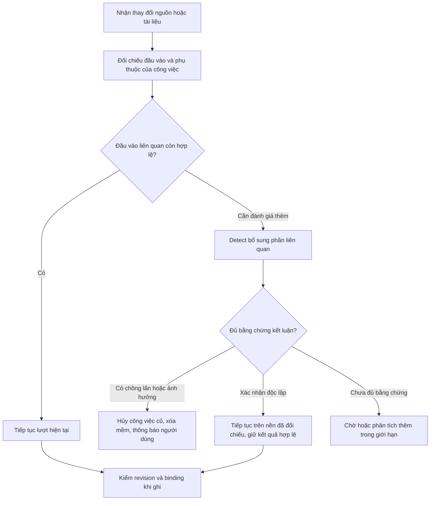

# Đề xuất xử lý thay đổi phiên bản và tái sử dụng kết quả trong LivingDocs

Ngày soạn 19/11/2026. Trạng thái **đề xuất phát triển**, cần thống nhất hợp đồng và chính sách trước khi triển khai.

## 1. Mục tiêu và phạm vi

Tài liệu trình bày hai đề xuất theo giai đoạn của công việc trong luồng PR → phát hiện sai lệch (detect drift) → sinh tài liệu AI → xét duyệt → xuất bản (publish).

| Đề xuất | Công việc được xử lý | Mục tiêu |
|---|---|---|
| **A — Tận dụng kết quả đã hoàn tất** | Đã hoàn tất detect và sinh tài liệu, đang chờ áp dụng, xét duyệt hoặc xuất bản | Tái sử dụng khi xác nhận các phần liên quan còn nguyên và độc lập. Có chồng lấn hoặc ảnh hưởng thì hủy công việc cũ bằng xóa mềm. |
| **B — Điều chỉnh công việc đang chạy** | Đang chờ, đang detect hoặc đang gọi AI, chưa hoàn tất kết quả | Đối chiếu đầu vào mới. Tiếp tục khi xác nhận còn hợp lệ, hủy công việc cũ khi có chồng lấn hoặc ảnh hưởng. |

Cả hai đề xuất sử dụng cơ chế thông báo thay đổi và kiểm tra có điều kiện khi ghi. Việc chuyển giữa hai nhóm được quyết định theo trạng thái đã lưu của công việc, thay vì chỉ dựa vào thời điểm thông báo tới worker.

Phạm vi đánh giá gồm đúng tenant, workspace, repository, đích nguồn và tài liệu liên quan. Một PR thay đổi không mặc nhiên hủy mọi công việc trong repository.

Chính sách cập nhật theo trao đổi ngày 19/11/2026 là **có chồng lấn hoặc ảnh hưởng thì hủy công việc cũ**. Việc xử lý tiếp nội dung bị ảnh hưởng cần một công việc mới trên đầu vào mới và đáp ứng lại điều kiện xét duyệt. Tối ưu tái sử dụng trong tài liệu này áp dụng cho kết quả được xác nhận còn nguyên và độc lập.

Riêng tại cửa xác minh cuối S04 → S02, áp chính sách đơn giản hơn theo trao đổi tiếp theo cùng ngày. **S02 xác nhận SHA hoặc cấu hình lệch binding đã gửi thì hủy công việc/lượt xuất bản cũ, xóa mềm và báo lỗi ngay.** Việc đối chiếu để tiếp tục công việc độc lập ở các mục trước cửa cuối không thay thế quy tắc này. Người dùng khởi tạo công việc mới trên đầu vào hiện tại khi cần xử lý tiếp.

## 2. Phân biệt các loại phiên bản

| Giá trị | Ý nghĩa | Cách xử lý khi thay đổi |
|---|---|---|
| `documentVersionId` và phiên bản tài liệu | Nhận diện phiên bản nghiệp vụ của tài liệu | Chọn đúng phiên bản cần xử lý và đúng lịch sử xét duyệt. |
| Revision tài liệu và ETag | Nhận diện trạng thái/nội dung mà một thao tác đã đọc | Đối chiếu lại trước khi áp dụng kết quả. |
| Commit SHA | Nhận diện snapshot mã nguồn | Đọc code theo SHA đã ghim, xác minh lại khi binding thay đổi. |
| Mốc nền so sánh của PR | Snapshot dùng để phân tích phần thay đổi | Lưu cùng đầu PR để tái hiện đúng đầu vào của phân tích. |
| `configRevision` | Phiên bản cấu hình kết nối và điều kiện nguồn do S02 quản lý | Kiểm lại cấu hình, quyền và binding trước khi tiếp tục. |
| `observation_version` | Bộ đếm mỗi lần S02 chấp nhận ghi quan sát | Xung đột bộ đếm chỉ yêu cầu kiểm tra lại quan sát. Cùng SHA có thể vẫn giữ nguyên nội dung tài liệu. |
| `source_revision` | Thế hệ thay đổi nguồn đã được S02 quan sát cho một đích | Đối chiếu bằng chứng nguồn trong đúng phạm vi, kết hợp SHA và binding. |

Các số đếm thuộc những miền khác nhau. Việc bộ đếm quan sát tăng từ 8 lên 9 chưa chứng minh tài liệu hoặc code đã thay đổi.

Nhánh đích của PR có thể thay đổi trong khi head SHA của PR giữ nguyên. Đầu PR, nền so sánh và nhánh đích cần được phân biệt khi xác định phạm vi ảnh hưởng.

## 3. Hiện trạng làm căn cứ

- S02 V3 có bảng `source_target_heads` cùng bộ đếm quan sát và thế hệ nguồn. Cơ chế ghi có điều kiện bảo vệ trạng thái quan sát trong S02.
- S04 V1 có `content_revisions.content_ref`, `document_evidence_refs.artifact_ref` và `revalidation_records`. Các trường này cung cấp nền tảng tham chiếu nội dung, bằng chứng và kết quả tái xác minh.
- `revalidation_records` có hai kết quả `NO_RELEVANT_IMPACT` và `RELEVANT_IMPACT`.
- S03 có API dự kiến `POST /internal/v1/revalidation/impact`, hiện mang trạng thái `INTERNAL_CANDIDATE`.
- Kế hoạch LIV-122 quy định S04 kiểm lại binding, ETag, approval, quyền và thời hạn bằng chứng tại giao dịch xuất bản cuối.

Các thành phần trên chưa chứng minh rằng pipeline đã hỗ trợ đầy đủ lưu checkpoint, điều chỉnh công việc đang chạy, hợp nhất tài liệu hoặc tái sử dụng kết quả theo đầu vào. Các phần đó thuộc đề xuất này.

## 4. Cơ chế dùng chung

### 4.1. Bên phát hiện và bên chịu trách nhiệm

| Thành phần | Trách nhiệm đề xuất |
|---|---|
| S02 | Xác minh thay đổi nguồn GitHub, lưu mốc nguồn và gửi thông báo thay đổi có phạm vi. Trả kết quả xác minh nguồn cho lượt xuất bản. |
| S03 | Sở hữu công việc phân tích, theo dõi đầu vào, tìm công việc có thể bị ảnh hưởng, đánh giá tác động và điều phối S05. |
| S04 | Phát thông báo khi revision tài liệu thay đổi. Sở hữu nội dung, áp dụng/hợp nhất kết quả, xét duyệt, xuất bản và kiểm toán. |
| S05 | Thực hiện yêu cầu sinh nội dung gắn với một lượt xử lý xác định. Trả kết quả cùng định danh để S03 kiểm tra còn hiệu lực. |
| Giao diện người dùng | Hiển thị đang đối chiếu, đang xử lý lại, đã hoàn tất hoặc đã đóng lỗi qua kênh trạng thái công việc. |

S03 điều phối yêu cầu AI do mình sở hữu. S02 gửi thông tin thay đổi tới các bên liên quan theo hợp đồng, các service tự quyết định công việc thuộc phạm vi của mình. Cách này tránh việc S02 phải hỏi đồng bộ tất cả service mỗi khi nguồn thay đổi.

### 4.2. Thông báo thay đổi và độ tin cậy

Thông báo cần mang định danh duy nhất, phạm vi tài nguyên, loại thay đổi, mốc cũ/mới và thông tin tương quan (correlation). Thông báo tài liệu có revision do S04 cấp. Thông báo nguồn có các mốc do S02 cấp. Bên nhận đối chiếu thứ tự trong đúng miền tương ứng.

Đề xuất ban đầu có thể dùng request HTTP nội bộ có xác thực để báo thay đổi. Việc gửi cần có bản ghi bền vững, retry và nhận trùng an toàn (idempotency). ACK chỉ xác nhận đã tiếp nhận thông báo, trạng thái công việc được theo dõi riêng. Khi áp dụng pipeline Kafka/outbox/inbox theo kiến trúc dự án, cần chốt một hợp đồng xử lý thống nhất để tránh cùng một thay đổi tạo nhiều lượt phục hồi độc lập.

Thông báo có thể trễ, trùng hoặc sai thứ tự. Bên nhận kiểm tra revision đã biết và trạng thái hiện tại trước khi hành động. Một thông báo cũ không được làm công việc quay lại đầu vào cũ.

### 4.3. Đầu vào và kết quả được lưu

Mỗi công việc và lượt xử lý cần đủ thông tin để tái hiện và kiểm tra kết quả.

| Nhóm thông tin | Nội dung cần lưu |
|---|---|
| Phạm vi | Tenant, workspace, repository, PR hoặc nhánh, tài liệu bị tác động. |
| Đầu vào | SHA nguồn, mốc so sánh, revision tài liệu nền, cấu hình phân tích và template liên quan. |
| Phụ thuộc | Những thành phần code, cấu hình, tài liệu và quan hệ phụ thuộc ảnh hưởng đến kết quả. |
| Kết quả | Detect/drift evidence, nội dung AI, tham chiếu artifact và phần thay đổi so với tài liệu nền. |
| Thực thi | ID công việc, ID lượt xử lý, giai đoạn, thời điểm, checkpoint và nguyên nhân chuyển trạng thái. |
| Xét duyệt | Nội dung/revision đã được duyệt, quyết định duyệt và nguồn gốc của bằng chứng. |

Kết quả cũ được giữ theo đầu vào gốc. Khi xác nhận nó tiếp tục phù hợp với đầu vào mới, lưu thêm bằng chứng tái xác minh và liên kết nguồn gốc.

## 5. Đề xuất A — Tận dụng kết quả đã hoàn tất

### 5.1. Tình huống

Hai công việc cùng đọc tài liệu D8. Công việc J1 cập nhật mục Đăng nhập và đã áp dụng thành D9. Công việc J2 đã sinh xong mục Thanh toán nhưng tới bước áp dụng mới thấy tài liệu đã đổi revision.

J2 được đưa vào bước đối chiếu. Phân tích và nội dung đã sinh được giữ để đánh giá khả năng tái sử dụng.

### 5.2. Luồng xử lý

1. Lưu kết quả hoàn tất và trạng thái chờ áp dụng/xuất bản.
2. Đọc revision tài liệu và binding nguồn hiện tại.
3. Phân loại nguyên nhân bị chặn theo bảng quyết định bên dưới.
4. Khi tài liệu nền thay đổi, đối chiếu ba bản gồm tài liệu gốc, tài liệu hiện tại và kết quả của công việc để xác định chồng lấn và ảnh hưởng.
5. Hủy công việc cũ nếu có chồng lấn hoặc ảnh hưởng. Chỉ ghép phần thay đổi được xác nhận độc lập, rồi kiểm phạm vi nguồn và điều kiện xét duyệt.
6. Thực hiện xác minh nguồn cho lượt xuất bản, rồi ghi có điều kiện tại S04.
7. Nếu có thay đổi chen ngang, tiếp tục từ bước đối chiếu với các kết quả đã lưu, trong giới hạn retry đã thống nhất.

### 5.3. Quyết định tái sử dụng

| Tình huống | Cách xử lý |
|---|---|
| Xung đột `observation_version`, nguồn và nội dung liên quan vẫn khớp | Thử lại bước xác minh và chốt. Giữ kết quả detect/AI. |
| Tài liệu đổi ở các phần đã xác nhận độc lập | Ghép phần thay đổi đã lưu vào bản hiện tại và kiểm tra kết quả cùng điều kiện xét duyệt. |
| Nguồn đổi, đã có bằng chứng không ảnh hưởng | Giữ nội dung có giá trị, ghi bằng chứng tái xác minh và cập nhật binding theo chính sách được phê duyệt. |
| Nguồn đổi có ảnh hưởng tới đầu vào hoặc kết quả của công việc | Hủy công việc cũ, xóa mềm và báo lỗi. Công việc mới dùng snapshot mới sau khi người dùng xử lý đầu vào. |
| Phần thay đổi mới chồng lấn với phạm vi công việc cũ định sửa | Hủy công việc cũ, xóa mềm và báo lỗi, kể cả khi công cụ có thể tự merge sạch về văn bản. |
| Khác vị trí sửa nhưng có ảnh hưởng về phụ thuộc hoặc ý nghĩa | Hủy công việc cũ, xóa mềm và báo lỗi theo cùng chính sách. |
| Chưa đủ bằng chứng | Chờ phân tích bổ sung hoặc đóng lượt tự động khi hết giới hạn. Phân biệt nguyên nhân này với xung đột đã xác nhận. |

### 5.4. Hợp nhất ba bản và hàng đợi áp dụng

Với ví dụ J1/J2, ba đầu vào là D8, D9 và kết quả của J2. Hệ thống tính phần sửa của J2 so với D8 rồi đối chiếu với D9. Nếu các phần độc lập và các giả định liên quan còn đúng, bản ứng viên tiếp theo có thể chứa cả hai thay đổi.

Đối chiếu ba bản dùng để nhận diện thay đổi và ghép các phần đã xác nhận độc lập. Chồng lấn trong phạm vi định sửa làm công việc cũ bị hủy. Thay đổi ảnh hưởng đến giả định hoặc phụ thuộc của công việc cũng làm công việc cũ bị hủy, kể cả khi khác section và merge sạch về văn bản.

Các công việc có thể phân tích song song. Những công việc cùng áp dụng vào một tài liệu đi qua một hàng đợi áp dụng. Giao dịch ghi cuối sử dụng khóa ngắn hoặc điều kiện revision tương ứng. Những đường ghi khác, như người dùng chỉnh tài liệu, vẫn phải tăng revision và tuân thủ kiểm tra đồng thời.

Có thể gom các kết quả đã xác nhận độc lập thành một bản ứng viên nếu cùng phạm vi nghiệp vụ. Công việc có chồng lấn hoặc ảnh hưởng bị đóng theo mục 7. Kết quả tổng hợp phải giữ nguồn gốc từng phần và đáp ứng điều kiện xét duyệt của S04.

### 5.4.1. Kiểm tra snapshot cuối sau khi pull, merge hoặc resolve

Pull kèm merge/rebase và thao tác resolve có thể thay đổi code, tài liệu hoặc hành vi. Đầu vào kiểm tra phải là SHA thực tế sau khi các thao tác đó hoàn tất và xuất hiện trên GitHub trong phạm vi cần xác minh. Chỉ fetch về máy cập nhật thông tin remote, còn code đã resolve cục bộ chưa được đưa lên GitHub thì S02 chưa quan sát được.

Đối chiếu snapshot cũ với snapshot cuối, kiểm cả vùng code/tài liệu định sửa và các đầu vào, phụ thuộc được dùng để tạo kết quả. Cùng tên file, cùng vị trí hoặc kết quả merge thành công chưa đủ để xác nhận công việc còn hợp lệ. Với snapshot mới, đánh giá tác động cũ phải được kiểm lại cho đúng cặp mốc.

| Kết quả sau resolve | Quyết định cho công việc cũ |
|---|---|
| Có thay đổi chồng lấn phạm vi định sửa | Hủy và xóa mềm. |
| Khác phạm vi ghi nhưng thay đổi phụ thuộc, contract hoặc ý nghĩa liên quan | Hủy và xóa mềm. |
| Đủ bằng chứng rằng phần liên quan còn nguyên và độc lập | Cho phép tiếp tục đối chiếu, xác minh nguồn và điều kiện ghi cuối. |
| Phụ thuộc chưa rõ hoặc bằng chứng chưa đủ | Chặn áp dụng và Publish. Phân tích thêm trong giới hạn, ghi nguyên nhân thiếu bằng chứng khi kết thúc. |

Kết quả detect/AI và approval trước đó vẫn có giá trị truy vết. Công việc đã bị hủy chỉ được tham chiếu như lịch sử, một công việc mới phải xác lập lại đầu vào và điều kiện xét duyệt của chính nó.

### 5.5. Đã xét duyệt xong nhưng lệch binding khi S04 gọi S02

Đây là nhánh đóng lỗi ở cửa kiểm tra cuối của đề xuất A. Tài liệu đã hoàn tất detect, sinh nội dung và xét duyệt, nhưng đầu nguồn có thể thay đổi trước khi S02 xử lý yêu cầu xác minh. Nhánh này phải hoạt động cả khi webhook hoặc thông báo thay đổi chưa tới S04.

Ví dụ tài liệu D đang ở `APPROVED`, revision r8, nội dung C8 và binding SHA A. Một yêu cầu Publish của S04 gửi binding A tới S02, trong khi đầu nhánh hoặc đầu PR đã chuyển sang B.

1. S04 ghi nhận lượt xuất bản cùng revision r8, nội dung C8, quyết định duyệt và binding A đã đọc, rồi gọi API-070 của S02.
2. S02 xác minh đầu nguồn trong lần gọi. Nếu xác nhận SHA B khác A, kết quả nghiệp vụ là `STALE_SHA`. Việc S02 ghi quan sát B thành công vẫn dẫn tới chặn lần xuất bản dùng A.
3. S04 chặn Publish, đóng lỗi và đánh dấu xóa mềm công việc/lượt xuất bản cũ trong phạm vi mình sở hữu. Áp chuyển trạng thái tài liệu theo T-DOC-10/REQ-05 trên đúng checkpoint khi đủ điều kiện. Artifact và quyết định duyệt được giữ làm lịch sử.
4. S04 lưu nguyên nhân nguồn lỗi thời, binding cũ và mốc mới đã xác minh, trả lỗi cho người dùng. Nếu công việc S03 liên quan cần được đóng, gửi yêu cầu có nhận diện và retry để S03 cập nhật bản ghi do mình sở hữu.
5. Người dùng có thể khởi tạo công việc mới trên snapshot hiện tại. Công việc mới có ID, đầu vào và quy trình xét duyệt riêng.

Đóng lỗi tại cửa này là trạng thái kết thúc của công việc cũ. Kết quả AI và approval cũ được giữ để truy vết. Quy tắc hủy được áp dụng ngay khi xác nhận lệch binding, kể cả thay đổi mới nằm ở phần độc lập.

Xóa mềm được áp dụng cho công việc, bản ứng viên hoặc lượt xuất bản bị loại theo mô hình sẽ chốt. Tài liệu hiện tại, bản đã PUBLISHED và các bản ghi của một yêu cầu khác đã thành công được bảo vệ theo vòng đời riêng. Khi hai yêu cầu cạnh tranh, chỉ bản ghi thuộc phía thất bại được đóng theo quy tắc này.

### 5.6. Phân loại lỗi tại cửa S04 → S02 → S04

| Kết quả tại cửa cuối | Cách phục hồi và bảo vệ dữ liệu |
|---|---|
| `SOURCE_OBSERVATION_CONFLICT` | Chưa đủ bằng chứng kết luận nguồn đã thay đổi. Thử xác minh mới với cùng binding trong ngân sách cho phép. Giữ kết quả detect, AI và lịch sử duyệt. |
| `STALE_SHA` | Hủy công việc/lượt xuất bản cũ, xóa mềm và báo lỗi nguồn lỗi thời theo mục 5.5. |
| `CONFIG_CHANGED` | Hủy công việc/lượt xuất bản cũ, xóa mềm và báo lỗi binding cấu hình đã đổi. |
| Bằng chứng hết hạn, S02 không sẵn sàng hoặc phản hồi chưa xác minh được | Chặn Publish. Giữ kết quả đã hoàn tất để thử lại khi đủ điều kiện, có giới hạn retry và thời gian. |
| S02 trả `PASS/CURRENT`, nhưng revision, nội dung, binding hoặc approval ở S04 đã đổi | Giao dịch S04 từ chối ghi, đóng lượt xuất bản cũ và báo lỗi theo hợp đồng. Xóa mềm đúng bản ghi bị loại, bảo vệ phiên bản hiện tại và lịch sử. |
| Hai yêu cầu Publish cùng đọc một revision | Chỉ một yêu cầu được chuyển trạng thái thành công bằng kiểm tra có điều kiện. Replay đúng yêu cầu đã commit trả kết quả đã lưu sau kiểm quyền, yêu cầu cạnh tranh được xử lý theo revision/trạng thái hiện tại. |

Các tên reason của S02 ở đây dựa trên lõi nghiệp vụ và thiết kế LIV-122. HTTP status và mã trả từ S04 phải được đối chiếu OpenAPI ở bước triển khai, gồm `412` cho revision không khớp và các mã lỗi nguồn trong kế hoạch S02.

Lệch binding đã xác nhận được phân biệt với xung đột kỹ thuật `SOURCE_OBSERVATION_CONFLICT` và lỗi tạm thời. Hai trường hợp sau chưa đủ căn cứ kết luận code hoặc tài liệu đã thay đổi. Chính sách retry của chúng vẫn có ngân sách và điều kiện riêng.

### 5.7. Kiểm tra sau phản hồi PASS và giới hạn đồng bộ

Khoảng thời gian từ lúc gửi request tới S02 đến lúc nhận phản hồi có thể đủ để người khác sửa tài liệu. Vì vậy, S04 đối chiếu lại đúng revision, nội dung, approval, binding, mốc nguồn đã biết, quyền và thời hạn bằng chứng ngay trong giao dịch ghi `PUBLISHED`. Nếu chờ khóa, các kiểm tra phụ thuộc thời gian dùng thời điểm thực tại lúc ghi. Revision thay đổi trong khoảng chờ làm lượt cũ mất quyền ghi.

Giới hạn còn lại là GitHub có thể nhận push sau lần S02 đọc nguồn và trước khi S04 commit. Với mốc nguồn mới đã đến S04 trước giao dịch ghi, điều kiện nguồn phải chặn bằng chứng cũ. Với thay đổi chưa được quan sát, hợp đồng hiện tại giữ lịch sử xuất bản gắn với SHA đã xác minh và xử lý thay đổi qua luồng phát hiện sai lệch sau đó.

Nếu sản phẩm yêu cầu head GitHub và trạng thái Publish luôn khớp tại đúng thời điểm commit, cần quyết định bổ sung về điều phối thay đổi ở GitHub hoặc mô hình snapshot phát hành. Hai đề xuất trong tài liệu này bảo vệ kết quả trước các thay đổi đã biết, đồng thời giữ giới hạn quan sát nêu trên để kiểm thử rõ ràng.

### 5.8. Phân biệt với export sau khi tài liệu đã PUBLISHED

Sau Publish, S04 có thể gửi S02 lệnh export tài liệu sang GitHub. Nếu nhánh đích export đã thay đổi, lần export cần được đối chiếu lại bằng kết quả đã xuất bản và cơ chế ghi GitHub theo hợp đồng export.

Đề xuất cho nhánh này là giữ bản `PUBLISHED` cùng nguồn gốc, ghi trạng thái thất bại/chờ xử lý của thao tác export riêng, retry có nhận diện và đối soát kết quả đã ghi khi mất phản hồi. Chỉ tiếp tục export khi xác nhận thay đổi đích độc lập với thao tác. Có chồng lấn hoặc ảnh hưởng thì đóng thao tác export cũ bằng xóa mềm và báo lỗi. Thay đổi tài liệu phát sinh sau xử lý của người dùng cần đi theo quy trình phiên bản của S04.

Hợp đồng export chi tiết cần được chốt ở đầu việc export tương ứng. API-070 ở mục 5.5 là cửa xác minh nguồn trước khi S04 chuyển sang `PUBLISHED`.

## 6. Đề xuất B — Điều chỉnh công việc đang detect hoặc gọi AI

### 6.1. Điều kiện kích hoạt

S03 nhận thông báo rằng tài liệu nền hoặc nguồn liên quan tới công việc đã thay đổi. Worker đánh giá lại ở checkpoint và tại các điểm trước tác vụ tốn tài nguyên, trước khi nhận kết quả AI làm kết quả hợp lệ và trước khi bàn giao cho S04.

Phạm vi gồm công việc đang chờ, đang detect và đang gọi AI. Công việc đã có kết quả hoàn tất được chuyển sang cách đối chiếu của đề xuất A bằng kiểm tra trạng thái nguyên tử.

### 6.2. Luồng quyết định

1. Đọc trạng thái công việc và xác định snapshot đầu vào đã dùng.
2. Đọc nền mới nhất trong đúng phạm vi và ghim các mốc cho lần đánh giá.
3. Đối chiếu cả vùng dữ liệu đã đọc và vùng tài liệu định sửa.
4. Nếu đầu vào liên quan vẫn hợp lệ, tiếp tục lượt hiện tại và lưu căn cứ của quyết định.
5. Nếu cần đánh giá nền mới, giữ kết quả theo đầu vào gốc và thực hiện detect bổ sung. Chỉ tiếp tục khi xác nhận phần liên quan còn nguyên và độc lập, lưu bằng chứng cho mốc mới.
6. Nếu xác định có chồng lấn hoặc ảnh hưởng, hủy công việc cũ bằng xóa mềm và trả nguyên nhân cho người dùng. Công việc mới sau xử lý đầu vào có ID và snapshot riêng.
7. Mọi kết quả ghi cuối đều kiểm lại trạng thái công việc, lượt xử lý còn hiệu lực, revision tài liệu và binding nguồn.

### 6.3. Công việc đang gọi AI

Nếu đầu vào vẫn hợp lệ, lời gọi đang chạy có thể được tiếp nhận theo lượt hiện tại. Nếu đầu vào mất hiệu lực, hệ thống đánh dấu lượt đó hết hiệu lực và yêu cầu dừng tác vụ khi cơ chế thực thi hỗ trợ.

Kết quả trả về muộn mang ID lượt cũ bị chặn tại bước áp dụng. Có thể lưu artifact theo chính sách lưu trữ để phục vụ đối chiếu, nhưng việc tái sử dụng phải đi qua đánh giá đầu vào. Cơ chế chặn ghi là điều kiện bảo vệ dữ liệu kể cả khi hủy tác vụ vật lý chưa hoàn tất.

### 6.4. Phụ thuộc và kết luận tác động

Đánh giá xem xét code trực tiếp, thư viện liên quan, cấu hình, contract, template và nội dung tài liệu được dùng làm ngữ cảnh. Thay đổi khác file vẫn có thể đổi hành vi được mô tả.

Phạm vi phụ thuộc chưa đầy đủ hoặc kiểm tra chưa xác định được cần được thể hiện trong kết quả đánh giá. Chỉ cho phép tiếp tục tự động khi có đủ bằng chứng theo chính sách của loại tài liệu và công việc.

Chỉ cần có một phần chồng lấn hoặc một quan hệ ảnh hưởng đã xác định là hủy toàn bộ công việc cũ trong phạm vi đang đánh giá. Khả năng công cụ hoặc AI đề xuất cách resolve không làm thay đổi quyết định hủy này.

## 7. Đóng lỗi, xóa mềm và phản hồi người dùng

### 7.1. Phạm vi xóa mềm

Đóng công việc hoặc bản ứng viên có chồng lấn hoặc ảnh hưởng, hoặc bị xác nhận lệch binding tại cửa cuối theo mục 5.5. Lưu thời điểm xóa mềm, nguyên nhân, đầu vào cũ/mới và các lượt xử lý liên quan. Lịch sử kiểm toán, quyết định duyệt và artifact cần truy vết được giữ theo chính sách lưu trữ. Công việc mới sau khi người dùng xử lý có đầu vào và quyền áp dụng riêng.

Việc đóng lỗi của pipeline được quản lý riêng với vòng đời PR trên GitHub và tài liệu đang được sử dụng. S03 đóng công việc do mình sở hữu, S04 đóng bản ứng viên do mình sở hữu. Các cập nhật liên service cần có retry và khả năng đối soát trạng thái.

Trạng thái công việc như đang đối chiếu, đang xử lý lại, lượt đã hết hiệu lực và đóng do xung đột sẽ được đặt tên chính thức khi chốt contract. Chúng thuộc vòng đời công việc, còn trạng thái tài liệu tiếp tục theo REQ-05.

### 7.2. Nội dung lỗi và khả năng tra cứu

Người dùng cần xem được công việc nào bị đóng, tài nguyên liên quan, nguyên nhân, các phiên bản được so sánh và bước tiếp theo phù hợp. Chi tiết kỹ thuật phải được lọc theo quyền tài nguyên.

Ví dụ nội dung hiển thị đề xuất là “Công việc đã dừng vì nội dung đang cập nhật xung đột với phiên bản tài liệu hiện tại. Kết quả đã tạo được giữ để đối chiếu.”

Nếu yêu cầu ban đầu đã được nhận để xử lý bất đồng bộ, lỗi cuối được phản ánh qua API trạng thái hoặc kênh thông báo. Danh sách công việc đang hoạt động lọc các mục đã xóa mềm. Endpoint tra cứu có quyền vẫn cần cung cấp tóm tắt trạng thái kết thúc để người dùng hiểu nguyên nhân.

Lỗi version, xung đột nội dung, thiếu bằng chứng và hết ngân sách retry cần mã nguyên nhân riêng. Tên mã, HTTP status và cơ chế thông báo sẽ được chốt trong OpenAPI tương ứng.

## 8. Quy tắc nhất quán của cả hai đề xuất

1. Mỗi lượt xử lý có đầu vào cố định và ID riêng. Phục hồi giữ liên kết đến lượt trước.
2. Thông báo trùng không tạo nhiều lượt phục hồi cho cùng thay đổi.
3. Thông báo cũ không làm giảm mốc đã biết trong cùng phạm vi.
4. Lượt hết hiệu lực hoặc công việc đã đóng không được ghi kết quả hoạt động trở lại.
5. Nếu nguồn cấu hình hoặc quyền thay đổi, kiểm lại các điều kiện đó trước thao tác tiếp theo.
6. Quyết định giữ hiệu lực của approval khi binding đổi cần chính sách rõ ràng. Nội dung hợp nhất hoặc sinh mới phải đáp ứng quy trình xét duyệt tương ứng.
7. Lượt xuất bản có bằng chứng nguồn hiện hành và ghi có điều kiện. Việc ghim SHA giúp truy vết, còn thay đổi GitHub sau lần kiểm tra tiếp tục được xử lý theo cơ chế phát hiện sai lệch của dự án.
8. Giao dịch S04 ghi trạng thái xuất bản, audit và các bản ghi liên quan theo hợp đồng cùng một lần commit. Retry phải kiểm soát được trường hợp mất phản hồi sau commit.
9. S04 sở hữu Publish. S02 sở hữu xác minh nguồn và export GitHub khi được yêu cầu.

## 9. Kiểm soát tài nguyên và tránh vòng lặp

- Giới hạn lượt phục hồi tự động và tổng thời gian cho một công việc. Giá trị cụ thể cần chọn từ thử tải và ngân sách xử lý.
- Gộp các thông báo đang chờ của cùng công việc để đánh giá tới nền mới nhất đã biết. Giữ lịch sử sự kiện phục vụ truy vết.
- Dùng hàng đợi và giới hạn worker theo tài nguyên, đồng thời cho phép công việc độc lập chạy song song.
- Tái sử dụng kết quả theo đầu vào đã xác minh. Khóa tái sử dụng bao gồm phạm vi tenant, SHA, revision tài liệu và cấu hình ảnh hưởng tới kết quả.
- Thu hẹp phạm vi detect bổ sung theo khả năng xác minh phụ thuộc. Có chồng lấn hoặc ảnh hưởng thì kết thúc công việc cũ, giữ artifact phục vụ truy vết.
- Khi liên tục có thay đổi mới, đóng lượt tự động hoặc chờ nền ổn định theo chính sách. Lưu nguyên nhân riêng để người dùng phân biệt với xung đột nội dung.

Chi phí lưu artifact, kiểm tra phụ thuộc và hợp nhất cần được đo. Chưa có số liệu để khẳng định mức giảm tài nguyên của đề xuất.

## 10. Thứ tự phát triển và kiểm thử

| Bước | Phạm vi có thể nghiệm thu | Kiểm thử bắt buộc của bước |
|---|---|---|
| 1 | Chốt mô hình đầu vào, lượt xử lý, trạng thái và dữ liệu xóa mềm | Phân biệt revision tài liệu, SHA, bộ đếm quan sát và cấu hình. Công việc đã đóng có lịch sử tra cứu. |
| 2 | Lưu kết quả bền vững, phục hồi riêng bước xác minh/Publish | Xung đột quan sát cùng SHA giữ kết quả AI. Restart tiến trình vẫn phục hồi được. Mất phản hồi sau commit tránh xuất bản trùng. |
| 2a | Đóng lỗi sau xét duyệt ở cửa S04 → S02 → S04 | Đã APPROVED nhưng S02 phát hiện A → B khi webhook chưa tới, cả trường hợp phần đổi độc lập. Xác nhận hủy/xóa mềm đúng công việc cũ, trả lỗi và giữ lịch sử. Kiểm thêm CONFIG_CHANGED, yêu cầu đóng gửi trùng và lỗi mạng khi báo S03. |
| 2b | Bảo vệ sau phản hồi PASS và tách lỗi export | Tài liệu đổi trong lúc chờ S02, bằng chứng hết hạn khi chờ khóa, hai Publish đồng thời, nguồn đổi sau PASS với/không có mốc mới ở S04, export thất bại sau PUBLISHED và mất phản hồi export. |
| 3 | Gửi và nhận thông báo thay đổi có phạm vi | Nhận trùng, sai thứ tự, mất mạng, crash sau lưu trước gửi, tenant/workspace/PR khác nhau. |
| 4 | Checkpoint, hết hiệu lực lượt cũ và công việc đang detect/AI | Thay đổi xảy ra trước detect, trong detect, trong lời gọi AI và lúc bàn giao kết quả. Kết quả AI muộn bị chặn. |
| 5 | Đối chiếu ba bản và phát hiện tác động trong phạm vi đầu tiên | Hai job độc lập được tiếp tục. Cùng vùng sửa bị hủy kể cả merge sạch. Khác vùng nhưng ảnh hưởng ngữ nghĩa bị hủy. Dữ liệu phụ thuộc thiếu chặn Publish. |
| 6 | Tái sử dụng công việc độc lập và đóng công việc bị ảnh hưởng | Kiểm code sau resolve có SHA mới, phụ thuộc dùng chung đổi, AI trả muộn sau hủy, artifact lịch sử và công việc mới có đầu vào riêng. Kiểm điều kiện duyệt và thay đổi chen ngang khi ghi. |
| 7 | Giới hạn tài nguyên và xác minh xuyên service | Luồng PR đến trạng thái cuối, nhiều cập nhật liên tiếp, retry hết giới hạn, lỗi ghi/rollback, theo dõi số lần gọi AI và thời gian chờ. |

Mỗi bước cần xác định danh sách file, hợp đồng, migration nếu có và kiểm thử trước khi sửa mã. Các bổ sung contract có ảnh hưởng nhiều service cần đồng bộ producer, consumer, OpenAPI/event schema và kiểm thử tích hợp.

## 11. Điều kiện nghiệm thu chung

- Kết quả detect/AI hoàn tất được giữ qua lỗi version và qua restart.
- Đổi bộ đếm quan sát cùng nguồn không kích hoạt lại toàn bộ detect/AI.
- Trước cửa xác minh cuối, nền đổi nhưng phần liên quan còn hợp lệ được tiếp tục với bằng chứng đối chiếu. Tại cửa cuối áp quy tắc hủy khi xác nhận lệch binding.
- Chỉ cần có chồng lấn hoặc ảnh hưởng đã xác định là hủy công việc cũ, xóa mềm và cho người dùng xem nguyên nhân, kể cả merge sạch về văn bản.
- Code sau resolve được kiểm theo SHA thực tế. Thiếu bằng chứng độc lập phải chặn Publish. Artifact và approval lịch sử được giữ để truy vết, công việc mới xác lập đầu vào và điều kiện duyệt riêng.
- Thông báo trùng, muộn hoặc sai thứ tự không gây phục hồi trùng hay ghi đè kết quả mới.
- Hai lượt ghi đồng thời được bảo vệ tại database, kể cả khi thông báo chưa tới.
- Tài liệu đã xét duyệt nhưng bị S02 xác nhận lệch SHA/cấu hình làm công việc hoặc lượt xuất bản cũ bị hủy và xóa mềm, có lỗi cho người dùng. Artifact và approval giữ làm lịch sử, công việc mới có ID và đầu vào riêng.
- S02 trả PASS rồi tài liệu thay đổi trước lúc S04 ghi phải bị chặn bằng revision/binding. Giới hạn push GitHub chưa quan sát được có kiểm thử và được ghi nhận đúng phạm vi bảo đảm.
- Lỗi export sau PUBLISHED có trạng thái và cơ chế đối soát riêng, giữ đúng nguồn gốc artifact đã xuất bản.
- Quyền, tenant isolation, approval và xác minh nguồn trước Publish được kiểm tra theo hợp đồng đã chốt.
- Có số liệu về tỷ lệ tái sử dụng, số lần gọi AI, số lượt phục hồi, độ dài hàng đợi và độ trễ so với luồng xử lý lại đầy đủ.

## 12. Những quyết định cần chốt trước khi triển khai

| Nội dung | Hướng đề xuất |
|---|---|
| Ranh giới công việc hoàn tất | Dựa trên checkpoint kết quả đã lưu. Đối chiếu chuyển trạng thái nguyên tử khi có thông báo đến đồng thời. |
| Phạm vi xử lý lần đầu | Bắt đầu ở mức một tài liệu hoặc module có thể kiểm chứng phụ thuộc. |
| Định nghĩa phạm vi chồng lấn và ảnh hưởng | Chính sách là hủy công việc cũ khi có chồng lấn hoặc ảnh hưởng. Cần chốt độ chi tiết đoạn/hàm/section và cách xác minh phụ thuộc, thiếu bằng chứng có trạng thái chặn riêng. |
| Gửi thông báo | Chốt request nội bộ có lưu bền/retry hoặc event theo pipeline Kafka, cùng ownership và quy tắc nhận trùng. |
| Chính sách approval | Xác định khi nào được giữ quyết định duyệt, khi nào cần duyệt lại sau hợp nhất hoặc cập nhật binding. |
| Đóng lỗi tại cửa Publish cuối | Chính sách là hủy khi xác nhận lệch binding. Chốt bản ghi xóa mềm, quyền mở công việc mới và đồng bộ trạng thái đóng giữa S03/S04 bằng yêu cầu có nhận diện. |
| Độ mới tại thời điểm Publish | Giữ phạm vi nguồn đã quan sát của hợp đồng hiện tại hoặc bổ sung mô hình điều phối GitHub/snapshot phát hành với yêu cầu riêng. |
| Xóa mềm và thời gian lưu | Chốt đối tượng đóng, endpoint tra cứu trạng thái cuối, thời gian giữ artifact và audit. |
| Ngân sách phục hồi | Chốt số lần, thời gian, cách chờ/gộp thay đổi và thông báo cho người dùng. |
| Hợp đồng dữ liệu | Chốt trường snapshot, lượt xử lý, phụ thuộc, bằng chứng tác động và mã lỗi trước khi mở rộng schema/API. |

## 13. Tài liệu và mã nguồn tham chiếu

- [Master Decisions](../engineering/LivingDocs_Master_Decisions_Technical_Rules_Team_Agent_Handoff_2026-11-13.md)
- [Backend Standards v3](../engineering/LivingDocs_Backend_Engineering_Standards_v3.md)
- [Thiết kế S02 LIV-122, đặc biệt mục 6 và mục 8](S02/S02-LIV-122-HLD-va-ke-hoach-trien-khai.md)
- [Migration V3 của S02](../../backend/repository-integration-service/src/main/resources/db/migration/V3__add_source_target_heads.sql)
- [Migration V1 của S04](../../backend/document-governance-service/src/main/resources/db/migration/V1__create_document_governance_tables.sql)
- [OpenAPI S03](../../contracts/openapi/s03-intelligence.yaml)
- [OpenAPI S04](../../contracts/openapi/s04-document.yaml)
- [Hợp nhất ba chiều trong Git](https://git-scm.com/docs/git-merge#_merge_strategies)
