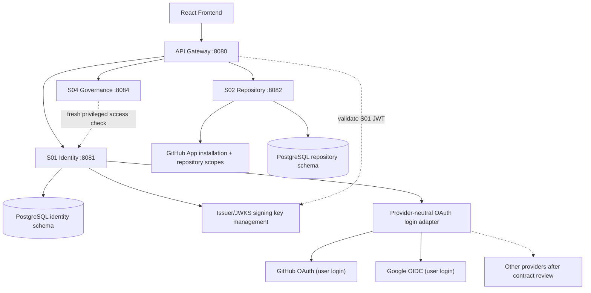
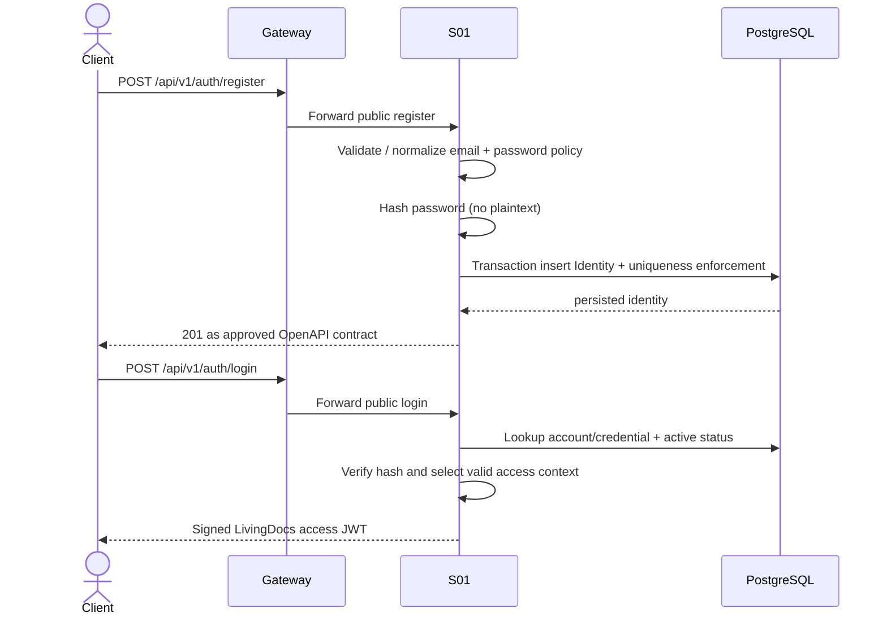
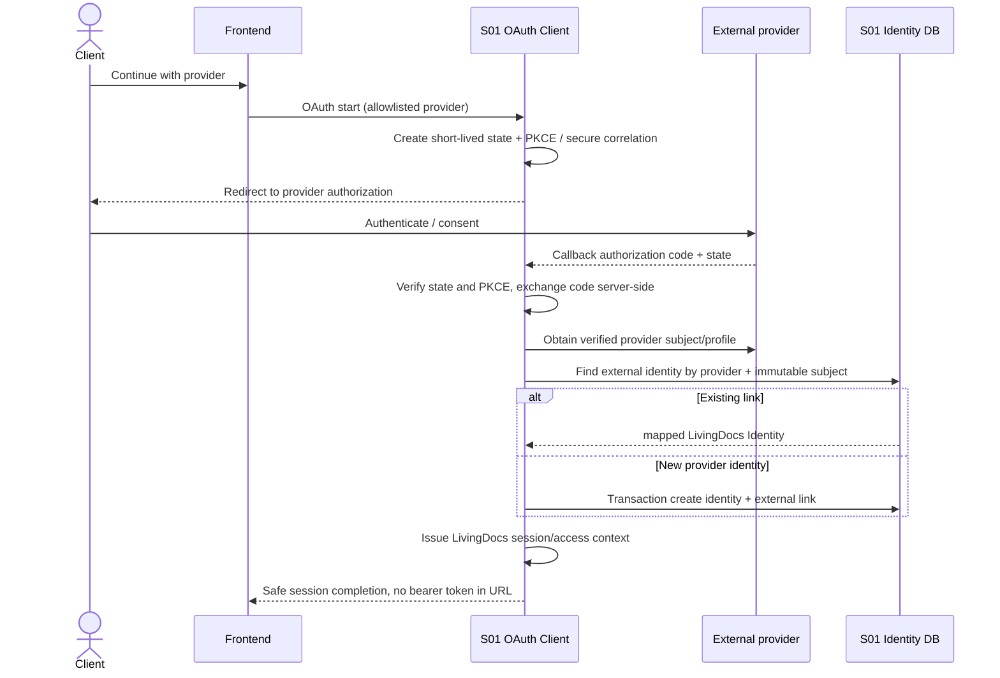
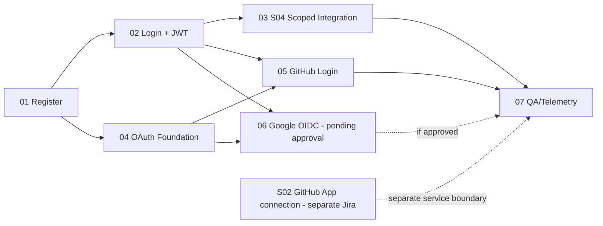

# LIV-134 — S01 Authentication & Multi-Provider OAuth: Kế hoạch cá nhân và Jira execution plan

> **Ngày cập nhật:** 13/11/2026 · **Dành cho:** Project Owner/Lead và Codex của LivingDocs.  
> **Trạng thái:** Kế hoạch thực thi cần review (không tự động coi là ADR, thay đổi OpenAPI/Jira, hoặc bằng chứng tính năng đã chạy).  
> **Nguồn nội bộ:** Yêu cầu đề tài `yeu_cau_de_tai_livingdocs_md.md` (email/password + GitHub OAuth; OAuth2/OIDC); Jira [LIV-134](https://huutiense25.atlassian.net/browse/LIV-134), [LIV-84](https://huutiense25.atlassian.net/browse/LIV-84), [LIV-96](https://huutiense25.atlassian.net/browse/LIV-96); [LD-API-001](https://huutiense25.atlassian.net/wiki/spaces/LPKB/pages/11337744), [LD-ARCH-003](https://huutiense25.atlassian.net/wiki/spaces/LPKB/pages/10190849); tài liệu `docs/engineering/LivingDocs_Master_Decisions_Technical_Rules_Team_Agent_Handoff_2026-11-13.md`.

## 1. Outcome và ranh giới nghiệp vụ

- **S01** cung cấp **một LivingDocs Identity nhất quán** có thể đăng nhập bằng local email/password hoặc nhiều external identity providers (đầu tiên GitHub; Google là provider kế tiếp được đề xuất; LinkedIn chưa mặc định đưa vào scope). Sau khi chứng thực bằng bất kỳ cách nào, S01 phát hành **LivingDocs access JWT**, không chuyển GitHub/Google access token thành token nội bộ dùng trực tiếp.
- **S01 là authority** của Identity, Membership, Tenant/Workspace grants và việc cấp token. JWT không tự cấp quyền bởi vì user vừa đăng nhập; quyền phải đối chiếu membership/scope. S04 tiếp tục tự enforce state/business guards, nhất là cấm tự Final Approval.
- **S02** quản lý **GitHub App installation/repository permissions**, source SHA, webhook HMAC, token cấp cho installation, outbox/Kafka. Đây là nghiệp vụ khác với đăng nhập qua GitHub OAuth tại S01. **P4 là dependency liên service**, không được nhét vào S01/LIV-134 hay dùng GitHub OAuth user token như mặc định thay thế installation credential.
- **Mục tiêu sprint ưu tiên:** Register thật → Login/JWT/JWKS → Gateway/S04 scoped access thật để mở khóa Golden Flow Review/Approval/Publish. **OAuth đa provider vẫn là deliverable thật** nhưng triển khai theo lát sau khi core identity được kiểm chứng; không tính các provider chưa bật là xong.

## 2. HLD: Luồng tổng thể



### 2.1 Local registration/login



### 2.2 Multi-provider OAuth user login (S01)



**Quan trọng:** GitHub login dùng OAuth2; Google có OIDC (định danh `iss + sub`/subject). Không suy rằng mọi provider đều hỗ trợ OIDC hoặc có verified email. `provider + stable subject` phải là unique key. Không auto-link theo email trùng; linking account cần explicit authenticated proof, CSRF/state, xử lý collision. Không tự cấp Tenant Owner/Staff/Manager khi đăng nhập lần đầu.

### 2.3 Model dữ liệu và chiến lược không phá schema

- **Hiện trạng S01:** `identity.identities` có `identity_id`, `email`, `password_hash` (nullable), `status` và unique normalized email; Flyway là schema authority.
- **Đề xuất mở rộng bằng migration mới:** `identity.external_identities` với `id`, `identity_id FK`, `provider` (allowlisted), `provider_subject` (immutable provider account ID), `created_at`, `last_login_at`; **unique `(provider, provider_subject)`**; phân tích khóa `provider+issuer+sub` cho IdP OIDC và tình huống provider namespaces trước khi chốt DDL.
- `identity.email/password_hash` có thể giữ làm local credential cho MVP; tài khoản OAuth-only phải có chính sách email/nullable hoặc placeholder rõ ràng dựa trên approved contract; **không sửa migration V1 đã áp dụng**, không tự bịa email. Nếu cần tách `local_credentials`, phải có quyết định/plan migration và tests chứng minh tương thích.
- Access/refresh session: thiết kế `refresh_sessions`/opaque token *chỉ khi* triển khai refresh/logout có rotation, reuse detection, HttpOnly/Secure/SameSite cookies, CSRF và approved contract. Không enable endpoints BLOCKED_SECURITY trước test.
- Không lưu provider access token lâu dài cho đăng nhập nếu không cần; không log token, secrets hoặc email nhạy cảm.

## 3. Danh sách work packages (đề xuất thành Jira subtasks)

| ID dự kiến | Phase | Subtask title | Outcome đo được | Dependency | Trạng thái khởi tạo |
| --- | --- | --- | --- | --- | --- |
| S01-AUTH-01 | **P0** | Real Register + JPA Identity + Flyway + password safety | `201` cho account thực; `400/409`; DB uniqueness, hashed password; PostgreSQL integration test | Contract Register response; existing V1 | To Do / work in progress existing |
| S01-AUTH-02 | **P1** | Credential Login + JWT/JWKS + Gateway trust | Token ký thực; `401` cho invalid/expired/wrong issuer/audience/signature; real Gateway protected call | 01 | To Do |
| S01-AUTH-03 | **P2** | Fresh scoped access context + S04 authorization integration | Staff/Manager allowed correctly; cross-tenant, role revoke, self-approval blocked; DB audit proof | 02 + S04 integration | To Do |
| S01-AUTH-04 | **P3-A** | Provider-neutral OAuth2 login framework and external identity persistence | `provider+subject` mapping; secure state/PKCE; collision, linking, logout/session acceptance documented/tested | 01 + OAuth/API decisions | To Do |
| S01-AUTH-05 | **P3-B** | GitHub OAuth user login end-to-end | Real GitHub authorization/callback → LivingDocs identity/JWT; no token URL leak; no implicit role | 04 + 02 | To Do |
| S01-AUTH-06 | **P3-C** | Google OIDC user login end-to-end (proposed second provider) | Real Google login with validated issuer/audience/nonce/sub; provider contract tests and backend/FE flow | 04 + 02; Owner approves provider | Proposed |
| S01-AUTH-07 | **Cross-cutting** | S01 auth regression, telemetry and E2E handoff | Newman/Postman for local+GitHub(+Google when approved), authz negative, DB/RLS, CI, Prometheus metrics and handoff | 01–06 as in-scope | To Do |

**Provider scope note:** GitHub login is **REQ baseline**. Google/LinkedIn are **extension possibilities**. For a true multi-provider abstraction, implement a second actual provider when explicitly approved; do not claim Google/LinkedIn live because a Strategy/adapter interface exists. An approved second provider is part of the expanded LIV-134 DoD, otherwise keep it separate/unaccepted.

### 3.1 Detailed acceptance criteria

**01 — Register:** transaction with unique normalized email (race-safe DB unique index + 409), hash via approved secure `PasswordEncoder` with byte-length policy, `@Valid`, sanitized error details, no default tenant/workspace role, no plaintext logging; unit + real Postgres insert/read-back + duplicate/concurrency tests. Decide `ApiResponse<T>` before altering approved success JSON.

**02 — Login/JWT:** Spring Security password verification; appropriate password hash algorithm (BCrypt length byte policy or reviewed alternative); keys not in repository; issuer/audience/exp/nbf/sub/JWKS and rotation plan; Gateway AND domain services verify trust; disallow forged JWT/role headers, 401/403 RFC 9457, no default permit-all; tests through Gateway using S01 token.

**03 — Scoped authorization:** minimal `tenant_id`, active membership and effective workspace/repo roles; sensitive mutation performs fresh effective permission validation; S04 checks local author/editor history/no-self approval; revoked, inactive, cross-tenant and insufficient role deny, no DB mutation; RLS verified against pool reuse; no broad admin lifecycle here (LIV-84).

**04 — Provider-neutral foundation:** Spring Security OAuth2 Client plus configurable `ClientRegistrationRepository`/provider-specific user mapping, stable provider key/subject, provider identity table, safe new identity/link-account workflow; state, PKCE, redirect allowlist, CSRF/cookie boundaries, account takeover negative tests; **don't create an interface per provider without a real variation**.

**05 — GitHub:** GitHub OAuth App user login (or approved GitHub App user-to-server login integration if it meets the same identity contract) using authorization code + PKCE, real GitHub user id mapping, callback state validation, secure completion, login/relogin/unlinked identity/error tests. This is NOT S02 GitHub App install/repository permission.

**06 — Google (proposed):** Google OIDC authorization-code + PKCE, validated `iss/aud/nonce/sub`, provider-neutral mapping, distinct provider subject, safe account linking; real provider flow and user story; **not automatically mandatory before approval**. LinkedIn follows same provider contract later if business requires, not as a placeholder claim of completion.

**07 — E2E/security:** CI + real env, Postman/Newman, Browser callback tests, negative/cross-tenant, session/cookie security if implemented, DB traces, metrics (no high-cardinality sensitive labels); structured evidence. A test double is acceptable only for unit/component tests and never counted as provider-live or Golden Flow PASS.

## 4. Dependency graph and recommended execution order



**Unblock Sprint 3 first:** 01→02→03. Implement 04–05 in parallel after the S01 identity/token contracts are stable. 06 only after explicit selection of Google as second login provider. P4 S02 is independently scheduled: [LIV-103](https://huutiense25.atlassian.net/browse/LIV-103)/[LIV-124](https://huutiense25.atlassian.net/browse/LIV-124) primarily cover GitHub webhook/outbox; **the S02 installation/onboarding issue must be matched or created separately after reviewing the backlog**.

## 5. Parent task Definition of Done

`LIV-134` may be **Done** only when all *approved in-scope* child deliverables are Done and verified, **and** the consolidated S01 user-login/JWT/authorization flow passes through real Gateway + PostgreSQL + at least one S04 protected operation with negative paths. The mandatory GitHub OAuth Login requirement must not be silently dropped; it can be a linked follow-on only if scope is formally revised and tracked. Google is not implicitly in scope until approved. S02 GitHub App installation is **not** a child criterion for S01 LIV-134, but remains a real product requirement of S02. Product-level Golden Flow Review→Approval→Publish is tracked separately at Sprint/Story level.

A PR can pass review and CI without the parent being Done. Do not merge a PR that breaks approved contracts, bypasses auth, or corrupts schema just to advance status.

## 6. Jira hierarchy issue discovered (no mutation performed)

- As of inspection **LIV-134 is a Jira Sub-task of LIV-96**, not a standard Task. Jira does not accept child subtasks beneath it.
- **Option preferred for direct parent/child rollup:** promote `LIV-134` from Sub-task → Task, then create `S01-AUTH-01`–`07` as real subtasks under `LIV-134`. This **removes its hierarchy parent link to LIV-96**. Jira preview flags potential dropped read-only metadata (`Status category`, `Rank`, `Development`); therefore **explicit Project Owner approval is required** before conversion. Preserve relationship to LIV-96 via linked issue, if approved. Verify all metadata/status afterward.
- **Fallback without hierarchy change:** create child subtasks under LIV-96 with `S01-AUTH-*` labels and `relates to LIV-134` links; `LIV-134` must be manually verified as Done because children are not actually under it. This meets issue creation, but not true automatic rollup.
- **No Jira issues were created by this document**; names are proposed tracking IDs, not live Jira keys. Don't invent keys or claim status.

## 7. Instruction for Codex (worktree + approval gates)

```text
Read-only Phase 0 for LIV-134. Work in the CURRENT local checkout/worktree only;
print pwd, git rev-parse --show-toplevel, git branch --show-current,
git status --short, git worktree list. Do not create/switch worktree or branch.
Read docs/engineering/LivingDocs_Master_Decisions_Technical_Rules_Team_Agent_Handoff_2026-11-13.md,
contracts/openapi/s01-identity.yaml, S01 pom/application/Flyway and current Java code.
Use the approved plan in this document. First report HLD + business flows,
contract decisions, exact file allowlist (1–3 files), and tests for the next slice.
Do not write any files, run migrations, commit/push/merge, or jump P0→P1 without
Owner approval. Existing worktree changes must be preserved without overwrite.
```

## 8. Critical decisions still requiring review

1. **Authentication protocol/profile:** requirements name OAuth2/OIDC; GitHub user OAuth is not equivalent to OIDC. Decide whether Google OIDC or a compliant OIDC IdP is needed to satisfy NFR; don't claim S01 is a full Authorization Server because it issues its own JWT.
2. **Provider phase approval:** Google as second provider, LinkedIn future; GitHub OAuth Login baseline mandatory.
3. **Identity creation/link rules:** verified-email requirements, provider-only identity email schema constraints, explicit link flow, collision and account recovery; migrate without changing executed Flyway scripts.
4. **Session completion:** access token delivery for browser OAuth callback, refresh/logout/CSRF/rotation before enabling BLOCKED_SECURITY endpoints.
5. **Contract:** `RegisterResponse`/`ApiResponse<T>` is not approved universally; align with LD-API-001/OpenAPI before introducing response envelope.
6. **Jira hierarchy:** converting LIV-134 to Task clears its parent LIV-96 and may drop metadata. No automatic Jira status close should be assumed.
7. **Security execution:** no production GitHub/Google client secret in source, no unapproved callback URL or broad redirect, HTTPS for deployment and real state/nonce/PKCE validation.

---

**Practical next step:** Finish/review P0 Register and P1 JWT to unblock the current Sprint Golden Flow; review Jira hierarchy conversion, then register phases as subtasks and execute them in small, evidence-backed PRs. S02 P4 is a separate track.
