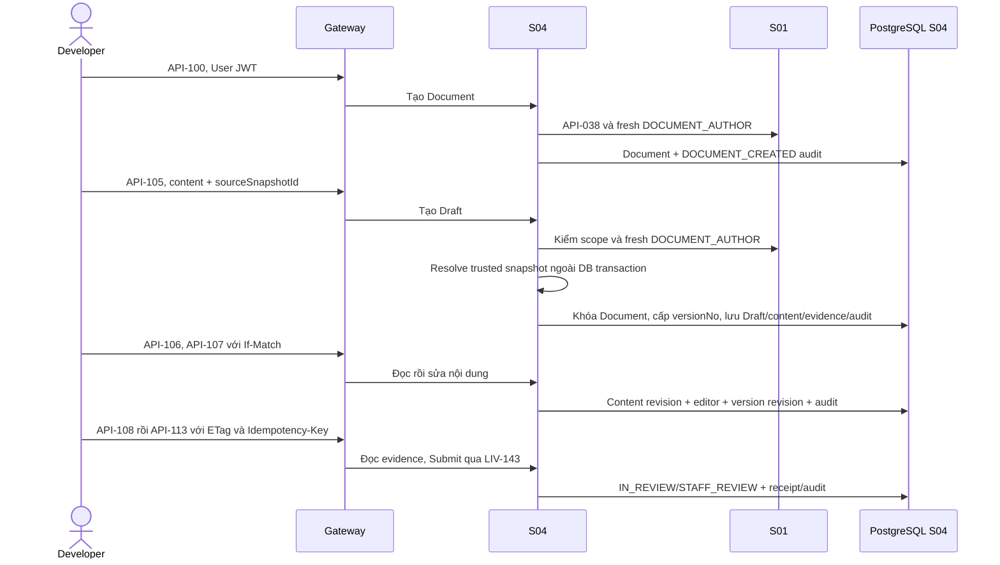

# LIV-164 — S04 Developer Document APIs

## Kết quả và baseline

LIV-164 bổ sung bảy API tạo/đọc/sửa Document và Draft trên nền S04 của LIV-143. Demo tạo Document và Draft qua HTTP, sửa Markdown, đọc evidence rồi gọi API-113 để chuyển sang `IN_REVIEW / STAFF_REVIEW`.

- Jira [LIV-164](https://huutiense25.atlassian.net/browse/LIV-164). Submit theo [LIV-143](https://huutiense25.atlassian.net/browse/LIV-143).
- Nhánh `feature/LIV-164-s04-developer-document-apis`, từ `f8457b1f6318fa1b3d81e348aa18d014412d7931`. SHA lấy theo plan người dùng duyệt; chat chưa ghi nhận Hải xác nhận SHA riêng.
- Worktree `D:/uth/xdpmhdt/LivingDocs/LivingDocs/.worktrees/liv-164`.
- Content là Markdown, collection được chuẩn bị sẵn, upstream fixture trong môi trường test riêng theo lựa chọn người dùng.

## Luồng và cấu trúc



`DocumentAuthoringController` gọi `DocumentAuthoringService`/`DocumentAuthoringServiceImpl`. Controller map typed result qua MapStruct và `SuccessResponse<T>`. `DocumentAuthoringRepository` dùng JPA; dùng lại tenant RLS và scope locks của `DocumentVersionRepository`. `S01DocumentAuthorizationClient` dùng transport API-038 hiện hữu. Fresh client có overload `AuthorizationScope` để authoring kiểm quyền trước khi version tồn tại, đồng thời giữ method cũ cho Submit/Review.

Đọc scope trong transaction riêng, đóng trước HTTP S01/provider, sau ALLOW khóa và kiểm lại resource scope trước khi ghi. Content edit chỉ chạy ở DRAFT, kiểm strong If-Match và dùng version counter chung. Pessimistic force increment tăng revision khi chỉ thay bảng content con. History/editor/audit cùng transaction.

## Public API

| API | Method/path | Request và kết quả |
| --- | --- | --- |
| 100 | POST /api/v1/workspaces/{workspaceId}/documents | collectionId, title, repositoryConnectionId → 201 DOCUMENT_CREATED. Ownership từ actor. |
| 101 | GET /api/v1/documents/{documentId} | 200 DOCUMENT_LOADED. currentVersionId theo versionNo cao nhất; null khi chưa có version. |
| 104 | GET /api/v1/documents/{documentId}/versions | page=0, size=20, size tối đa 100; versionNo giảm dần → DOCUMENT_VERSIONS_LOADED. |
| 105 | POST /api/v1/documents/{documentId}/versions | content, sourceSnapshotId → 201 DOCUMENT_VERSION_CREATED, DRAFT/reviewStage null/revision 0 và ETag. |
| 106 | GET /api/v1/document-versions/{versionId} | 200 DOCUMENT_VERSION_LOADED, ETag, content, contentRef/contentAvailable, creator, provenance. |
| 107 | PATCH /api/v1/document-versions/{versionId}/content | content và If-Match → 200 DOCUMENT_CONTENT_UPDATED và ETag mới. |
| 108 | GET /api/v1/document-versions/{versionId}/evidence | 200 DOCUMENT_EVIDENCE_LOADED, binding và evidenceId/type/sourceRef/artifactRef. |
| 113 | POST /api/v1/document-versions/{versionId}/submit | LIV-143 giữ body note, If-Match/Idempotency-Key, fresh auth và receipt/replay. |

Content tối đa 100000 ký tự, cho phép rỗng. Chỉ API-105 tạo version; API-100 tạo Document chưa có version. Mỗi POST được chấp nhận tạo resource mới, nên client cần xác định kết quả trước khi retry. UUID, creator, state/stage, revision và source provenance do server kiểm soát. Browser chỉ chọn sourceSnapshotId.

Lỗi dùng RFC 9457 với code/correlationId. Các mã mới gồm DOCUMENT_RESOURCE_NOT_FOUND, SOURCE_SNAPSHOT_UNAVAILABLE và RESOURCE_INACTIVE. If-Match thiếu trả 428 PRECONDITION_REQUIRED, stale/scope race trả 412 REVISION_CONFLICT, sửa ngoài DRAFT trả 409 STATE_TRANSITION_FORBIDDEN. Auth và persistence giữ hành vi S04 hiện có.

## Flyway và compatibility

V5 thêm `content_markdown` nullable vào `content_revisions`. Content ref là tham chiếu do server sinh. Với dữ liệu cũ chỉ có ref, API-106 trả content null/contentAvailable false và không fetch nội dung bên ngoài.

Audit DOCUMENT_CREATED được phép thiếu version/state vì xảy ra trước API-105. Những action phiên bản vẫn bắt buộc versionId/newState qua CHECK. FK Document bảo vệ cả audit cấp Document. RLS và quyền append-only tiếp tục được kiểm bằng test. V1–V4 giữ nguyên checksum.

OpenAPI S04 public lên 0.4.0. Bảy operation LIV-164 là IN_PROGRESS, có schema cụ thể và được so YAML/runtime/HTTP trong tests. Schema trả Submit/Staff Review tiếp tục giữ shape riêng. Gateway đã có route, code Gateway giữ baseline. CI cập nhật expected migrations S04 từ 4 thành 5.

## Nguồn và fixture

Reads yêu cầu WORKSPACE_VIEW + DOCUMENT_READ và repository access. Authoring yêu cầu Developer + DOCUMENT_AUTHOR và fresh API-039. Tenant/Workspace/repository lấy từ scope đã kiểm, actor lấy từ S01 Identity.

S01 hiện chỉ cấp source:resolve cho S03. Provider snapshot production của LIV-164 mặc định trả 503 SOURCE_SNAPSHOT_UNAVAILABLE. Provider tin cậy khi được tích hợp phải trả snapshot đúng ID/scope, SHA/ref/config revision/capturedAt và evidence đầy đủ.

`AuthoringFixtureApplication` nằm trong src/test và được runner load tường minh bằng test classpath. Production JAR không chứa launcher này. Runner dùng S01/Gateway/S04 thật, PostgreSQL/Redis tạm và fixture collection/role/VERIFIED grant/source snapshot. Document, Draft, content và submit đều gọi API. Kết quả này chứng minh demo tích hợp với upstream fixture; connection/grant lifecycle/GitHub evidence thật còn cần tích hợp và chạy lại.

## Chạy lại

Từ module S04, Java 21 và Docker Desktop sẵn sàng:

```powershell
.\mvnw.cmd -B -ntp '-DargLine=-Duser.timezone=UTC' clean verify
```

Timezone UTC khắc phục PostgreSQL từ chối alias JVM Asia/Saigon trên máy kiểm thử. Định dạng thời gian API tiếp tục dùng timestamp/Instant.

Build S01 và Gateway từ cùng worktree bằng Maven package. S04 package cũng biên dịch test classes, giữ fixture launcher ngoài production JAR. Sau đó từ root:

```powershell
python -X utf8 scripts/test_api164_authoring.py --newman-cli <absolute-path-to-newman/bin/newman.js>
```

Runner đặt evidence ở `backend/document-governance-service/target/liv164-authoring-integration.json`. Chỉ report tổng hợp và resource IDs được lưu, credential và raw Newman report được dọn cùng môi trường tạm. Runner API-113 hiện hữu vẫn chạy bằng `scripts/test_api113_s01_integration.py --gateway-newman --newman-cli <path>`.

Các URI API-038 authoring dùng cấu hình Submit hiện hữu. Fresh transport dùng namespace `livingdocs.authorization.*` và alias cũ của LIV-143. Workload secret/registry cần operator provision khi tích hợp môi trường thật.

## Verification

Baseline S04 tại f8457b1 đã chạy 102/102 tests. S04 LIV-164 đã chạy 113/113 tests trên PostgreSQL 17, gồm concurrency, fresh DENY/outage, IDOR/RLS, audit rollback, legacy content, OpenAPI parity và restart application/server/pool. Kiểm chứng runtime cuối và hashes được ghi tại `LIV-164-verification.json` cùng thư mục.


| Kiểm chứng cuối | Kết quả |
| --- | --- |
| S04 clean verify | 113 tests, 0 failures/errors/skips |
| LIV-164 Gateway/Newman | 15 requests, 50 assertions, 0 failures/skips và 9 runner checks |
| API-113 regression Gateway/Newman | 34 requests, 60 assertions và 36 runner checks |
| Static OpenAPI/Gateway | 6 schemas VALID, 114 APIs/91 entries/19 groups |
| Git/migrations/packaging | diff check PASS, V1–V4 unchanged, fixture launcher absent from production JAR |
