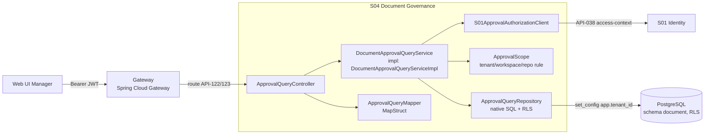
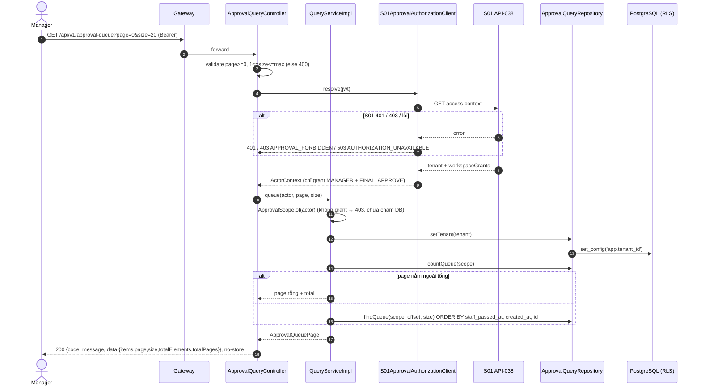
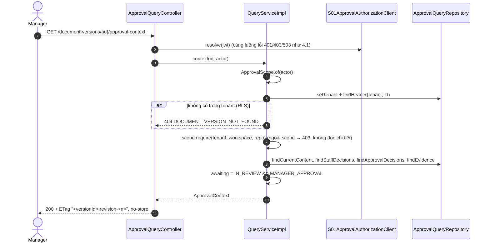

# LIV-98 — API-122 Approval Queue và API-123 Approval Context (Manager, S04)

**Người làm:** Thịnh (thinh vo), có AI hỗ trợ. **Cập nhật:** 27/11/2026, UTC+7.
**Nhánh:** `feature/LIV-98-s04-approval-queue-context`, tách từ `feature/LIV-118-s04-review-state-persistence` @ `9d38de5`.
**Trạng thái:** đã kiểm thử local (Maven, real stack S01 + Gateway + S04, Newman). Chưa push, chưa PR, chưa có remote CI và chưa có reviewer độc lập.

> Jira key **LIV-98** là key tạm. Nhờ anh Tiền tạo sub-task riêng cho API-122/123 rồi đổi tên nhánh và commit theo key đó.

## 1. Phạm vi

| API | Method + path | Mục đích |
|---|---|---|
| API-122 | `GET /api/v1/approval-queue?page&size` | Danh sách version đang chờ Manager duyệt, trong phạm vi Manager có quyền |
| API-123 | `GET /api/v1/document-versions/{versionId}/approval-context` | Toàn bộ ngữ cảnh để Manager quyết định một version: nội dung hiện tại, source binding, quyết định của Staff, các vòng Manager trước, evidence |

Cả hai là **read-only**: không đổi state, không ghi decision, không ghi audit. Quyết định duyệt (API-124) nằm ngoài phạm vi. API-124 sẽ dùng API-123 làm nguồn dữ liệu hiển thị, còn If-Match của nó dùng ETag mà API-123 trả về.

## 2. Nghiệp vụ mô tả bằng lời

1. Một tài liệu đi qua flow1: Developer submit (API-119) → Staff review → Staff **PASS** (API-120) → version chuyển sang `state=IN_REVIEW, review_stage=MANAGER_APPROVAL`. Từ thời điểm này version nằm trong **hàng chờ của Manager**.
2. Manager mở màn hình hàng chờ (API-122) và chỉ thấy các version:
   - thuộc **tenant của mình** (RLS PostgreSQL chặn ở tầng DB);
   - thuộc **workspace** mà Manager có role `MANAGER` và permission `DOCUMENT_FINAL_APPROVE`;
   - và **repository** của tài liệu nằm trong danh sách repository đã VERIFIED của chính workspace đó. Tài liệu không gắn repository vẫn hiển thị nếu workspace đúng.
   - Quyền **không được cộng dồn giữa các workspace**: repo X được cấp ở workspace B không mở tài liệu repo X ở workspace A.
3. Thứ tự hàng chờ: version **Staff PASS sớm nhất lên đầu** (FIFO, công bằng cho người submit). Version cùng thời điểm thì xếp theo thời gian tạo, cuối cùng theo id để thứ tự ổn định giữa các trang.
4. Manager bấm vào một dòng → API-123 trả đầy đủ ngữ cảnh. Cờ `awaitingManagerDecision=true` chỉ khi version đang ở đúng `IN_REVIEW/MANAGER_APPROVAL`. Version ở giai đoạn khác (Staff review, Draft, Approved…) vẫn đọc được (200) nhưng cờ là `false`, để UI biết không hiển thị nút Approve/Return.
5. Quyền được lấy **mới mỗi request** từ S01 (API-038), không cache. Manager bị thu hồi role thì request kế tiếp bị 403 ngay, dù JWT cũ vẫn còn hạn.
6. Khi S01 không trả lời, hệ thống **fail closed** với 503 `AUTHORIZATION_UNAVAILABLE` và không trả dữ liệu.
7. Version thuộc tenant khác trả **404** (không lộ chuyện nó tồn tại). Version cùng tenant nhưng ngoài workspace/repository được cấp trả **403** `APPROVAL_FORBIDDEN`.

## 3. High level design



| Tầng | Lớp | Trách nhiệm |
|---|---|---|
| Controller | `ApprovalQueryController` | Validate `page`/`size`, giới hạn `max-page-size`, header `Cache-Control: no-store`, `ETag` cho API-123, bọc `SuccessResponse.of(SuccessCode, data)` |
| Service | `DocumentApprovalQueryService` + `impl` | Rule nghiệp vụ: dựng scope trước mọi truy vấn DB, đặt tenant RLS, phân trang, 404 trước 403, tính `awaitingManagerDecision`. `@Transactional(readOnly = true)` |
| Domain model | `ApprovalScope`, `ApprovalQueueItem`, `ApprovalQueuePage`, `ApprovalContext` | Record bất biến, `ApprovalScope.covers/require` là luật phân quyền duy nhất |
| Client | `S01ApprovalAuthorizationClient` | Dùng lại `S01AccessContextClient` (API-038) có sẵn, lọc grant `MANAGER` + `DOCUMENT_FINAL_APPROVE`, map lỗi S01 sang exception có kiểu |
| Repository | `ApprovalQueryRepository` | Native SQL read-only trong transaction `MANDATORY`. `set_config('app.tenant_id', …, true)` |
| DTO / Mapper | `ApprovalQueueResponse`, `ApprovalContextResponse`, `ApprovalQueryMapper` | Hợp đồng JSON tách khỏi model. MapStruct `unmappedTargetPolicy=ERROR`. Phần `version` dùng lại `ReviewResponse` (DocumentVersionView) của LIV-118 |
| Error | `InsufficientApprovalScopeException`, `ApprovalAuthorizationUnavailableException`, `ReviewErrorCode.APPROVAL_FORBIDDEN` | RFC 9457 `application/problem+json` có `code` và `correlationId` qua handler sẵn có |

Thiết kế dùng lại hạ tầng của LIV-118/LIV-143 (JWT resource server, `S01AccessContextClient`, problem handler, `VersionEtags`, RLS) nên không có code mock hay nhánh "tạm" trong runtime. Mock chỉ nằm trong test.

## 4. Sequence các luồng chính

### 4.1 API-122 — Hàng chờ



### 4.2 API-123 — Approval context



## 5. Ma trận status

| Status | Khi nào | API-122 | API-123 |
|---|---|---|---|
| 200 | Thành công (queue rỗng vẫn 200) | ✓ | ✓ (kèm ETag) |
| 400 `INVALID_REQUEST` | `page<0`, `size<1`, `size>max`, versionId không phải UUID | ✓ | ✓ |
| 401 | Thiếu hoặc sai JWT, S01 báo unauthenticated (có `WWW-Authenticate`) | ✓ | ✓ |
| 403 `APPROVAL_FORBIDDEN` | Không có grant Manager, hoặc version ngoài workspace/repo được cấp | ✓ | ✓ |
| 404 `DOCUMENT_VERSION_NOT_FOUND` | Version không tồn tại trong tenant | – | ✓ |
| 406 | `Accept` không hỗ trợ | ✓ | ✓ |
| 500 | Lỗi không lường trước (problem+json, không lộ stack) | ✓ | ✓ |
| 503 `AUTHORIZATION_UNAVAILABLE` | S01 không truy cập được: fail closed | ✓ | ✓ |

OpenAPI đã cập nhật đầy đủ input, output và status trong `contracts/openapi/s04-document.yaml` (operationId `getApprovalQueue`, `getApprovalContext`, `x-contract-state: IN_PROGRESS`). Schema mới: `ApprovalQueueView`, `ApprovalQueueItem`, `ApprovalContextView`, `ApprovalContent`, `ApprovalStaffDecision`, `ApprovalManagerDecision`, `ApprovalEvidence`. Test runtime so sánh springdoc `/v3/api-docs` với file YAML tĩnh. Theo tiền lệ API-113, mỗi method + path chỉ được mô tả ở một spec nên contract đặt trong `s04-document.yaml`. `s04-document-review.yaml` chỉ thêm `APPROVAL_FORBIDDEN` vào enum Problem.

## 6. Kiểm thử và bằng chứng (27/11/2026)

| Mức | Nội dung | Kết quả |
|---|---|---|
| Unit: `ApprovalScopeTest` | Phân lớp tương đương tenant/workspace/repo, không cộng dồn grant, repo null | 7/7 |
| Unit: `S01ApprovalAuthorizationClientTest` | Lọc grant, map lỗi S01 → 401/403/503 | 3/3 |
| Unit: `DocumentApprovalQueryServiceImplTest` | 403 trước DB, phân trang, trang vượt tổng, 404, 403 không đọc chi tiết, cờ awaiting | 7/7 |
| Integration: `ApprovalQueryApiIntegrationTest` | PostgreSQL thật, JWT thật, S01 stub HTTP. Scope/thứ tự, BVA page/size, queue rỗng, 401/403/503, ETag, stage khác, 404/400, DB không đổi sau khi đọc, parity OpenAPI runtime với tĩnh | 9/9 |
| Regression toàn S04 (`mvn verify`) | 91 test cũ của LIV-118/LIV-143 + 26 test mới | **117/117 PASS** |
| Real stack: `scripts/test_api122_123_integration.py` | S01 + Gateway + S04 jar thật, PostgreSQL/Redis tạm. Đăng ký/đăng nhập thật, API-038 thật, RLS cross-tenant, thu hồi/khôi phục role với cùng JWT, tắt S01 → 503, snapshot DB không đổi | **17/17 PASS** |
| Newman qua Gateway: `tests/postman/liv98-approval-read.postman_collection.json` | 3 phase: Manager reads / Revoked Manager / S01 unavailable | **23 requests, 28 assertions, 0 fail** |
| Static: `scripts/validate_gateway_openapi.py` | Inventory và route | PASS (114 API) |

Bằng chứng lưu tại [LIV-98-test-evidence.json](LIV-98-test-evidence.json). File không chứa password hay token.

### Cách chạy

```powershell
# Working directory: repository root. Cần Java 21, Python 3, Node, Docker (hoặc PostgreSQL/Redis local)
cd backend/identity-organization-service; mvn -B -ntp -DskipTests package; cd ../..
cd infrastructure/api-gateway; mvn -B -ntp -DskipTests package; cd ../..
cd backend/document-governance-service; mvn -B -ntp verify; cd ../..
npm.cmd install --prefix "$env:TEMP/livingdocs-newman" newman@6.2.3 --no-audit --no-fund
python -X utf8 scripts/test_api122_123_integration.py --newman --newman-cli "$env:TEMP/livingdocs-newman/node_modules/newman/bin/newman.js"
# Không có Docker: thêm --local-pg-bin <thư mục bin PostgreSQL 16> --local-redis <redis-server>
```

Runner tự dựng DB tạm, seed fixture, đổi trạng thái giữa các phase (thu hồi role, tắt S01) rồi dọn sạch. Không dùng `.env` hay DB ứng dụng. Chạy folder Newman lẻ trên môi trường không được chuẩn bị sẽ cho kết quả không hợp lệ.

## 7. Quyết định đã chọn (cần anh Tiền xác nhận)

| # | Vấn đề | Đã chọn | Lý do |
|---|---|---|---|
| 1 | Base branch | Tách từ LIV-118 của Hải (chưa merge) | API-122/123 cần bảng `review_decisions`, `review_stage` và `ReviewResponse` của LIV-118. PR nên mở sau khi LIV-118 merge, hoặc đặt base là nhánh LIV-118 |
| 2 | No Self Final Approval | API đọc **không** chặn và **không** gắn cờ self-approval | Rule này thuộc API-124/LIV-120 (thời điểm ghi quyết định). Nếu UI cần ẩn nút thì có thể thêm field sau |
| 3 | Version không ở MANAGER_APPROVAL | API-123 vẫn 200, `awaitingManagerDecision=false` | Manager xem lại lịch sử được, UI dựa vào cờ để ẩn nút |
| 4 | Kích thước trang | Mặc định 20, tối đa 100 (`S04_APPROVAL_QUEUE_MAX_PAGE_SIZE`) | Chặn truy vấn quá lớn |
| 5 | Thứ tự hàng chờ | Staff PASS sớm nhất trước | FIFO |
| 6 | Version contract | Giữ `0.2.0`, state `IN_PROGRESS` | Chưa biết quy ước bump của nhóm |

## 8. Giới hạn và phụ thuộc

| Hạng mục | Trạng thái |
|---|---|
| Version ở MANAGER_APPROVAL trong runner | **Controlled SQL fixture**. API-120 PASS thật cần S02 source adapter (đang thiếu), nên flow1 end-to-end chưa chạy liền một mạch được |
| Repository grant | Fixture SQL `VERIFIED`, chưa qua quy trình Request/Verify/Activate production |
| API-124 (quyết định Manager) | Ngoài phạm vi, dùng ETag của API-123 |
| Remote CI / review / deploy | Chưa có |

## 9. Đối chiếu Master Decision

| Quy tắc | Bằng chứng |
|---|---|
| Layered architecture, Service interface + Impl, constructor injection | Mục 3 |
| JPA/Hibernate, Flyway, RLS | Không thêm migration. Truy vấn native read-only trong transaction `MANDATORY` với tenant RLS. `ddl-auto=validate` giữ nguyên |
| API contract | Success envelope `SuccessResponse`, RFC 9457, OpenAPI tĩnh = runtime (test parity) |
| Test criteria | Unit (happy/bad), integration DB thật, real stack, Newman qua Gateway |
| Gitflow | Không merge `develop`/`main`, không merge PR cũ chưa review |

## 10. File thay đổi

**Mới (S04 main):**
- `client/S01ApprovalAuthorizationClient`
- `controller/ApprovalQueryController`
- `dto/response/ApprovalQueueResponse`, `dto/response/ApprovalContextResponse`
- `exception/InsufficientApprovalScopeException`, `exception/ApprovalAuthorizationUnavailableException`
- `mapper/ApprovalQueryMapper`
- `model/ApprovalScope`, `model/ApprovalQueueItem`, `model/ApprovalQueuePage`, `model/ApprovalContext`
- `repository/ApprovalQueryRepository`
- `service/DocumentApprovalQueryService`, `service/impl/DocumentApprovalQueryServiceImpl`

**Sửa:**
- `ReviewErrorCode`, `SuccessCode`, `ReviewProblem`, `ReviewSecurityConfiguration`, `application.yaml`
- `ReviewApiIntegrationTest`: thêm 2 path vào danh sách runtime path

**Test:**
- `approval/ApprovalScopeTest`, `approval/S01ApprovalAuthorizationClientTest`, `approval/DocumentApprovalQueryServiceImplTest`
- `ApprovalQueryApiIntegrationTest`

**Contract / tooling:**
- `contracts/openapi/s04-document.yaml`, `s04-document-review.yaml`, `sprint3-route-inventory.json`
- `tests/postman/liv98-approval-read.postman_collection.json`
- `scripts/test_api122_123_integration.py`
- Report này và `LIV-98-test-evidence.json`
