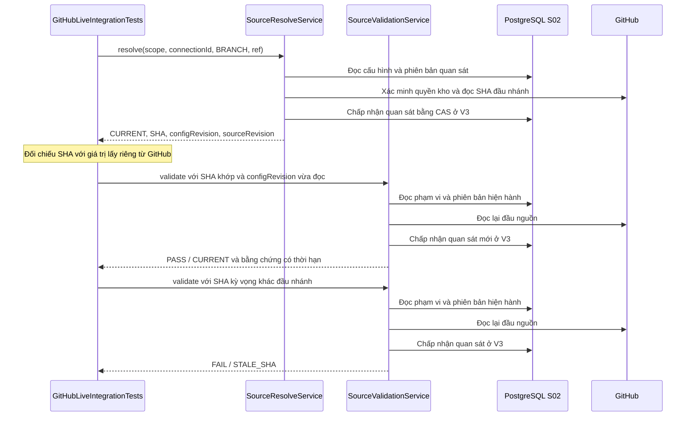

# LIV-122 — Chạy thử nghiệp vụ với GitHub thật

## 1. Phạm vi

Bài `GitHubLiveIntegrationTests` gọi giao diện nghiệp vụ `SourceResolveService` và `SourceValidationService` qua Spring, dùng GitHub App và PostgreSQL thật. Bài được bật riêng bằng `-Dlivingdocs.github.live=true`. Lần chạy Maven thông thường bỏ qua bài này.

Đây là bằng chứng tích hợp tầng nghiệp vụ. Phần HTTP, xác thực dịch vụ và tích hợp S04 có tiêu chí kiểm thử riêng trong kế hoạch S02. Kết quả bài này chưa đủ để đánh dấu LIV-122 hoàn thành.

## 2. Điều kiện và dữ liệu thử

- Docker Desktop đang chạy và PostgreSQL của dự án hoạt động.
- S02 có `.env` trong `backend/repository-integration-service`, với cấu hình DB ứng dụng, Flyway và GitHub App. Có thể đối chiếu `.env.example` trong cùng thư mục.
- Khóa `.pem` nằm trong thư mục ngoài kho mã nguồn đã đặt ở `LIVINGDOCS_SOURCE_GITHUB_KEYDIRECTORY`.
- App đã được cài vào kho thử, có quyền đọc nội dung (`Contents: Read-only`) và yêu cầu hợp nhất (`Pull requests: Read-only`).
- Nhánh `main` đã có ít nhất một lần ghi mã nguồn (`commit`). Giữ đầu nhánh ổn định trong lúc chạy bài kiểm thử.

Đường dẫn thư mục khóa trong `.env` dùng dấu `/`, ví dụ `C:/Users/admin/Documents/KEY_GITHUBAPP`. S02 nhập tệp này dưới định dạng thuộc tính (`properties`); dấu `\` có thể bị diễn giải thành ký tự thoát và làm sai đường dẫn.

Kết nối thử ngày 19/11/2026 sử dụng các giá trị sau. Khi dùng kho khác, kiểm tra lại ID kho và mã cài đặt tương ứng.

| Thông tin | Giá trị |
|---|---|
| Kho thử | [TienTuiTeen1405/livingdocs-s02-test](https://github.com/TienTuiTeen1405/livingdocs-s02-test) |
| ID kho trên GitHub (`repository ID`) | `1463763176` |
| Mã cài đặt App (`Installation ID`) | `183597993` |
| Nhánh đầy đủ (`ref`) | `refs/heads/main` |
| Đơn vị thử (`tenantId`) | `12200000-0000-4000-8000-000000000001` |
| Không gian làm việc thử (`workspaceId`) | `12200000-0000-4000-8000-000000000002` |
| Kết nối kho trong S02 (`repositoryConnectionId`) | `12200000-0000-4000-8000-000000000004` |

Tenant và workspace trên là định danh dữ liệu thử cục bộ. Luồng HTTP có xác thực sẽ lấy phạm vi từ danh tính được xác minh theo hợp đồng.

### Nạp dữ liệu kết nối khi chuẩn bị DB mới

Chạy PowerShell ở thư mục gốc dự án. Thay tên khóa bằng đúng tên tệp `.pem` trên máy. Tham chiếu khóa (`credential_ref`) chỉ chứa tên tệp. Nội dung khóa vẫn nằm trên máy.

```powershell
docker compose -f infrastructure/docker/compose.yaml up -d postgres

# Chạy cấu hình S02 Local một lần để Flyway tạo V1/V2/V3 trước khi nạp dữ liệu.
Get-Content -LiteralPath backend/repository-integration-service/src/test/resources/liv122/github-live-fixture.sql -Raw |
    docker compose -f infrastructure/docker/compose.yaml exec -T postgres psql `
        -U postgres -d livingdocs -X -v ON_ERROR_STOP=1 `
        -v installation_id=183597993 -v repository_id=1463763176 `
        -v credential_ref=TEN_TEP_KHOA_CUA_BAN.pem
```

Tệp dữ liệu thử (`fixture`) tạo ba bản ghi ở `github_connections`, `repository_connections`, `tracked_branches`, trong một giao dịch và dưới quyền `ld_s02_app`. Nạp lại cùng cấu hình giữ nguyên dữ liệu. Nếu bản ghi đã tồn tại với cấu hình khác, tệp thoát lỗi và hoàn tác. Bảng V3 `source_target_heads` được nghiệp vụ ghi khi đọc GitHub thành công.

### Cấu hình đầu vào bài kiểm thử

Đặt các giá trị sau trong `.env` của S02. Sao chép SHA đầy đủ 40 ký tự của lần commit mới nhất trên nhánh `main` tại GitHub. SHA là mã định danh đối tượng commit, dùng để đối chiếu đúng phiên bản mã nguồn.

```properties
LIV122_TEST_TENANT_ID=12200000-0000-4000-8000-000000000001
LIV122_TEST_WORKSPACE_ID=12200000-0000-4000-8000-000000000002
LIV122_TEST_CONNECTION_ID=12200000-0000-4000-8000-000000000004
LIV122_TEST_REF=refs/heads/main
LIV122_TEST_EXPECTED_SHA=SAO_CHEP_SHA_DAY_DU_TU_GITHUB
```

## 3. Bấm chạy trong IntelliJ

1. Mở danh sách cấu hình chạy trên thanh công cụ và chọn **S02 GitHub Live Test**. Cấu hình được lưu ở `.run/S02 GitHub Live Test.run.xml`.
2. Bấm **Run**. Bài kiểm thử tự khởi tạo Spring và dùng cấu hình `.env` của S02; có thể chạy khi tiến trình S02 Local đã dừng.
3. Chờ bài kiểm thử chuyển xanh. Kiểm tra dòng `LIV-122 LIVE PASS` trong cửa sổ kết quả.
4. Nếu muốn theo dõi từng bước, mở lớp kiểm thử, đặt điểm dừng (`breakpoint`) tại `resolver.resolve(...)` hoặc `validator.validate(...)`, rồi bấm **Debug**. Tránh dừng quá lâu trong lần xác minh vì bằng chứng có hạn sử dụng.

Nếu IntelliJ chưa hiện cấu hình, mở **Run → Edit Configurations → JUnit**, chọn lớp `com.livingdocs.service.GitHubLiveIntegrationTests`, mô-đun `repository-integration-service`, thư mục chạy `$PROJECT_DIR$/backend/repository-integration-service`, và tùy chọn máy ảo (`VM options`) `-Dlivingdocs.github.live=true`.

Có thể chạy bằng Maven từ thư mục gốc. Dấu nháy quanh tham số `-D` bảo đảm PowerShell truyền đúng tên thuộc tính.

```powershell
& ./backend/repository-integration-service/mvnw.cmd `
    -B -ntp -f backend/repository-integration-service/pom.xml `
    '-Dtest=GitHubLiveIntegrationTests' '-Dlivingdocs.github.live=true' test
```

## 4. Bài kiểm thử chạy những gì



CAS là kiểm tra phiên bản quan sát trước khi ghi, ngăn một kết quả đọc chậm ghi đè quan sát mới đã được chấp nhận. Trên nhánh giữ nguyên, `sourceRevision` giữ nguyên qua ba lần gọi và `observation_version` tăng ba lần. `sourceRevision` là thế hệ đầu nguồn do S02 quản lý, khác SHA của GitHub.

Ca SHA khác được tạo bằng cách đổi một ký tự của SHA kỳ vọng. Ca này chứng minh phép so sánh từ chối giá trị khác đầu nhánh. Kịch bản nguồn thật đổi từ commit A sang B cần một lần commit mới trên GitHub và được thực hiện riêng.

## 5. Xem kết quả V3

Chạy từ thư mục gốc. Truy vấn dùng đúng tenant và vai trò ứng dụng, có bảo vệ mức hàng (`RLS`).

```powershell
$query = @'
BEGIN;
SET LOCAL ROLE ld_s02_app;
SELECT set_config('app.tenant_id', '12200000-0000-4000-8000-000000000001', true);
SELECT target_ref, head_state, head_sha, observation_version, source_revision, observed_at
FROM repository.source_target_heads
WHERE tenant_id = '12200000-0000-4000-8000-000000000001'
  AND workspace_id = '12200000-0000-4000-8000-000000000002'
  AND repository_connection_id = '12200000-0000-4000-8000-000000000004'
  AND target_kind = 'BRANCH' AND target_ref = 'refs/heads/main';
COMMIT;
'@
$query | docker compose -f infrastructure/docker/compose.yaml exec -T postgres psql `
    -U postgres -d livingdocs -X -v ON_ERROR_STOP=1
```

Kỳ vọng `head_state=PRESENT` và `head_sha` khớp SHA đã đối chiếu. Bài kiểm thử giữ dữ liệu quan sát để có thể xem lại. Mỗi lần chạy đạt tạo thêm ba quan sát nếu nhánh và cấu hình giữ nguyên.

## 6. Khi bài kiểm thử báo lỗi

| Kết quả | Kiểm tra tiếp |
|---|---|
| `UNKNOWN_CONNECTION` | Đã nạp dữ liệu kết nối vào đúng DB chưa; ba ID trong `.env` có khớp fixture không. |
| `CONNECTION_INACTIVE` | Kho đang `ACTIVE`, GitHub đang `CONNECTED`, và `LIVINGDOCS_SOURCE_LOOKUP_GITHUBREADYSTATUSES=CONNECTED`. |
| `UNKNOWN_REF` | Nhánh có được theo dõi và còn tồn tại trên GitHub không. |
| `SOURCE_UNAVAILABLE` | Client ID, khóa App, Installation ID, quyền đọc của App, quyền truy cập kho, kết nối mạng và PostgreSQL. Kết quả nghiệp vụ được lọc thông tin bí mật nên mã này có thể đại diện cho nhiều lỗi kết nối khác nhau. |
| SHA thực tế khác SHA kỳ vọng | Nhánh đã đổi. Sao chép lại SHA đầu nhánh vào `.env` rồi chạy lại. |
| `CONFIG_CHANGED` hoặc `SOURCE_OBSERVATION_CONFLICT` | Cấu hình hoặc quan sát bị thay đổi đồng thời. Kiểm tra tác vụ đang chạy và chạy lại khi dữ liệu thử ổn định. |
| `VALIDATION_EXPIRED` | Quá hạn bằng chứng; kiểm tra độ trễ và chạy lại, tránh giữ breakpoint quá lâu. |
| `Skipped: 1` | Bài chưa bật cờ `livingdocs.github.live=true`. Đây là trạng thái bỏ qua, chưa phải kiểm thử đạt. |

## 7. Các tệp và trách nhiệm

| Tệp trong dự án | Trách nhiệm |
|---|---|
| `backend/repository-integration-service/src/test/java/com/livingdocs/service/GitHubLiveIntegrationTests.java` | Gọi hai giao diện nghiệp vụ bằng dữ liệu thật và kiểm kết quả. |
| `.run/S02 GitHub Live Test.run.xml` | Bật bài kiểm thử và chọn đúng mô-đun, thư mục chạy cho IntelliJ. |
| `backend/repository-integration-service/src/test/resources/liv122/github-live-fixture.sql` | Nạp ba bản ghi kết nối thử trong PostgreSQL cục bộ. |
| `backend/repository-integration-service/.env.example` | Mẫu các biến cấu hình; `.env` trên máy chứa giá trị thực. |

Để xem luồng thực thi chi tiết, từ `resolver.resolve(...)` đi vào `service/impl/SourceResolveServiceImpl.java`, rồi `service/impl/GitHubSourceLookupImpl.java`. Phần tra cấu hình nằm ở `repository/JpaConnectionLookup.java`; phần GitHub nằm ở `client/GitHubInstallationTokenProvider.java` và `client/GitHubSourceClient.java`; phần ghi V3 nằm ở `repository/JpaSourceObservationStore.java`. Lần xác minh đi từ `validator.validate(...)` vào `service/impl/SourceValidationServiceImpl.java` và dùng lại các thành phần đó.

## 8. Bằng chứng chạy cục bộ ngày 19/11/2026

Một bài kiểm thử tích hợp với ba lần gọi nghiệp vụ đã đạt `Tests run: 1, Failures: 0, Errors: 0, Skipped: 0`, dùng PostgreSQL Docker và GitHub App thật. Đầu nhánh đọc được là `351ee46328288729148635e218491be161767f77`. Sau lần chạy đạt đầu tiên, truy vấn bằng vai trò ứng dụng cho kết quả `PRESENT`, `observation_version=3`, `source_revision=1`. Nạp lại fixture cùng cấu hình tạo thêm `0` bản ghi ở cả ba bảng và giữ nguyên dữ liệu quan sát.

Nhật ký lần chạy đạt nằm tại `backend/repository-integration-service/target/liv122-github-live.log` trên máy phát triển. Kiểm tra riêng khi bỏ cờ bật cho kết quả `Skipped: 1`, xác nhận bài GitHub thật được chạy chủ động. Các bằng chứng này giới hạn ở luồng nhánh và ba lần gọi đã mô tả; PR, thay đổi nguồn A → B, HTTP và liên dịch vụ tiếp tục theo ma trận của kế hoạch S02.
