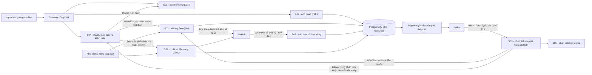
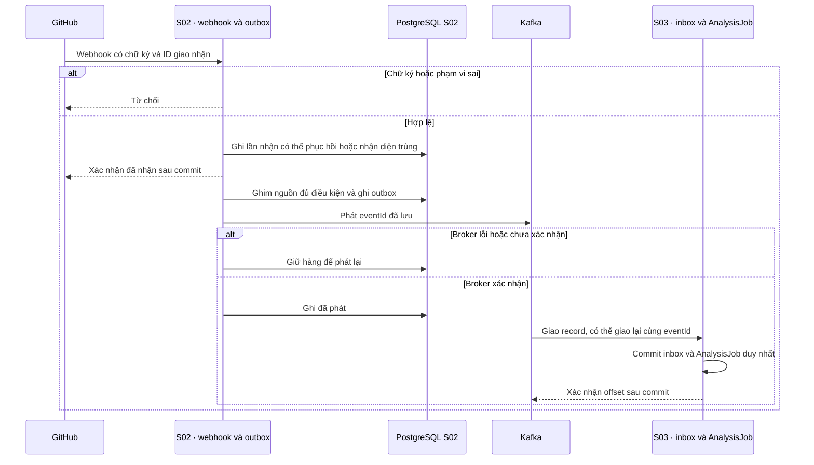
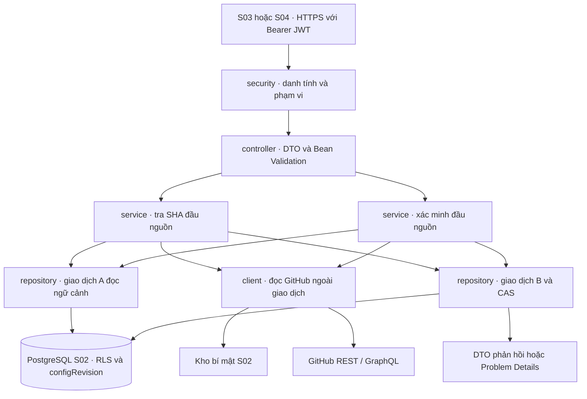
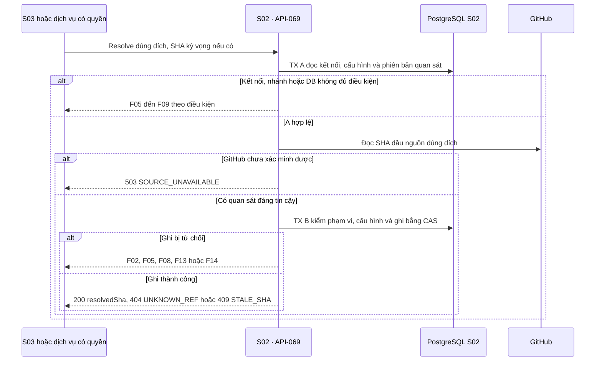
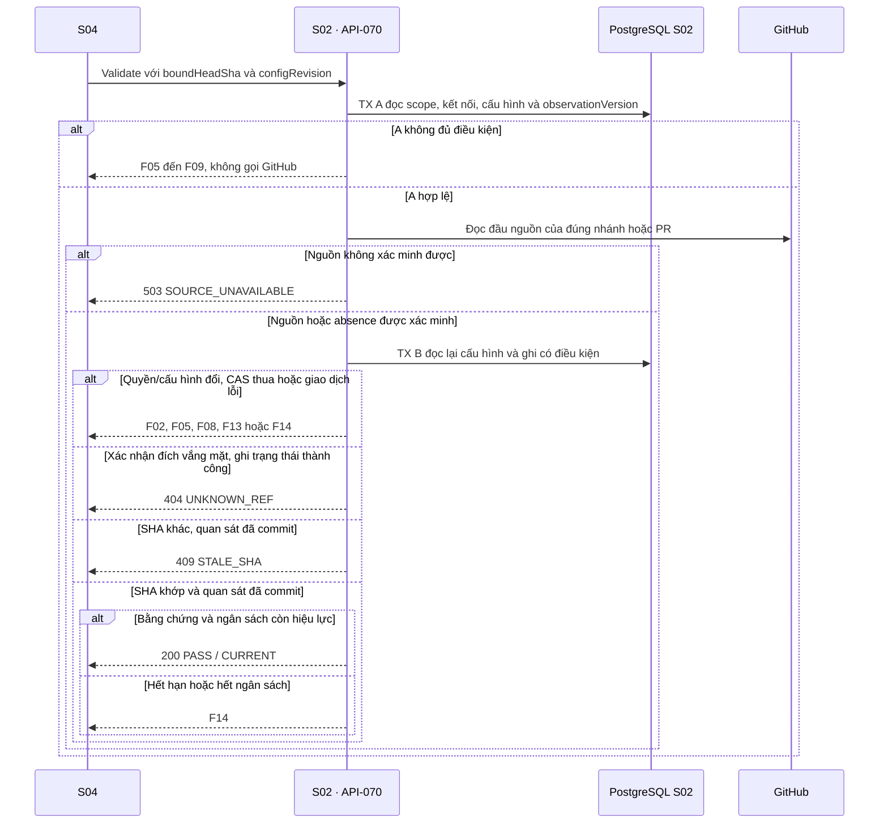
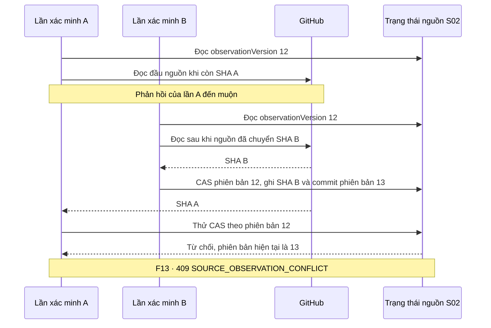
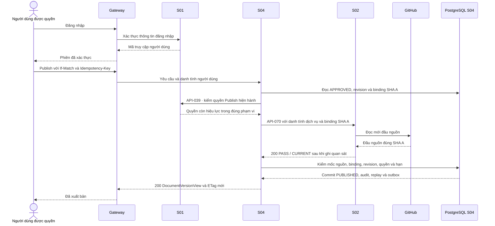
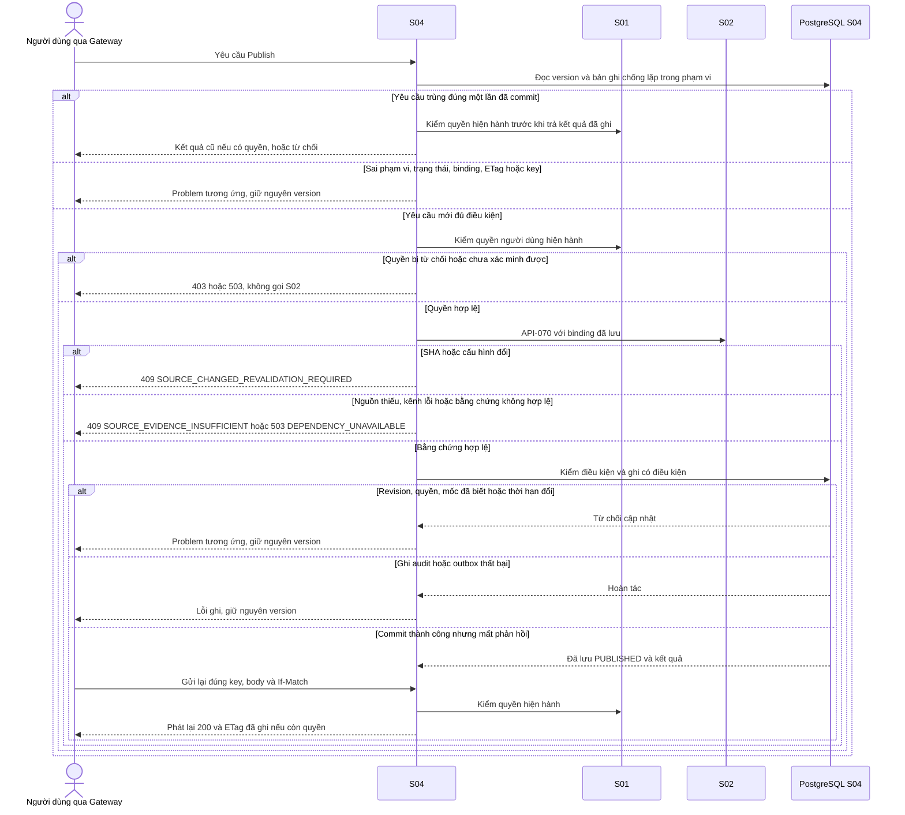

# LivingDocs S02 — Thiết kế và kế hoạch triển khai LIV-122

**Bản triển khai 2.1 · 17/11/2026 · Nhánh local `feature/LIV-122-source-sha-validation`**

Đọc theo thứ tự **phạm vi → hợp đồng HTTP → tra GitHub và giao dịch → sơ đồ → thứ tự viết mã → nghiệm thu**. `API-069` trả SHA đầu nguồn đã xác minh trên GitHub. `API-070` đọc đầu nguồn ngay trong lần gọi và xác minh SHA đã gắn với phiên bản tài liệu. S04 chỉ dùng kết quả của `API-070` cho lần thử xuất bản đang xử lý.

Khi bắt đầu viết mã, vào **§9, bước 1** để chuẩn bị kết nối GitHub thử nghiệm. Dùng hợp đồng ở §4 và ma trận §10 để kiểm từng phần trước khi nối HTTP và S04.

**Thuật ngữ.** SHA là mã băm định danh bản ghi thay đổi (commit). Đầu nguồn (head) là commit mà nhánh hoặc yêu cầu hợp nhất (PR) đang trỏ tới. Bằng chứng dùng được trong thời hạn hiệu lực (TTL). CAS là cập nhật có điều kiện dựa trên phiên bản đã đọc. RLS là chính sách cách ly hàng theo tổ chức (tenant).

## 1. Hiện trạng và phạm vi

| Hạng mục | Hiện trạng và đầu ra cần đạt |
|---|---|
| **LIV-122 · S02** | Jira `In Progress`. Tra kết nối theo phạm vi đã xác thực, tra SHA đầu nhánh hoặc đầu PR và trả bằng chứng có thể kiểm chứng. Bốn kết quả nghiệm thu là SHA hiện hành, SHA cũ, nguồn không tồn tại và nguồn không xác minh được. [LIV-122][liv122] |
| **Mã S02 đang có** | Có bộ đọc SHA GitHub, tra cấu hình bằng `REPEATABLE READ` và ghi đầu nguồn có điều kiện bằng V3. Hai nghiệp vụ resolve/validate đã dùng ngân sách cấu hình qua `SourceRequestExecutor`, timeout HTTP theo thời gian còn lại và giới hạn SQL/khóa cục bộ. Đã nối controller, DTO, MapStruct, Spring Security, Problem Details và OpenAPI runtime cho API-069/070; kiểm thử HTTP local đạt theo §9.2. Danh tính production từ chối mặc định khi chưa có contract issuer/claim được thống nhất. Giới hạn thời gian hiện có ở tầng nghiệp vụ; chưa có bằng chứng deadline bao trùm xác thực/đọc body/ghi phản hồi, phải đánh giá thêm trong §10.5. [Mã tra cứu][lookup] · [Dịch vụ xác minh][validation] · [Ghi chú kiểm thử local][progress] |
| **Cấu hình local đã kiểm thử** | `configRevision` có dạng `v1:<phiên bản kết nối kho>:<phiên bản kết nối GitHub>`. PostgreSQL cập nhật phiên bản khi cấu hình liên quan hoặc nhánh theo dõi thay đổi. Vai trò ứng dụng là `ld_s02_app`, vai trò chạy migration là `ld_s02_migrator`. Lần kiểm tra lại ngày 15/11 chạy `verify` trên PostgreSQL 18.6 và đạt 48/48, với đầu nguồn GitHub giả lập. [V2][v2] · [Truy vấn hiện tại][repoquery] · [Ghi chú kiểm thử local][progress] |
| **Hợp đồng và tích hợp** | Hai điểm cuối S02 vẫn là `INTERNAL_CANDIDATE` trong YAML. API xuất bản `API-127` của S04 là `PLANNED` trên checkout. Tài liệu này định nghĩa đích triển khai; dùng đúng YAML của mỗi service khi cập nhật hợp đồng máy đọc được ở bước tương ứng. [OpenAPI S02][s02spec] · [OpenAPI S04][s04spec] · [LIV-133][liv133] |
| **LIV-123 · S04** | Lưu ràng buộc nguồn của chính phiên bản đã duyệt, kiểm quyền xuất bản hiện hành, gọi S02 và kiểm trạng thái, phiên bản tài liệu, thời hạn bằng chứng. S04 sở hữu giao dịch `PUBLISHED`, kiểm toán và khôi phục phản hồi khi gửi lại cùng yêu cầu. [LIV-123][liv123] |
| **Điều kiện chạy thật** | Ngày 15/11, `LIV-96` và `LIV-137` đang triển khai, `LIV-138` chưa bắt đầu trên Jira. Cần thông tin cấp token dịch vụ theo nền tảng S3-EN01 và kết nối kho GitHub kiểm thử thật. Các bài kiểm thử riêng của S02 có thể triển khai ngay bằng cấu hình kiểm thử có kiểm soát. [LIV-96][liv96] · [LIV-137][liv137] · [LIV-138][liv138] |

**Tiêu chí phân biệt.** Hợp đồng LIV-122 đạt khi hai API S02 chạy thật với PostgreSQL, GitHub và danh tính dịch vụ tin cậy, đồng thời mã, kiểm thử và bằng chứng được rà soát. Câu chuyện xuất bản LIV-99 đạt khi người dùng đi qua S01, Gateway, S04 và S02, rồi đọc lại đúng trạng thái và lịch sử sau khi ghi. [LIV-122][liv122] · [LIV-99][liv99] · [Hướng dẫn Sprint 3–4][sprints]

## 2. Thiết kế tổng thể S02



| Nhóm việc toàn S02 | Phần cần triển khai và kết quả cần chứng minh |
|---|---|
| Kết nối và vòng đời kho, `API-046–052` | Cấp quyền GitHub App theo phạm vi, liên kết kho với workspace, liệt kê, xem trạng thái, ngắt kết nối, cấp quyền lại và đồng bộ. Giữ lịch sử nghiệp vụ và chứng minh kho ngoài quyền bị từ chối. |
| Đọc và cấu hình nguồn, `API-053–067` | PR, commit, lịch sử sự kiện, quản lý nhánh theo dõi, yêu cầu kiểm tra lại, chính sách kích hoạt và quy tắc hợp nhất. Tách xác minh PR khỏi xử lý chính thức của nhánh theo dõi. |
| Tra cứu và xác minh nguồn, `API-069–070` | **LIV-122**. Tra SHA đúng đích và xác minh đầu nguồn thật cho S04. PostgreSQL giữ phạm vi, cấu hình và đầu nguồn quan sát gần nhất. GitHub cung cấp đầu nguồn hiện hành. |
| Đọc nội dung nguồn, `API-071` | S03 đọc đoạn mã theo SHA cố định qua API có phân quyền, giới hạn dữ liệu và truy vết bằng chứng. |
| Nhận sự kiện và chuyển việc, `API-068` | LIV-124 xác minh HMAC của thân yêu cầu gốc, chống trùng lần giao nhận, ghi lưu trữ bền vững và phát Kafka. LIV-125 ghi inbox và `AnalysisJob` trước khi xác nhận đã nhận record. LIV-126 hiển thị trạng thái công việc. Thử dừng broker, phát lại và khởi động lại consumer. |
| Xuất tài liệu, `API-072–074` | S04 chỉ gửi lệnh cho phiên bản đã xuất bản. S02 ghi lần thực hiện, nguồn gốc (`provenance`) của thay đổi, đối soát khi mất phản hồi và chặn tự kích hoạt lại đúng phần thay đổi do export. |
| Quản trị và vận hành, `API-075–076` | Cấu hình cấp nền tảng bằng tham chiếu bí mật, kiểm tra quyền quản trị, quan sát lỗi/độ trễ và phục hồi. Kubernetes, biểu đồ theo dõi và các ca gián đoạn thực hiện theo đầu việc hạ tầng tương ứng. |

YAML S02 Sprint 3 hiện khai báo 18 điểm cuối. Các nhóm khác được tra theo danh mục LD-API-001. Luồng xuất bản của LIV-122 gọi GitHub đồng bộ. Kafka, webhook và xử lý job có vòng đời riêng. S02 cung cấp dữ liệu nguồn qua API có phân quyền. S05 nhận ngữ cảnh đã giới hạn qua luồng phân tích. [LD-API-001, mục 3.2][ldapi] · [Danh mục Sprint 3][inventory] · [Ranh giới dịch vụ][arch03] · [LIV-103][liv103] · [LIV-124][liv124] · [LIV-125][liv125] · [LIV-126][liv126] · [LIV-91][liv91]

### 2.1. Luồng sự kiện nguồn và phục hồi về sau

S02 xác minh HMAC trước khi parse webhook, đối chiếu installation/kho với kết nối đã cấp quyền, rồi dùng khóa giao nhận để loại trùng. Chỉ xác nhận webhook sau khi đã có dữ liệu bền vững để tiếp tục. Bộ xử lý áp dụng rule PR và nhánh theo dõi, đọc đúng đầu nguồn, ghim SHA đã xác minh và ghi sự kiện vào hộp thư gửi. Đầu ra mang ID sự kiện ổn định để consumer nhận lại mà chỉ tạo một việc phân tích. Khi export làm GitHub gửi webhook lại, đối chiếu nguồn gốc đến đúng phần thay đổi do export để giữ các thay đổi bên ngoài trong luồng phân tích. [Luồng sự kiện LIV-103][liv103] · [Webhook LIV-124][liv124] · [Xuất tài liệu LIV-91][liv91]



## 3. Quyết định cho LIV-122

1. **Danh tính và phân quyền.** Dùng HTTPS nội bộ xác minh chứng chỉ và tên máy chủ, kết hợp Bearer JWT ngắn hạn dành riêng cho dịch vụ S02. S04 dùng danh tính workload để xác minh nguồn và S03 dùng danh tính workload để tra SHA đã xác minh. Cổng ứng dụng S02 là `8082`. Gateway công khai chặn `/internal/`. Cơ chế cấp token triển khai theo S3-EN01, với bộ khóa công khai (JWKS) và môi trường tin cậy.
2. **Bằng chứng.** Dùng phản hồi HTTPS trực tiếp cho lần xác minh hiện tại. `validationId` là mã lần xác minh để S04 lưu cùng bằng chứng trong kiểm toán xuất bản. S02 lưu đầu nguồn quan sát gần nhất theo phạm vi và dùng phiên bản để kiểm soát thứ tự ghi.
3. **Định dạng HTTP.** Dùng JSON kiểu cụ thể cho phản hồi `200` và `application/problem+json` cho lỗi. Giữ tên trong OpenAPI là `TRACKED_BRANCH`, `boundHeadSha` và `configRevision`. Bộ ánh xạ chuyển sang `BRANCH`, `expectedHeadSha` và `expectedConfigRevision` trong mã Java hiện tại. S04 và S03 có DTO riêng (đối tượng truyền dữ liệu).
4. **Phiên bản cấu hình.** Dùng nguyên chuỗi `configRevision` do V2 và truy vấn local cấp. Thành phần tham gia quyết định là kết nối kho, trạng thái/định danh cài đặt GitHub, tham chiếu bí mật và cấu hình nhánh theo dõi. Chính sách kích hoạt webhook, merge và export nằm ở nhóm nghiệp vụ riêng.
5. **Nhận diện kho GitHub.** Giữ ID số bất biến của kho đã liên kết trong `external_repo_id`. Dùng GitHub App để cấp token installation phạm vi hẹp; tra node ID từ siêu dữ liệu đã xác minh của đúng ID kho. So ID số ở phản hồi GraphQL khi tra đúng node; đổi tên kho không đổi binding. Giữ thông tin xác thực trong S02.
6. **Ngân sách thời gian tích hợp.** Theo lựa chọn cấu hình ngày 19/11/2026, `API-069/070` dùng ngân sách toàn yêu cầu mặc định 15 giây, lấy từ `LIVINGDOCS_SOURCE_REQUEST_TIMEOUT_SECONDS` trong `.env` của S02 và ánh xạ thành `livingdocs.source.request-timeout`. Khi vận hành, sửa biến này để đổi ngân sách. Máy gọi dùng thời gian chờ lớn hơn ngân sách S02 để nhận được phản hồi lỗi, runner kiểm thử dùng biên 2 giây. TTL bằng chứng 30 giây tính từ thời điểm bắt đầu xác minh. **15 giây là cấu hình local tạm thời, không phải mốc bắt buộc trong Jira hoặc giá trị đã được benchmark.** Theo yêu cầu Owner ngày 19/11/2026, trước khi đánh dấu LIV-122 hoàn thành phải thực hiện phép đo ở §10.5, đề xuất timeout cho từng phần và kiểm chứng lại sau hiệu chỉnh. Dùng đồng hồ đơn điệu cho ngân sách và `Clock` UTC cho thời điểm bằng chứng. Truyền thời gian còn lại xuống GitHub và giới hạn chờ DB/khóa. Bài đo hiệu năng sản phẩm có mục tiêu riêng theo tải. S04 dùng biên an toàn đồng hồ 1 giây khi xác minh và trước khi cập nhật phiên bản.

[Quy tắc ngày 13/11, LD-D02–D12 và mục 4–5][handoff] · [LD-API-001, mục 2.2 và 4.3][ldapi] · [Ranh giới quyền tài nguyên][arch05]

### 3.1. Phạm vi tin cậy trong từng lần gọi

S02 xác thực chữ ký, thuật toán theo cấu hình, nơi phát hành (`iss`), đối tượng nhận dành cho S02 (`aud`), thời hạn (`exp`, `nbf` nếu có), loại danh tính dịch vụ và danh tính workload. Kiểm tra quyền thao tác và phạm vi ủy quyền cụ thể cho **một tenant, một workspace và kết nối kho được gọi**. Dùng `source:resolve` và `source:validate` làm tên quyền nghiệp vụ của S02, ánh xạ từ định dạng quyền đã thống nhất với bên phát hành token. Token người dùng đi qua Gateway để xác thực ở S04. S04 lấy quyền hiện hành cho thao tác xuất bản qua hợp đồng S01 `API-039` khi tích hợp.

Thân yêu cầu của hai API chỉ có mã kết nối và dữ liệu nguồn. S02 lấy tenant/workspace từ ngữ cảnh ủy quyền đã kiểm, so mã kết nối trong body với phạm vi được cấp và kiểm lại quyền S02 sở hữu. Nếu thiết lập môi trường chưa cấp được ngữ cảnh đã ký theo phạm vi, chỉ chạy kiểm thử có khóa và token riêng; đường chạy thực tế từ chối khi thiếu cấu hình đáng tin cậy. Header như `X-Tenant-ID` và `X-User-Role` không được dùng để cấp quyền. Đọc nguồn theo cấp quyền của S03/S04 không đồng nghĩa các service này có quyền đọc DB hoặc bí mật GitHub.

**Quyết định Owner khi triển khai bước 5, ngày 19/11/2026:** chưa có hợp đồng claim dịch vụ S03/S04 → S02; triển khai HTTP với bảo mật từ chối mặc định. `SourceServiceIdentityMapper` là chỗ tích hợp hợp đồng đã review, chỉ nhận JWT đã được `JwtDecoder` xác minh. Khi thiếu decoder hoặc mapper, không cấp quyền. Các claim `test_*` và khóa RSA sinh trong `SourceHttpTests` chỉ thuộc issuer kiểm thử, không phải đề xuất contract production. Việc mở kết nối thật cần đồng bộ bên cấp token, S03/S04 và S02.

```mermaid
sequenceDiagram
    participant C as S03 hoặc S04
    participant S as S02 · HTTPS và Spring Security
    participant D as PostgreSQL S02
    C->>S: POST với token dịch vụ và dữ liệu nguồn
    alt Kênh TLS thất bại
        S--xC: Kết nối không hoàn tất
    else Token thiếu hoặc không hợp lệ
        S-->>C: 401 INVALID_SERVICE_IDENTITY
    else Thiếu quyền thao tác
        S-->>C: 403 FORBIDDEN_SCOPE
    else HTTP hoặc dữ liệu không hợp lệ
        S-->>C: 400, 405, 413 hoặc 415 theo lỗi
    else Mã kết nối ngoài phạm vi ủy quyền
        S-->>C: 403 FORBIDDEN_SCOPE
    else Ngữ cảnh và yêu cầu hợp lệ
        S->>D: Đặt RLS và tìm kết nối theo tenant, workspace và UUID
        alt Kết nối không có trong phạm vi
            S-->>C: 404 UNKNOWN_CONNECTION
        else Kết nối thuộc đúng phạm vi
            Note over S,D: Tiếp tục nghiệp vụ resolve hoặc validate
        end
    end
```



## 4. Hợp đồng HTTP đích

### 4.1. Quy tắc chung

- Hai thao tác `POST` yêu cầu `Content-Type: application/json` với thân không quá 16 KiB. Từ chối trường ngoài lược đồ và khóa JSON bị lặp. UUID phải đúng định dạng. Khi token hợp lệ nhưng thiếu quyền thao tác, trả lỗi trước khi tra kho.
- `targetKind` là `PR` hoặc `TRACKED_BRANCH`. Với PR, `targetRef` là chuỗi số nguyên dương từ 1 đến 2147483647, không có số 0 đệm. Với nhánh, dùng tên đầy đủ `refs/heads/...` dài tối đa 512 ký tự, hợp lệ theo Git, giữ nguyên hoa/thường. SHA gồm đủ 40 ký tự hex, chuẩn hóa chữ thường, từ chối SHA toàn số 0.
- Giữ `X-Correlation-ID` hợp lệ theo mẫu Gateway hiện tại `^[A-Za-z0-9][A-Za-z0-9._-]{0,63}$` hoặc sinh UUID khi thiếu/sai định dạng. S04 truyền một mã hợp lệ và đối chiếu mã trả về. Với mọi phản hồi HTTP của hai API, đặt `Cache-Control: no-store` và `X-Correlation-ID`. Kết quả xử lý lỗi phản ánh cùng mã trong thân Problem.
- S02 trả lỗi RFC 9457 với `type`, `title`, `status`, `detail`, `instance`, `code` và `correlationId`. `type` là URI ổn định cho mỗi mã lỗi. `instance` dùng `urn:uuid:<UUID>` riêng cho lần lỗi. `detail` được lọc và bên gọi rẽ nhánh bằng `status` và `code`. Phản hồi `401` có `WWW-Authenticate: Bearer`. Log có cấu trúc giữ mã lý do, thời điểm, mã tương quan và `validationId` của bằng chứng đã cấp. Nhãn chỉ số đo lường giới hạn theo thao tác và nhóm kết quả. Mã truy cập, khóa, `credential_ref`, lỗi thô của GitHub và SQL ở ngoài phản hồi/log thông thường.

[OpenAPI S02][s02spec] · [RFC 9457][rfc9457] · [Bộ lọc mã tương quan của Gateway][correlation] · [Định dạng tên tham chiếu Git][gitref]

### 4.2. API-069 — Tra SHA đầu nguồn

**`POST /internal/v1/source/resolve` · `operationId: api069_post` · quyền `source:resolve`.** S03 gọi để tra SHA hiện hành của đúng nhánh hoặc PR. `explicitSha` là tùy chọn để đối chiếu khi bên gọi đã có SHA, chẳng hạn từ một sự kiện. Một dịch vụ nội bộ khác chỉ gọi được khi có đúng quyền và phạm vi.

```json
{
  "repositoryConnectionId": "33333333-3333-4333-8333-333333333333",
  "targetKind": "TRACKED_BRANCH",
  "targetRef": "refs/heads/main",
  "explicitSha": "aaaaaaaaaaaaaaaaaaaaaaaaaaaaaaaaaaaaaaaa"
}
```

**Phản hồi `200` dự kiến** dùng `SuccessResponse<T>` theo chuẩn Backend v3. `data` chứa kết quả tra SHA đã xác minh.

```json
{
  "code": "SOURCE_RESOLVED",
  "message": "Source resolved",
  "data": {
    "tenantId": "11111111-1111-4111-8111-111111111111",
    "workspaceId": "22222222-2222-4222-8222-222222222222",
    "repositoryConnectionId": "33333333-3333-4333-8333-333333333333",
    "targetKind": "TRACKED_BRANCH",
    "targetRef": "refs/heads/main",
    "resolvedSha": "aaaaaaaaaaaaaaaaaaaaaaaaaaaaaaaaaaaaaaaa",
    "configRevision": "v1:42:17"
  }
}
```

Khi có `explicitSha`, `resolvedSha` phải bằng giá trị đó sau chuẩn hóa. Nếu SHA đầu nguồn đã đổi, trả `409 STALE_SHA`. Khi thiếu `explicitSha`, trả SHA của lần quan sát GitHub hiện tại. Việc đọc nội dung theo SHA thuộc `API-071`. Ví dụ `code` và hợp đồng đọc `data` được đồng bộ với OpenAPI và bên gọi ở bước 5.

### 4.3. API-070 — Xác minh đầu nguồn hiện hành

**`POST /internal/v1/source/validate` · `operationId: api070_post` · quyền `source:validate`.** S04 dựng yêu cầu từ ràng buộc nguồn đã lưu của chính phiên bản được duyệt.

`configRevision` là chuỗi bắt buộc, không rỗng hoặc chỉ có khoảng trắng, dài tối đa 255 ký tự. S02 so khớp nguyên văn với giá trị đã cấp, giữ nguyên định dạng của V2.

```json
{
  "repositoryConnectionId": "33333333-3333-4333-8333-333333333333",
  "targetKind": "TRACKED_BRANCH",
  "targetRef": "refs/heads/main",
  "boundHeadSha": "aaaaaaaaaaaaaaaaaaaaaaaaaaaaaaaaaaaaaaaa",
  "configRevision": "v1:42:17"
}
```

**Phản hồi `200` dự kiến** dùng `SuccessResponse<SourceValidationReceipt>`. `data` chứa bằng chứng nhận qua cuộc gọi trực tiếp. `sourceRevision` biểu diễn mốc phiên bản nguồn. Đồng bộ tên trường và mã thành công ở bước 5.

```json
{
  "code": "SOURCE_VALIDATED",
  "message": "Source validated",
  "data": {
    "validationStatus": "PASS",
    "reason": "CURRENT",
    "validationId": "55555555-5555-4555-8555-555555555555",
    "tenantId": "11111111-1111-4111-8111-111111111111",
    "workspaceId": "22222222-2222-4222-8222-222222222222",
    "repositoryConnectionId": "33333333-3333-4333-8333-333333333333",
    "targetKind": "TRACKED_BRANCH",
    "targetRef": "refs/heads/main",
    "validatedHeadSha": "aaaaaaaaaaaaaaaaaaaaaaaaaaaaaaaaaaaaaaaa",
    "configRevision": "v1:42:17",
    "sourceRevision": "7",
    "checkedAt": "2026-11-15T00:06:00Z",
    "expiresAt": "2026-11-15T00:06:30Z"
  }
}
```

`sourceRevision` là chuỗi số thập phân dương trong miền `BIGINT`, so theo số trong đúng phạm vi và đích. `checkedAt` lấy từ đồng hồ UTC ngay sau khi xác thực và kiểm định dạng, trước khi đọc DB/GitHub. `expiresAt` bắt buộc và đúng thời hạn cấu hình. S02 kiểm lại thời hạn sau giao dịch cuối, trước khi trả `200`. S04 loại phản hồi `200` thiếu/khác trường, không khớp mã tương quan, hết hạn hoặc có giá trị khác `PASS/CURRENT`.

### 4.4. Mã lỗi và thứ tự ưu tiên

Xử lý theo thứ tự **tuyến và TLS → danh tính → quyền thao tác → định dạng → quyền tài nguyên → kết nối → cấu hình/đích → GitHub → kiểm tra và ghi cuối → hạn phản hồi**. Nếu các lỗi chồng nhau, áp dụng lỗi đầu tiên theo thứ tự này. `API-070` kiểm cấu hình kỳ vọng trước điều kiện nhánh theo dõi, sau khi đã xác thực kết nối đang sẵn sàng. Vì vậy, nhánh vừa bị bỏ theo dõi sau khi tài liệu được gắn cấu hình cũ trả `CONFIG_CHANGED`.

| Ca | Điều kiện | Kết quả S02 | Khi S04 dùng API-070 |
|---|---|---|---|
| F01 | Sai TLS, DNS, máy chủ, lỗi kênh hoặc không nhận được phản hồi | Lỗi kết nối, có thể không có HTTP | `503 DEPENDENCY_UNAVAILABLE`, giữ nguyên trạng thái |
| F02 | Thiếu/sai/hết hạn token, sai nơi phát hành hoặc đối tượng nhận, dùng token người dùng thay danh tính dịch vụ | `401 INVALID_SERVICE_IDENTITY`, kèm `WWW-Authenticate: Bearer` | `503 DEPENDENCY_UNAVAILABLE` |
| F03 | Workload thiếu quyền thao tác hoặc ngữ cảnh cấp quyền không bao phủ kết nối yêu cầu | `403 FORBIDDEN_SCOPE` | `503 DEPENDENCY_UNAVAILABLE` vì lỗi cấu hình/quyền của dịch vụ gọi |
| F04 | JSON, trường, UUID, SHA, loại đích, ref hoặc phiên bản sai; phương thức, dung lượng hay định dạng HTTP sai | `400 INVALID_REQUEST`, `405 METHOD_NOT_ALLOWED` kèm `Allow: POST`, `406 NOT_ACCEPTABLE` khi không thể đáp ứng Accept, `413 PAYLOAD_TOO_LARGE` hoặc `415 UNSUPPORTED_MEDIA_TYPE` | `503 DEPENDENCY_UNAVAILABLE` nếu đã gọi S02. S04 tự kiểm binding trước HTTP |
| F05 | Token bao phủ thao tác nhưng kết nối không tồn tại trong tenant/workspace được cấp, hoặc mất quyền tài nguyên cục bộ | `404 UNKNOWN_CONNECTION` dùng cùng định dạng | `409 SOURCE_EVIDENCE_INSUFFICIENT` |
| F06 | Kết nối đã ngắt hoặc trạng thái kho/installation chưa sẵn sàng | `409 CONNECTION_INACTIVE` | `409 SOURCE_EVIDENCE_INSUFFICIENT` |
| F07 | Thiếu phiên bản, DB/kho bí mật lỗi, hoặc thiếu cấu hình tin cậy | `503 SOURCE_UNAVAILABLE` | `503 DEPENDENCY_UNAVAILABLE` |
| F08 | Phiên bản cấu hình cũ trước khi gọi GitHub hoặc đổi giữa hai giao dịch | `409 CONFIG_CHANGED` | `409 SOURCE_CHANGED_REVALIDATION_REQUIRED` |
| F09 | Nhánh ngoài tập theo dõi đang hoạt động, hoặc GitHub xác nhận đích không tồn tại với đủ bằng chứng | `404 UNKNOWN_REF` | `409 SOURCE_EVIDENCE_INSUFFICIENT`; áp dụng quy tắc xác minh lại của S04 khi đã có bằng chứng nguồn đổi |
| F11 | SHA đầu nguồn đã chứng minh khác SHA đã gắn | `409 STALE_SHA` sau khi ghi quan sát hợp lệ | `409 SOURCE_CHANGED_REVALIDATION_REQUIRED` |
| F12 | GitHub `401/403/429/5xx`, lỗi/giới hạn GraphQL, timeout, chuyển hướng, `404` bị che quyền, sai danh tính, thiếu trường, fork thiếu quyền hoặc SHA không hợp lệ | `503 SOURCE_UNAVAILABLE`; mã nội bộ đã lọc có thể giữ `INVALID_SOURCE` hoặc `SOURCE_BINDING_MISMATCH` | `503 DEPENDENCY_UNAVAILABLE` |
| F13 | Quan sát khác đã ghi trước giao dịch kết thúc, khiến lần hiện tại thua cập nhật có điều kiện | `409 SOURCE_OBSERVATION_CONFLICT` | `409 SOURCE_EVIDENCE_INSUFFICIENT`; lần thử mới đọc GitHub lại |
| F14 | Vượt ngân sách, giao dịch ghi lỗi hoặc bằng chứng hết hạn | `409 VALIDATION_EXPIRED` khi bằng chứng đã hình thành và hết TTL trước khi trả. Các lỗi ngân sách hoặc giao dịch còn lại trả `503 SOURCE_UNAVAILABLE`. | `409 SOURCE_EVIDENCE_INSUFFICIENT` hoặc `503 DEPENDENCY_UNAVAILABLE` tương ứng |
| F15 | Lỗi không dự kiến trong S02 | `500 INTERNAL_ERROR` | `503 DEPENDENCY_UNAVAILABLE` |
| F16 | Phản hồi `200` sai ràng buộc/mã tương quan, thiếu trường, quá hạn, thấp hơn mốc đã biết hoặc chứa `FAIL` | S04 loại bỏ bằng chứng | `409 SOURCE_EVIDENCE_INSUFFICIENT` |
| F17 | Gọi `/internal/v1/source/...` qua Gateway công khai | Gateway chặn theo tuyến và chính sách đã cấu hình, không chuyển tiếp đến S02 | Kiểm thử có token người dùng hợp lệ và xác nhận S02 không nhận được yêu cầu |

Điểm dừng áp dụng từ chỗ xảy ra lỗi. Ví dụ, F02 ở lúc xác thực dừng trước PostgreSQL, F08 phát hiện ở giao dịch đầu dừng trước GitHub và F13 dừng trước khi cấp bằng chứng. Khi giao dịch B phát hiện mất phạm vi tài nguyên hoặc đổi cấu hình, kết quả đó có ưu tiên hơn quan sát thành công vừa đọc từ GitHub. Ở kiểm tra cuối, ưu tiên `VALIDATION_EXPIRED` nếu đã hình thành bằng chứng hợp lệ về nội dung nhưng hết TTL, sau đó kiểm ngân sách còn lại. Các kết quả khác đã quá ngân sách trả `SOURCE_UNAVAILABLE` nếu còn gửi được phản hồi.

Thông báo lỗi trả qua HTTP dùng tiếng Anh. `SourceApiException` giữ mã nghiệp vụ và lý do nội bộ đã lọc, chẳng hạn khi phản hồi GitHub vượt giới hạn. Trường hợp đó trả `503 SOURCE_UNAVAILABLE` với thông báo công khai trong `SourceApiError`. `GlobalExceptionHandler` xử lý exception chủ động từ controller và các filter đọc body hoặc kiểm tra HTTPS. Các callback xác thực và phân quyền của Spring Security ghi cùng định dạng Problem Details qua `SourceProblems`.

Ví dụ phản hồi `STALE_SHA`. Header `X-Correlation-ID` có cùng giá trị với trường trong thân.

```json
{
  "type": "urn:livingdocs:problem:stale-sha",
  "title": "Conflict",
  "status": 409,
  "detail": "Current source head differs from the expected SHA",
  "instance": "urn:uuid:66666666-6666-4666-8666-666666666666",
  "code": "STALE_SHA",
  "correlationId": "liv122-stale-01"
}
```

## 5. Triển khai bộ đọc GitHub

### 5.1. Kết nối kiểm thử và thông tin xác thực

1. Chuẩn bị một tenant/workspace kiểm thử, kho GitHub riêng, nhánh theo dõi `refs/heads/main`, hai commit A/B và một PR có SHA đầu nhánh nguồn phân biệt được với commit hợp nhất thử. Dùng thêm fork thử nghiệm có quyền phù hợp để kiểm chứng danh tính đầu PR.
2. Cài GitHub App kiểm thử vào đúng kho, cấp `Contents: read` và `Pull requests: read` theo thao tác cần chạy. Tạo hoặc cấp sẵn kết nối S02 bằng cơ chế vận hành của môi trường tích hợp. `github_connections` giữ ID installation, tham chiếu bí mật và trạng thái `CONNECTED` sau khi kiểm chứng. `repository_connections` giữ đúng workspace, ID số kho GitHub và trạng thái `ACTIVE`. `tracked_branches` giữ ref đầy đủ với `active=true`. Đặt `livingdocs.source.lookup.github-ready-statuses=CONNECTED` trong cấu hình tích hợp.
3. `GitHubInstallationTokenProvider` dùng khóa App từ kho bí mật để lấy mã truy cập installation giới hạn bằng ID kho và quyền đọc. Nếu môi trường không hỗ trợ thu hẹp lúc cấp token, installation kiểm thử phải được giới hạn sẵn đúng kho cần đọc và quyền phải được kiểm chứng. Cache token trong bộ nhớ theo tenant, installation, ID kho, quyền và phiên bản cấu hình. Chỉ dùng đến trước `expires_at` ít nhất 60 giây. Loại token khi lỗi quyền; cấu hình mới dùng khóa cache mới. Mỗi request kiểm trạng thái kết nối và đọc đầu nguồn mới.
4. Tra `GET /installation/repositories` với token đã giới hạn để lấy `id` và `node_id` từ GitHub. Chọn mục có `id` bằng `external_repo_id`, đọc các trang cần thiết trong ngân sách yêu cầu và giữ cặp định danh đến khi kết thúc lần đọc. Thiếu đối chiếu hoặc thiếu quyền trả F12. Lưu ID kho dạng chuỗi số để tránh mất chính xác. Dùng node ID nguyên vẹn để định vị và ID số do provider trả để kiểm danh tính.

[Cấp token GitHub App](https://docs.github.com/en/apps/creating-github-apps/authenticating-with-a-github-app/generating-an-installation-access-token-for-a-github-app) · [Danh sách kho của installation][ghinstallrepos] · [GitHub Node ID][ghnode]

### 5.2. Dữ liệu phải kiểm trước khi tin đầu nguồn

Trong `client/`, `GitHubSourceClient` dùng Spring `RestClient`. Dùng REST cho cấp token và tra định danh kho. GraphQL đọc SHA đầu nhánh hoặc đầu PR và các trường đối chiếu danh tính. Tạo yêu cầu từ host đã cấu hình và biến GraphQL đã kiểm tra. Kiểm chứng TLS/tên máy chủ, từ chối tự theo redirect, giới hạn kích thước phản hồi và dùng timeout kết nối/đọc nằm trong ngân sách chung. Gọi GitHub ngoài giao dịch PostgreSQL. Khi gặp giới hạn tần suất, lưu thông tin thời điểm phục hồi an toàn và trả F12.

| Đích | Trường đọc và đối chiếu | Hành vi |
|---|---|---|
| Nhánh theo dõi | `node(id)` phải là `Repository`, `fullDatabaseId` bằng `external_repo_id`. `ref(qualifiedName)` phải có `prefix + name` khớp chính xác, `ref.repository.fullDatabaseId` đúng và `target` là `Commit`. | Dùng `target.oid` làm đầu nguồn. GraphQL có thể thử khớp tên ngắn, nên kết quả ref khác bị từ chối. |
| PR | `pullRequest(number)` thuộc kho gốc đã xác minh. So số PR, `baseRepository.fullDatabaseId`, `headRepository.fullDatabaseId`, `headRef.repository.fullDatabaseId`, và đối chiếu `headRefOid` với commit `headRef.target.oid`. | Dùng commit đầu nhánh nguồn. Giá trị merge/base không tham gia so khớp. `headRefOid` có thể còn sau khi ref bị xóa; thiếu `headRef` hoặc thiếu kho nguồn dẫn tới F12 nếu chưa đủ bằng chứng vắng mặt theo F09. PR đóng hoặc đã merge vẫn dùng đầu PR nếu GitHub còn cung cấp đủ các dữ liệu này và quyền đọc hợp lệ. Quyết định phiên bản tài liệu có được xuất bản nằm ở S04. |
| PR từ fork | Xác nhận ID kho gốc và ID kho chứa đầu PR từ phản hồi GitHub đã xác thực. | Dùng SHA mà GitHub trả qua PR khi installation được cấp quyền đọc và các trường đối chiếu khớp. Khi dữ liệu nguồn thiếu hoặc không xác minh được quyền, trả F12. |

Phân biệt tín hiệu vắng mặt và lỗi GitHub. Nếu HTTP `200` mang `errors`, kiểm field/path bị ảnh hưởng và dữ liệu GraphQL. Chỉ trả `404` sau khi chứng minh đúng installation, đúng kho, quyền đọc đủ cho thao tác đó và tín hiệu absence rõ ràng cho chính đích hoặc object. Ví dụ, nhánh vắng mặt khi truy vấn ref exact trong kho có quyền đọc Contents, với phản hồi GraphQL hoàn chỉnh xác nhận không có ref. Nếu GitHub đưa ref sai do so tên ngắn, quyền có thể bị che hoặc không rõ dữ liệu là absence hay lỗi, trả `503`. Việc đọc được metadata của kho chưa đủ chứng minh quyền đọc PR/Contents. Với lỗi giới hạn hoặc hết thời gian, lần thử sau đọc lại toàn bộ ngữ cảnh và đầu nguồn. [GitHub GraphQL Repository][ghrepo] · [GitHub GraphQL Ref][ghref] · [GitHub GraphQL PullRequest][ghpr] · [GitHub về lỗi REST và 404][gh404]

**Truy vấn đầu PR cho API-069 và API-070.** `repoNodeId` do S02 tra từ kho đã liên kết, `prNumber` lấy từ `targetRef` sau khi kiểm kiểu số nguyên.

```graphql
query ReadPullRequestHead($repoNodeId: ID!, $prNumber: Int!) {
  node(id: $repoNodeId) {
    __typename
    ... on Repository {
      fullDatabaseId
      pullRequest(number: $prNumber) {
        number
        baseRepository { fullDatabaseId }
        headRepository { fullDatabaseId }
        headRefOid
        headRef {
          repository { fullDatabaseId }
          target {
            __typename
            oid
          }
        }
      }
    }
  }
}
```

**Truy vấn đầu nhánh** áp cùng bước kiểm danh tính.

```graphql
query ReadTrackedBranch($repoNodeId: ID!, $targetRef: String!) {
  node(id: $repoNodeId) {
    __typename
    ... on Repository {
      fullDatabaseId
      ref(qualifiedName: $targetRef) {
        prefix
        name
        repository { fullDatabaseId }
        target {
          __typename
          oid
        }
      }
    }
  }
}

```

[Lược đồ GraphQL công khai của GitHub][ghschema]

## 6. PostgreSQL và thứ tự ghi đầu nguồn



### 6.1. V1, V2 và thiết kế V3

`V3__add_source_target_heads.sql` lưu đầu nguồn quan sát gần nhất cho mỗi đích. `source_revisions` V1 chứa lịch sử theo schema cũ. [V1][v1] · [V2][v2] · [CI PostgreSQL][ci]

| Bảng | Dữ liệu và ràng buộc |
|---|---|
| `repository.source_target_heads` | Khóa chính `(tenant_id, workspace_id, repository_connection_id, target_kind, target_ref)`. Giữ `authority_repository_id` (kho đã kết nối, là kho gốc đối với PR), `head_state` gồm `PRESENT` và `ABSENT`, `source_repository_id` (kho chứa đầu nguồn), `head_sha`, `observation_version`, `source_revision` và `observed_at`. `PRESENT` yêu cầu ID kho nguồn và SHA hợp lệ. `ABSENT` giữ ID kho có thẩm quyền và để trống ID kho nguồn/SHA. |

Áp khóa ngoại ghép tenant/connection và RLS theo `app.tenant_id` đặt cục bộ. Mọi truy vấn còn lọc workspace và ID kho có thẩm quyền. Liên kết tới một kho GitHub khác dùng connection ID mới. Vai trò `ld_s02_app` đọc, chèn và cập nhật các cột quan sát đã cấp quyền. Giữ các hàng trạng thái khi ref vắng mặt hoặc kết nối tạm mất quyền để duy trì số thế hệ. Dùng `TIMESTAMPTZ` cho thời điểm ghi và xuất UTC. CI S02 kiểm **3 migration và 10 bảng RLS**.

### 6.2. Ba chặng cho mỗi lần gọi

1. **Giao dịch A, chỉ đọc.** Xác định scope và quyền trước truy vấn; mở giao dịch riêng `REPEATABLE READ`, đặt `app.tenant_id` bằng `set_config(..., true)`. Đọc kết nối theo tenant + workspace + ID, trạng thái GitHub, phiên bản cấu hình, nhánh active nếu là `TRACKED_BRANCH`, và `observationVersion` của đúng đích. Chỉ tiếp tục API-070 khi cấu hình yêu cầu khớp. Kết thúc A rồi mới gọi GitHub.
2. **Đọc GitHub ngoài giao dịch.** Dùng ngữ cảnh tối thiểu từ A và thông tin xác thực của S02. Đọc SHA và đối chiếu danh tính kho nguồn. Khi GitHub lỗi hoặc dữ liệu không đủ bằng chứng, kết thúc bằng F12 trước giao dịch ghi.
3. **Giao dịch B, kết thúc có điều kiện.** Đặt lại scope, kiểm token còn hạn (F02 nếu hết hạn) và tài nguyên vẫn nằm trong phạm vi. Khóa hàng kết nối GitHub trước hàng kết nối kho bằng `FOR NO KEY UPDATE`, theo thứ tự nhất quán. Ở `READ COMMITTED`, xác nhận lại ID liên kết GitHub sau khi đã khóa cả hai hàng. Tài nguyên ra khỏi scope trả F05. Đổi liên kết hoặc `configRevision` trả F08. Kiểm lại trạng thái và điều kiện theo dõi trước khi ghi. Các thay đổi do V2 cập nhật trên hàng kết nối sẽ được thấy trước khi B hoàn tất hoặc chờ sau commit B. Writer chạm nhiều hàng phải theo cùng thứ tự khóa. Ghi quan sát theo toàn khóa đích và điều kiện `observation_version = expectedVersion`. Lần ghi đầu dùng insert có ràng buộc duy nhất. Nếu ghi thua, trả F13. Sau commit, kiểm thời gian cuối rồi trả phản hồi. [Khóa hàng PostgreSQL][pglocks]

Tách A và B bằng bean có phương thức giao dịch được gọi qua Spring hoặc `TransactionTemplate`. GitHub được gọi sau khi A kết thúc và trước khi B mở. Khi có SHA mới hợp lệ, trả kết quả nghiệp vụ khỏi B để quan sát được commit trước khi ánh xạ thành `409 STALE_SHA`. Nếu B thất bại, rollback và trả F14. Khóa các hàng liên quan đến đúng kết nối đang xác minh.

### 6.3. Ý nghĩa hai bộ đếm

- `observationVersion` tăng sau mỗi lần chấp nhận ghi quan sát, kể cả cùng SHA. A đọc phiên bản, B so sánh rồi ghi (`CAS`). Lần A chậm mang phiên bản cũ không thể ghi đè kết quả mà lần B đã commit.
- `sourceRevision` bắt đầu từ 1 theo từng đích và tăng khi trạng thái, danh tính kho hoặc SHA quan sát được thay đổi. Cùng đầu nguồn giữ cùng `sourceRevision`. A → B → A nhận ba thế hệ nếu đã quan sát đủ. Mất quyền/timeout không tạo quan sát `ABSENT`; chỉ kết quả vắng mặt đã xác minh mới ghi được trạng thái này.
- S04 đối chiếu `sourceRevision` với mốc lớn nhất mà S04 đã biết từ nguồn tin cậy cho chính tenant/workspace/kết nối/kind/ref. So theo số; giữ chuỗi nguyên vẹn khi truyền. Khi nhiều thao tác S04 cùng đọc một đích, kiểm mốc đã biết và guard tài liệu trong giao dịch ghi. Phạm vi bảo đảm là các thay đổi đã được quan sát. GitHub có thể đổi và quay lại giữa hai lần đọc; một push ngay sau xác minh cũng có thể chưa đến S04 khi commit. [LD-API-001, mục 4.3][ldapi] · [LIV-90][liv90]

## 7. Nghiệp vụ từng API

### 7.1. API-069 — Tra SHA đầu nguồn

1. Mở giao dịch A theo §6.2 để kiểm phạm vi kết nối, cấu hình, đích và đọc `observationVersion`.
2. Đọc SHA từ GitHub theo đúng đích. Kết thúc với F12 khi nguồn chưa xác minh được.
3. Giao dịch B kiểm lại quyền và cấu hình, rồi ghi đầu nguồn bằng CAS. Ghi `ABSENT` và trả F09 khi đã xác nhận đích vắng mặt. Trả F11 nếu đã cung cấp `explicitSha` và SHA vừa ghi khác giá trị đó. Trả `200` với `resolvedSha` khi các điều kiện còn lại đều đạt.



### 7.2. API-070 — Xác minh đúng đầu nguồn

1. Dùng `SourceValidationService` hiện có làm lõi. Mở A và kiểm `boundHeadSha`, phạm vi, trạng thái, `configRevision` và đích. Đọc mới GitHub để lấy đầu nguồn thật. Kiểm danh tính kho, đúng loại và tham chiếu; với PR lấy SHA nhánh nguồn.
2. B kiểm lại cấu hình/quyền, áp CAS và ghi quan sát. Một lần xác nhận ref vắng mặt ghi `ABSENT` bằng CAS rồi trả F09. Nếu xác minh được SHA khác kỳ vọng, commit quan sát và trả F11. Nếu SHA khớp nhưng mất điều kiện cấu hình/phạm vi/phiên bản trong lúc chờ, trả lỗi tương ứng.
3. Khi SHA khớp và giao dịch B hoàn tất, kiểm deadline và TTL. Trả bằng chứng `PASS/CURRENT` của lần gọi, có `validationId` mới và đủ trường. Nếu trước lúc gửi đã hết thời hạn của bằng chứng thì trả F14. Nếu mất phản hồi sau khi S02 ghi quan sát, lần thử mới ở S04 gọi lại với cùng binding nếu binding còn hiệu lực; S02 đọc mới, cấp `validationId` mới và giữ `sourceRevision` nếu đầu nguồn giữ nguyên.



### 7.3. Hai lần gọi trả kết quả sai thứ tự



Nếu lần đọc cũ commit trước, lần còn lại vẫn có thể thua CAS. Lần đó phải đọc GitHub lại. Thứ tự ghi này bảo vệ phiên bản đã được chấp nhận trong PostgreSQL.

## 8. Bàn giao cho S04 trong LIV-123

### 8.1. Dữ liệu và thứ tự của API xuất bản

1. **Đọc phiên bản bằng danh tính người dùng.** Gateway xác thực người dùng và chuyển `API-127` tới S04. S04 kiểm lại danh tính và phạm vi, đọc đúng phiên bản và ràng buộc nguồn đã lưu. Binding cần tenant/workspace, `repositoryConnectionId`, `targetKind`, `targetRef`, `headSha` và `configRevision`. Giữ dữ liệu với đúng revision đã được Final Approval. Nếu binding cũ thiếu dữ liệu, chặn bằng `409 SOURCE_EVIDENCE_INSUFFICIENT`; phục hồi từ bằng chứng có nguồn gốc hoặc đi lại luồng duyệt/xác minh theo REQ-05.
2. **Chống thực hiện trùng.** Yêu cầu `If-Match` (ETag mạnh của phiên bản) và `Idempotency-Key`. Kiểm đúng trường và định dạng. Đọc kết quả đã ghi theo khóa gồm tenant, workspace, actor, thao tác và version. So dấu vết nội dung, gồm version, `If-Match` và body đã chuẩn hóa. Khóa trùng khác nội dung trả `409 IDEMPOTENCY_CONFLICT`. Đúng khóa và nội dung của lần đã commit có thể trả lại phản hồi/ETag đã lưu sau khi kiểm quyền hiện hành. Nhánh gửi lại (replay) kiểm kết quả đã ghi trước điều kiện `APPROVED` và so ETag của thao tác mới.
3. **Kiểm đủ điều kiện xuất bản.** Với thao tác mới, kiểm `APPROVED`, đúng approval, binding đầy đủ và `If-Match` khớp. Đọc quyền hiện hành từ S01 `API-039` trước khi gọi S02. Scope của quyết định phải khớp thao tác và tài nguyên. Dùng thời hạn quyền theo phản hồi/quy ước tích hợp của S01. Quyền bị từ chối trả `403`; không xác minh được quyền trả `503`. S04 thực thi quy tắc người tự duyệt ở Final Approval, rồi kiểm kết quả duyệt đã lưu khi xuất bản.
4. **Lấy bằng chứng trực tiếp.** S04 dùng token dịch vụ dành cho đúng scope để gọi `API-070`; ánh xạ `headSha → boundHeadSha`. Dữ liệu từ trình duyệt không cấp được binding hoặc `validationId`. S04 kiểm response status, `Cache-Control`, mã tương quan, JSON, tất cả trường ở §4.3, `PASS/CURRENT`, chính binding và phiên bản nguồn. Dùng thời gian UTC đồng bộ. Chấp nhận khi `checkedAt <= now + 1 giây`, `0 < expiresAt - checkedAt <= TTL` đã cấu hình, và `now + 1 giây < expiresAt`. Thời hạn chính quyền cũng phải còn hiệu lực.
5. **Ghi một giao dịch local S04.** Đặt RLS, khóa/kiểm mốc nguồn đã biết của đúng đích, rồi khóa phiên bản và xử lý bản ghi chống lặp theo thứ tự khóa thống nhất trong S04. Đối chiếu lại quyền còn hạn, `APPROVED`, approval, binding, ETag và bằng chứng còn hạn ngay trước cập nhật. Nếu chờ khóa, dùng thời gian thực tại lúc ghi, chẳng hạn `clock_timestamp()` ở PostgreSQL. Ghi có điều kiện `PUBLISHED`, audit, kết quả chống lặp và outbox trong cùng giao dịch. Audit giữ actor, phiên bản, scope, SHA đã xác minh, `validationId`, `configRevision`, `sourceRevision` và thời điểm. Lỗi ghi bất kỳ phần nào hoàn tác cả giao dịch. Trả trực tiếp `DocumentVersionView` và ETag mới sau commit.

Nếu S02 chứng minh đầu nguồn khác, S04 chặn xuất bản và xử lý `NEEDS_REVALIDATION` theo T-DOC-10 bằng cập nhật có điều kiện trên đúng checkpoint trong LIV-123/LIV-90. `CONFIG_CHANGED` cũng chặn xuất bản và yêu cầu xác minh lại; riêng thay đổi cấu hình chưa chứng minh SHA đầu nguồn đã đổi. Khi thiếu quyền, nguồn vắng mặt, mất kết nối hoặc bằng chứng không đủ, áp mã ở §4.4. Các kết quả lỗi giữ nguyên dữ liệu xuất bản. Một lần thử mới chưa có commit phải lấy quyền và bằng chứng hiện hành. Nếu yêu cầu trùng tới khi lần trước đang xử lý, điều kiện ghi và ràng buộc duy nhất giữ một lần commit; nếu kết quả đã được lưu, nhánh replay trả đúng kết quả đó.

S04 chỉ đối chiếu được mốc nguồn **đã biết**. S02 không giữ khóa GitHub qua giao dịch S04. Khi có push ngay sau lần đọc, kiểm thử phải ghi rõ hai biến thể đã nhận được mốc mới hoặc chưa quan sát được. Phiên bản đã xuất bản giữ lịch sử; thay đổi mới đi qua luồng phát hiện sai lệch và vòng duyệt phù hợp. [LIV-123][liv123] · [REQ-05][req05] · [LIV-90][liv90] · [LD-API-001, mục 4.3][ldapi] · [OpenAPI S04][s04spec]

### 8.2. Sequence — Xuất bản thành công



### 8.3. Sequence — S04 chặn, hoàn tác và gửi lại



| Ca S04 cần chứng minh | Kết quả |
|---|---|
| P01 · JWT người dùng sai; quyền sai/thu hồi; sai tenant/workspace/version | `401` nếu danh tính sai, `403` nếu từ chối quyền, `404` chung cho tài nguyên ngoài phạm vi. Không gọi S02 bằng dữ liệu ngoài quyền. |
| P02 · S01 lỗi hoặc thời hạn quyền hết khi chờ ghi | `503 DEPENDENCY_UNAVAILABLE`. Giữ nguyên trạng thái. |
| P03 · `DRAFT`, chưa duyệt, có `NEEDS_REVALIDATION` hoặc thiếu nguồn đã gắn | `409 STATE_TRANSITION_FORBIDDEN` khi sai trạng thái, `409 SOURCE_EVIDENCE_INSUFFICIENT` khi thiếu binding. |
| P04 · Thiếu hoặc cũ ETag, khóa thử lại khác nội dung | `428` khi thiếu `If-Match`, `412` khi revision không khớp, `400` khi định dạng/key bắt buộc sai và `409 IDEMPOTENCY_CONFLICT` khi key trùng khác nội dung. |
| P05 · Nhận F01–F16 từ S02 hoặc kênh lỗi | Ánh xạ theo §4.4. Nếu đủ điều kiện xác minh lại theo REQ-05, audit revalidation độc lập với audit Publish. |
| P06 · Hai lần xuất bản đồng thời hoặc trace mốc nguồn tăng | Với document revision đã đổi, trả `412`; với guard nguồn/hạn không đạt, trả `409 SOURCE_EVIDENCE_INSUFFICIENT`. Chỉ một lần commit Publish cho version. |
| P07 · Mất phản hồi sau commit, lỗi audit hoặc outbox | Exact replay hợp lệ trả đúng response/ETag đã ghi. Lỗi ghi hoàn tác state, audit, outbox và kết quả chống lặp. Phục hồi sau lỗi chạy lại với quyền và bằng chứng mới. |

## 9. Thứ tự triển khai và chỗ đặt mã

Module S02 dùng gói gốc `com.livingdocs`. Đặt lớp yêu cầu/phản hồi dạng Java `class` với trường `private` và Bean Validation ở `dto/request`, `dto/response`. Controller mỏng, logic ở `service`, thông tin nguồn bên ngoài ở `client`, truy vấn có scope và điều kiện ở `repository`, cấu hình kiểu chặt ở `config`, lỗi có kiểu ở `exception`. Dùng Spring Data JPA và SQL có tham số khi cần RLS hoặc CAS. Giữ Flyway, `ddl-auto: validate` và `open-in-view: false`. [Quy chuẩn backend 13/11, mục 4][handoff]

| Bước | Việc thực hiện | Kết quả cần đạt trước khi chuyển |
|---|---|---|
| **0 · Nền local** | Giữ V1/V2, `JpaConnectionLookup`, truy vấn `configRevision` và lõi `SourceValidationService`. Bắt đầu từ nhánh local hiện tại. | Cấu hình và quyền DB đúng vai trò. Ghi nhận baseline `verify`; dữ liệu giả lập chỉ dùng đúng phạm vi kiểm thử. |
| **1 · Fixture và truy cập GitHub** | Thực hiện §5.1. Thêm bộ lấy token cài đặt ở `client/GitHubInstallationTokenProvider.java` và cấu hình typed trong `config`. Dùng định danh lưu ở S02 để nhận đúng ID kho. | Từ môi trường test riêng, token đọc đúng repo/nhánh/PR, repository ngoài quyền bị chặn và bí mật không xuất hiện ở output. |
| **2 · Tra cứu đích và máy khách nguồn** | Kiểm nhánh bằng `TrackedBranchRepository`. Dùng `GitHubSourceLookup` và `GitHubSourceClient` để đọc SHA theo §5.2. | Kiểm nhánh chứa dấu gạch chéo, PR head khác merge SHA, fork đúng/sai ID, định dạng SHA, quyền và lỗi GitHub. |
| **3 · Quan sát đầu nguồn** | Thêm V3 và truy xuất thuộc §6, ánh xạ thực thể và kiểm giao dịch. Đồng bộ kỳ vọng CI và kiểm cả DB mới lẫn nâng cấp V2. | CAS thắng/thua, ABA, RLS, lỗi ghi và hai giao dịch đi qua Spring đúng biên. |
| **4 · Nghiệp vụ API-069 và API-070** | Nối nghiệp vụ tra SHA và `SourceValidationService` với A → GitHub → B theo thời hạn. Dùng giao diện nghiệp vụ và lớp triển khai trong `service/impl`. | Tra đúng SHA đầu nguồn, xác minh SHA hiện hành và từ chối SHA cũ, đích vắng mặt hoặc nguồn không khả dụng. |
| **5 · Hợp đồng HTTP nội bộ** | Cập nhật `../../../contracts/openapi/s02-repository.yaml` cho đúng DTO, media type, header, security và mã lỗi đã nêu. Giữ nguyên method/path/operation ID và độ lộ tuyến của danh mục. Nối `controller/SourceController.java`, DTO request/response, MapStruct, `SuccessResponse<T>`, Spring Security, mã tương quan và Problem Details. | `API-069` chuyển body sang bắt buộc, `API-070` giữ schema có kiểu. Không có lỗi trả `200`. Test token, phân quyền, schema, code, no-store, Gateway và fail closed. |
| **6 · Nối và bàn giao S04** | Dùng §8 làm hợp đồng consumer cho LIV-123. S04 dựng DTO từ binding đã lưu, xác thực S02 qua TLS và kiểm scope/phiên bản/hạn. Đồng bộ phần API-127 trong YAML S04 khi bên đó triển khai. | Kiểm thử liên dịch vụ qua kênh nội bộ; negative S04 không tạo `PUBLISHED` hoặc audit/outbox xuất bản sai. |
| **7 · Chạy thật, đo và lưu bằng chứng** | Chạy suite PostgreSQL, lint OpenAPI/Gateway, Newman và kịch bản GitHub thật ở §10. Khi HTTP/auth và nghiệp vụ đã chạy được, thực hiện §10.5: đo từng chặng và toàn yêu cầu, đề xuất timeout, hiệu chỉnh và đo lại. Kiểm mã, kết quả, cấu hình, commit và nguồn tham chiếu. | `LIV-122` đạt cả bốn kết quả Jira và ca tra SHA đúng đích; có runner, dữ liệu đo và báo cáo chốt timeout được review. Thiếu phép đo thì phần nghiệm thu này chưa đạt. E2E LIV-99 có thêm S01/Gateway/S04 và đọc lại trạng thái. |

Đối với thay đổi hợp đồng, `s02-repository.yaml` là nơi duy trì operation chính thức. Bản ứng viên `../../../backend/repository-integration-service/LIV-122-source-validation-candidate.yaml` ghi nhận lịch sử thiết kế. Trong YAML, khai báo tập phản hồi đích `200/400/401/403/404/405/406/409/413/415/500/503` cho hai API, với `409` theo các mã ở §4.4 và `serviceAuth` như hiện có. Thay `CandidateObject` ở API-069 bằng schema cụ thể và cập nhật `SourceValidationReceipt` ở API-070 theo §4.3. Đồng bộ header, ví dụ, kiểm thử người gọi và ma trận lỗi trong cùng lát. [Quy ước OpenAPI][openapireadme] · [LIV-133][liv133]

### 9.1. Cấu hình để chạy tích hợp

| Thành phần | Đầu vào triển khai |
|---|---|
| HTTPS S02 | Dùng cổng `8082` và DNS nội bộ theo môi trường, với chứng chỉ có tên máy chủ khớp. Mount khóa/chứng chỉ qua cơ chế bí mật của môi trường. S03/S04 dùng địa chỉ HTTPS nội bộ và CA tin cậy. Với Gateway tích hợp, cập nhật `S02_SERVICE_URI` tới business hop HTTPS và giữ allowlist hiện có. |
| Danh tính dịch vụ | Issuer, JWKS, audience S02 và ánh xạ principal/scope đến từ nền tảng S3-EN01. Duy trì ủy quyền chính xác theo tenant/workspace/connection và hành động như §3.1. |
| PostgreSQL | Dùng profile `db`, hai vai trò app/migrator, schema `repository`, V1/V2/V3 và transport theo cấu hình bảo mật môi trường. CI dùng DB kiểm thử riêng. |
| GitHub | Cấu hình host API GitHub tin cậy, phiên bản REST được ghim, mã App/installation và tham chiếu khóa. Giới hạn cài đặt vào fixture kiểm thử cần đọc. |
| Vận hành | Health/metrics tiếp cận từ mạng được cấp. Đo số lần resolve/validate, thời gian, kết quả stale/denied/unavailable và lỗi provider bằng nhãn giới hạn. Correlation ID nằm trong log. Kiểm scrape và phục hồi trong đầu việc hạ tầng tương ứng. |

Cấu hình Compose HTTP local là nền phát triển; dùng profile TLS của môi trường để nghiệm thu chặng thực tế. [Compose][compose] · [LD-API-001, mục 2.2][ldapi]

### 9.2. Kết quả bước 5 — kiểm thử local ngày 20/11/2026

**HTTP local: PASS. Tích hợp danh tính production/TLS thật/S03–S04: chưa nghiệm thu.** Không đánh dấu LIV-122 Done dựa trên phần này.

| Nhóm mã | Trách nhiệm đã nối |
|---|---|
| `controller/SourceController`, `dto/request`, `dto/response`, `mapper/SourceHttpMapper` | Hai POST đúng operation ID; Bean Validation, kiểm ref và phạm vi repository; ánh xạ `TRACKED_BRANCH` ↔ `BRANCH`; response có `code/message/data`; chỉ trả `200` cho nguồn hợp lệ. Controller gọi giao diện nghiệp vụ hiện có. |
| `config/SourceSecurityConfiguration`, `security/SourceServiceIdentityMapper`, `SourceServiceAuthentication` | Spring Security stateless, quyền thao tác trước đọc body, tenant/workspace/repository lấy từ danh tính đã xác minh. Thiếu token trả `401`; thiếu cấu hình trust/claim trả `503`; thiếu quyền trả `403`. Không có bộ phát hành token hoặc ánh xạ claim production tự dựng. |
| `SourceTransportFilter`, `SourceBodyLimitFilter`, `SourceCorrelationFilter` | HTTPS bắt buộc theo mặc định, không redirect; từ chối body quá 16 KiB cả Content-Length và chunked; no-store và correlation ID cho phản hồi. `livingdocs.source.http.allow-insecure-transport=true` chỉ được bật rõ trong HTTP test local; không thêm mặc định này vào `.env` chạy thực tế. |
| `exception/SourceApiError`, `SourceApiException`, `SourceProblems`, `GlobalExceptionHandler` | Ánh xạ lỗi nghiệp vụ, MVC và Security về Problem Details được lọc. Log lý do và validation ID đã cấp kèm mã tương quan. |
| `config/SourceHttpConfiguration`, OpenAPI S02 | Từ chối trường lạ, khóa JSON lặp, sai kiểu và JSON dư; schema request/response cụ thể, header và mã lỗi đồng bộ với runtime Springdoc. Giữ `INTERNAL_CANDIDATE` vì contract danh tính và nghiệm thu thật còn thiếu. |

`SourceHttpTests` chạy HTTP trên cổng ngẫu nhiên với Spring Security, JWT ký RSA và PostgreSQL thật trong cluster test tạm. Chỉ GitHub/installation access được giả lập ở ranh giới provider; claim và decoder test không được đóng gói vào ứng dụng. `SourceHttpDefaultsTests` kiểm đường HTTP mặc định và dùng MockMvc `.secure(true)` cho các nhánh sau kiểm TLS; ca này không chứng minh bắt tay TLS thật.

Maven offline `verify` đạt **140 kiểm thử: 139 đạt, 0 lỗi, 1 GitHub live bị bỏ qua**. Hai lớp HTTP có 27 kiểm thử, gồm quyền, token sai, body/JSON, scope, cấu hình cũ, SHA cũ, provider unavailable, lỗi nội bộ và đối chiếu status/header/schema fields bắt buộc giữa YAML và OpenAPI runtime. Build dùng POM tạm trỏ cùng source và thư mục `target/http-verified-build` để tránh JAR local đã bị khóa; không thay đổi cấu hình build phát hành. PostgreSQL tạm đã được dừng và dọn.

Kiểm thử Gateway hiện có `GatewayRoutingIntegrationTest#internalPathRemainsBlocked` đạt **1/1** với decoder JWT và downstream giả lập. Validator tĩnh đạt 112 API, 91 tuyến, không công khai internal API. Các phép kiểm này không thay thế bằng chứng service identity hoặc S04 E2E thật.

Bằng chứng local: `backend/repository-integration-service/target/step5-full-verify.log`, `target/liv122-http-runtime-openapi.json` trong cùng service và `infrastructure/api-gateway/target/liv122-gateway-internal-verify.log`. `target` là artifact cục bộ, không thay thế evidence CI/review.

**Phần còn lại:** chốt hợp đồng issuer/claim và tích hợp decoder/mapper với S03/S04; kiểm HTTPS/chứng chỉ thật và cả ma trận nguồn thật; bàn giao consumer ở bước 6; bổ sung runner/điểm đo theo §10.5, benchmark và hiệu chỉnh timeout trước Done. Mốc 15 giây hiện chưa bao gồm bằng chứng đo toàn tuyến HTTP. CI và review độc lập chưa chạy trong phiên local này.

## 10. Kiểm thử và nghiệm thu

### 10.1. Ma trận đi từ yêu cầu đến bằng chứng

| Nhóm | Ca tối thiểu | Khẳng định cần lưu |
|---|---|---|
| **LIV-122 · SHA hiện hành** | Một nhánh chứa dấu gạch chéo; PR cùng kho với head khác merge SHA; PR từ fork có quyền đọc | `API-070` trả đúng `200 PASS/CURRENT` và đủ trường. `validatedHeadSha` đúng SHA nhánh hoặc đầu PR kiểm trực tiếp trên GitHub. Hai lần hợp lệ đọc GitHub mới, `validationId` khác và `sourceRevision` giữ nguyên nếu đầu nguồn giữ nguyên. |
| **LIV-122 · SHA cũ** | Tra SHA A, thay đầu nguồn A → B, rồi gửi lại A để đối chiếu | F11. `409 STALE_SHA` và quan sát B đã commit. |
| **LIV-122 · Nguồn vắng mặt** | UUID kết nối không có, ref không còn theo dõi và ref GitHub đã xóa trong kho còn đủ quyền | F05/F09. `404` theo mã. Chỉ ghi `ABSENT` khi bằng chứng từ GitHub đủ. A → vắng mặt → A đã quan sát tăng thế hệ. |
| **LIV-122 · Nguồn chưa xác minh được** | Kho bí mật/DB/GitHub lỗi, quyền app bị thu hồi, DNS/TLS, timeout, 404 mơ hồ, 429, lỗi/thiếu dữ liệu GraphQL, repo/ref trả sai hoặc fork ngoài quyền | F01/F07/F12/F14 tùy nơi lỗi. Trường hợp upstream chưa xác minh được trả `503 SOURCE_UNAVAILABLE`; giữ nguyên quan sát nếu nguồn mơ hồ. Mã phản hồi và log không mang thông tin xác thực. |
| **Tra SHA theo đích** | Gọi API-069 cho nhánh và PR với `explicitSha` khớp, khác hoặc bỏ trống | Trả SHA của đúng đích khi yêu cầu đạt điều kiện. SHA kỳ vọng khác đầu nguồn trả F11. |
| **Danh tính, HTTP và phạm vi** | JWT thiếu/sai/hết hạn/sai đối tượng nhận, user JWT, dịch vụ sai action/scope, JSON lỗi/trùng trường, ref sai, sai method/media type, quá dung lượng; hai tenant và hai workspace; request Gateway công khai và request nội bộ trực tiếp | F02–F06 và F17. Đúng status, `WWW-Authenticate`/`Allow` khi áp dụng, `no-store`, mã tương quan, Problem. Không dò dữ liệu ngoài scope. Đường public không đến S02. |
| **PostgreSQL và thay đổi giữa chừng** | DB sạch, nâng cấp V2 có dữ liệu, tái sử dụng connection pool, đổi trạng thái/kho/nhánh/cấu hình trong lúc GitHub chậm, mất quyền, chuyển workspace, chèn head lần đầu đồng thời, quan sát chậm và A → B → A | F05/F08/F13/F14. RLS và bộ lọc workspace đồng thời đúng. Quan sát chậm không ghi đè; lỗi ghi giữ nguyên đầu nguồn và hai phiên bản đã chấp nhận. |
| **Thời gian và máy gọi** | Hết ngân sách, TTL ở đúng ranh giới, lệch đồng hồ, lỗi nội bộ, `200` sai binding, sai kiểu dữ liệu, mã tương quan sai, thiếu/trùng trường, `200 + FAIL`, mốc cũ ở S04 | F14–F16. Không dùng bằng chứng khi thiếu điều kiện. Lỗi nội bộ trả Problem đã lọc. |
| **LIV-123/LIV-99 · xuất bản** | Chạy P01–P07, kiểm cặp trạng thái trước/sau, hai request song song, mất response sau commit, lỗi audit/outbox, kiểm lại sau restart, thay đổi GitHub sau lookup với/không có mốc mới | Một lần xuất bản hợp lệ ghi đủ `PUBLISHED`, audit, outbox và replay. Khi bị chặn hoặc rollback, không có ghi xuất bản mới. Trạng thái lịch sử đã xuất bản giữ đúng phiên bản. |

### 10.2. Trình tự chạy thật

1. Chuẩn bị S02 + PostgreSQL test với vai trò ứng dụng thật, V1/V2/V3 và cấu hình tích hợp. Ghi commit, profile, DB và thời điểm. Chuẩn bị một token hợp lệ cho từng service/action, token sai scope và kho GitHub kiểm thử riêng.
2. Gọi `API-069` cho nhánh và PR. Đối chiếu SHA với GitHub. Sau khi đầu nhánh lên B, gửi `explicitSha` là A để kiểm `409 STALE_SHA`, rồi bỏ `explicitSha` để kiểm trả B.
3. Gọi `API-070` với A khi đầu nguồn là A, sau đó dùng binding A khi head là B. Yêu cầu đúng B để có bằng chứng mới. Chạy các ca không thấy ref và mất quyền/gián đoạn provider. Thu hồi quyền trên fixture sống riêng để phân biệt `404` với `503`.
4. Chạy kiểm thử có kiểm soát cho timeout, lỗi ghi, cạnh tranh và scope. Thực hiện qua CI/kiểm thử thành phần hoặc môi trường tích hợp được cô lập. Ghi lỗi theo F01–F17 và xác minh dữ liệu thực tế sau mỗi ca.
5. Sau khi S04 triển khai, tạo version `APPROVED` qua luồng Staff/Manager, chạy `API-127` và đọc lại version/audit. Chạy P01–P07, so ETag, `validationId` và số audit/outbox. Lưu bằng chứng request/event/DB/trace đã lọc theo cùng mã tương quan.

### 10.3. Lệnh kiểm tra

Chạy ở gốc repo bằng PowerShell. `verify` cần môi trường PostgreSQL kiểm thử riêng, các biến kết nối và profile `db` như CI. Kiểm tra `Tests run`, số lỗi và số bị bỏ qua, vì các kiểm thử tích hợp S02 phụ thuộc `DB_URL`.

```powershell
Push-Location backend/repository-integration-service
try {
    .\mvnw.cmd -B -ntp verify
} finally {
    Pop-Location
}
python scripts/validate_gateway_openapi.py
git diff --check
```

Sau khi triển khai hai route, runner nội bộ gọi từng nghiệp vụ bằng PowerShell 7.4 trở lên từ thư mục gốc repository. `S02_INTERNAL_URL` là địa chỉ HTTPS nội bộ và `requestBodyPath` là tệp JSON theo §4.2 hoặc §4.3. Nhập token đúng thao tác qua luồng nhập ẩn. Dùng CA tin cậy của môi trường. Runner đọc ngân sách từ cùng `.env` của S02 và cộng biên 2 giây. Giới hạn phía gọi được kiểm thử riêng với deadline toàn yêu cầu trong S02.

```powershell
$operation = 'validate' # dùng 'resolve' khi kiểm API-069
$requestBodyPath = 'request.json'
$budgetEntry = Get-Content -LiteralPath 'backend/repository-integration-service/.env' |
    Where-Object { $_ -match '^LIVINGDOCS_SOURCE_REQUEST_TIMEOUT_SECONDS=' }
$callerTimeoutSeconds = [int]($budgetEntry -split '=', 2)[1] + 2
$serviceToken = Read-Host 'Token dịch vụ cho thao tác kiểm thử' -AsSecureString
$correlationId = [guid]::NewGuid().ToString()
$result = Invoke-WebRequest `
    -Uri "$($env:S02_INTERNAL_URL.TrimEnd('/'))/internal/v1/source/$operation" `
    -Method Post -ContentType 'application/json' `
    -Authentication Bearer -Token $serviceToken `
    -Headers @{ 'X-Correlation-ID' = $correlationId } `
    -InFile $requestBodyPath -MaximumRedirection 0 `
    -ConnectionTimeoutSeconds $callerTimeoutSeconds `
    -OperationTimeoutSeconds $callerTimeoutSeconds -SkipHttpErrorCheck
$result.StatusCode
$result.Headers['X-Correlation-ID']
$result.Content
```

Lặp các kịch bản với Postman/Newman theo tiêu chuẩn dự án. Kiểm định dạng YAML, schema ví dụ và sự khớp giữa OpenAPI, danh mục route, implementation và consumer trước khi coi hợp đồng đã ổn định. [CI backend][ci] · [Hướng dẫn kiểm OpenAPI][openapireadme] · [Hướng dẫn kiểm thử Sprint 3–4][sprints]

### 10.4. Điều kiện đánh dấu hoàn thành

- [ ] API-069 trả đúng SHA đầu nguồn trong đúng phạm vi và kiểm SHA kỳ vọng nếu bên gọi cung cấp.
- [ ] API-070 đọc GitHub thật, current trả `200`; stale, unknown và unavailable trả mã riêng, cùng negative tests xác thực/phạm vi/thời hạn.
- [ ] V1/V2 vẫn chạy, V3 nâng cấp được, giao dịch kiểm scope và CAS có bằng chứng tích hợp với PostgreSQL.
- [ ] Hai API chỉ được gọi qua kênh nội bộ đã xác thực. Kiểm tra HTTP/TLS thật, code, log và phản hồi chứng minh bí mật GitHub nằm trong S02.
- [ ] Hoàn thành §10.5: có runner tái lập được, phân bố thời gian từng phần và toàn yêu cầu, số lỗi/timeout theo tải, bảng timeout đề xuất cùng căn cứ và kết quả đo lại cấu hình đã chọn. Mốc local 15 giây chưa được coi là giá trị đã nghiệm thu.
- [ ] Báo cáo có commit, môi trường, lệnh/kết quả CI và kiểm thử, correlation ID, SHA/đích đã kiểm, kết quả DB đã lọc và review độc lập.
- [ ] LIV-123/LIV-99 có bằng chứng riêng cho việc ghi `PUBLISHED`, kiểm toán và hành vi chặn xuyên service. Trạng thái công việc phản ánh đúng phần đã chạy.

Để nghiệm thu môi trường thật, dùng thông tin phát hành token service, CA/trust store, URL nội bộ và mã kết nối GitHub của môi trường được cấp. Khi một điều kiện chưa có, báo `BLOCKED` hoặc `NOT RUN` cho phần kiểm thử phụ thuộc và tiếp tục phần độc lập có thể kiểm chứng. [LIV-122][liv122] · [LIV-96][liv96] · [Quy tắc bằng chứng, mục 6][handoff]

### 10.5. Đo hiệu năng và chốt timeout trước khi hoàn thành LIV-122

**Yêu cầu Owner ngày 19/11/2026.** Thực hiện ở bước 7 khi hai API, xác thực nội bộ, PostgreSQL và GitHub thật đã chạy được. Chuẩn bị công cụ đo và điểm ghi thời gian trong bước 5–6 để cuối task có thể chạy và thu bằng chứng. Đây là điều kiện hoàn thành bổ sung của dự án; không diễn giải thành yêu cầu gốc của Jira về con số 15 giây.

Dùng [kế hoạch và mẫu báo cáo đo](LIV-122-Do-hieu-nang-va-chot-timeout.md). Phải bàn giao runner có lệnh chạy, dữ liệu mẫu đã lọc bí mật và báo cáo gồm:

- Thời gian toàn yêu cầu ở máy gọi và trong S02; thời gian xác thực, lấy connection, giao dịch A/B và chờ khóa, lấy token GitHub, REST tra kho và GraphQL đọc head. Phân biệt cache token lạnh/ấm, kết nối mới/tái sử dụng và branch/PR.
- Số mẫu, thời lượng, tải, p50/p95/p99, thời gian lớn nhất quan sát được, tỷ lệ lỗi/timeout và tài nguyên sử dụng. Tách ca thành công khỏi ca lỗi, giữ đầy đủ số lượt hết hạn; không chỉ thống kê các lượt thành công.
- Kịch bản bình thường, tải đồng thời dự kiến và lỗi có kiểm soát (HTTP chậm header/body, DB chờ khóa/pool cạn, provider unavailable/rate limit). Kiểm lỗi trong môi trường cô lập, ghi rõ mô phỏng hay phụ thuộc thật. Việc chạy tải cần quyền riêng theo quy tắc dự án.
- Bảng timeout cho từng phần với giá trị hiện tại, giá trị đề xuất, căn cứ phân vị và biên dự phòng, giới hạn của provider/tài nguyên, vị trí cấu hình và kết quả đo lại. Tổng deadline và timeout của máy gọi được đánh giá riêng. TTL bằng chứng là chính sách độ mới, không tự thay bằng timeout đo được.

Nếu cấu hình chung hiện tại không phù hợp với các chặng, ghi rõ đề xuất tách biến cấu hình; không đồng loạt đặt mọi timeout bằng 15 giây. Không cộng cơ học p99 từng chặng hoặc dùng thời gian lớn nhất của một lần chạy làm bảo đảm cho mọi sự cố. Các con số chỉ có hiệu lực với môi trường/tải đã đo; thay đổi đáng kể phải đo lại.

**Hiện trạng: NOT RUN.** Các kiểm thử timeout local trước đây chứng minh hành vi hết hạn, chưa thay thế benchmark của API thật. Khi thiếu môi trường hoặc dữ liệu, ghi `BLOCKED/NOT RUN` và dependency cụ thể, giữ checklist ở §10.4 chưa hoàn thành.

## 11. Kết quả kiểm tra bản 2.0

| Thứ tự đối chiếu | Kết quả ngày 15/11/2026 |
|---|---|
| Jira và quy tắc dự án → phạm vi và trách nhiệm | **PASS.** LIV-122 chịu trách nhiệm tra SHA và xác minh đầu nguồn. LIV-123 chịu trách nhiệm quyết định xuất bản. Tách luồng webhook/Kafka theo Sprint 4. |
| Checkout local → cấu hình và kế hoạch dữ liệu | **PASS nền V1/V2.** Maven `verify` trên PostgreSQL 18.6 bằng vai trò ứng dụng đạt 48 kiểm thử, 0 lỗi, 0 bỏ qua. V3 là bước triển khai. |
| OpenAPI hiện tại → hợp đồng đích | **PASS kiểm tra tĩnh của repo.** Cả năm YAML hợp lệ, 112 API và 91 tuyến Gateway khớp danh mục, không lộ tuyến nội bộ. Phần schema cụ thể, trạng thái triển khai và kiểm thử HTTP của API-069/070 nằm ở §9. |
| Hợp đồng đích → ví dụ, sơ đồ và ca lỗi | **PASS kiểm tra tài liệu.** 5 ví dụ JSON được so với trường và kiểu dữ liệu đã mô tả, 3 truy vấn được kiểm theo lược đồ GraphQL công khai của GitHub và 9 sơ đồ Mermaid qua kiểm tra cú pháp. Đối chiếu mã lỗi F01–F17 và điều kiện xuất bản P01–P07. |
| Hệ thống thật → nghiệm thu | **NOT RUN.** Cần bộ đọc GitHub và HTTP đã triển khai, kho thử nghiệm, danh tính service và phần tích hợp S04 cho các ca tương ứng. |

[liv91]: https://huutiense25.atlassian.net/browse/LIV-91
[liv90]: https://huutiense25.atlassian.net/browse/LIV-90
[liv96]: https://huutiense25.atlassian.net/browse/LIV-96
[liv99]: https://huutiense25.atlassian.net/browse/LIV-99
[liv103]: https://huutiense25.atlassian.net/browse/LIV-103
[liv122]: https://huutiense25.atlassian.net/browse/LIV-122
[liv123]: https://huutiense25.atlassian.net/browse/LIV-123
[liv124]: https://huutiense25.atlassian.net/browse/LIV-124
[liv125]: https://huutiense25.atlassian.net/browse/LIV-125
[liv126]: https://huutiense25.atlassian.net/browse/LIV-126
[liv133]: https://huutiense25.atlassian.net/browse/LIV-133
[liv137]: https://huutiense25.atlassian.net/browse/LIV-137
[liv138]: https://huutiense25.atlassian.net/browse/LIV-138
[ldapi]: https://huutiense25.atlassian.net/wiki/spaces/LPKB/pages/11337744
[arch03]: https://huutiense25.atlassian.net/wiki/spaces/LPKB/pages/10190849
[arch05]: https://huutiense25.atlassian.net/wiki/spaces/LPKB/pages/10715150
[req05]: https://huutiense25.atlassian.net/wiki/spaces/LPKB/pages/3702785
[sprints]: https://huutiense25.atlassian.net/wiki/spaces/LPKB/pages/11960322
[handoff]: ../../engineering/LivingDocs_Master_Decisions_Technical_Rules_Team_Agent_Handoff_2026-11-13.md
[progress]: ../../../backend/repository-integration-service/LIV-122-source-validation.md
[s02spec]: ../../../contracts/openapi/s02-repository.yaml
[s04spec]: ../../../contracts/openapi/s04-document.yaml
[inventory]: ../../../contracts/openapi/sprint3-inventory.md
[openapireadme]: ../../../contracts/openapi/README.md
[ci]: ../../../.github/workflows/backend-ci.yaml
[v1]: ../../../backend/repository-integration-service/src/main/resources/db/migration/V1__create_repository_integration_tables.sql
[v2]: ../../../backend/repository-integration-service/src/main/resources/db/migration/V2__add_source_configuration_revisions.sql
[lookup]: ../../../backend/repository-integration-service/src/main/java/com/livingdocs/repository/JpaConnectionLookup.java
[validation]: ../../../backend/repository-integration-service/src/main/java/com/livingdocs/service/SourceValidationService.java
[repoquery]: ../../../backend/repository-integration-service/src/main/java/com/livingdocs/repository/RepositoryConnectionRepository.java
[correlation]: ../../../infrastructure/api-gateway/src/main/java/com/livingdocs/gateway/filter/CorrelationIdWebFilter.java
[compose]: ../../../infrastructure/docker/compose.yaml
[rfc9457]: https://www.rfc-editor.org/rfc/rfc9457.html
[gitref]: https://git-scm.com/docs/git-check-ref-format
[ghinstallrepos]: https://docs.github.com/en/rest/apps/installations#list-repositories-accessible-to-the-app-installation
[ghnode]: https://docs.github.com/en/graphql/guides/using-global-node-ids
[ghrepo]: https://docs.github.com/en/graphql/reference/repos#repository
[ghref]: https://docs.github.com/en/graphql/reference/git#ref
[ghpr]: https://docs.github.com/en/graphql/reference/pulls#pullrequest
[gh404]: https://docs.github.com/en/rest/using-the-rest-api/troubleshooting-the-rest-api
[ghschema]: https://docs.github.com/en/graphql/overview/public-schema
[pglocks]: https://www.postgresql.org/docs/current/explicit-locking.html#LOCKING-ROWS
