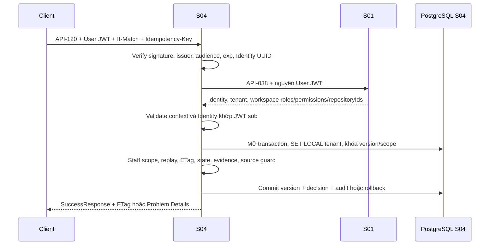

# LIV-118 — API-120 tích hợp S01 Identity và API-038

**Người lập:** Codex. **Ngày:** 23/11/2026, UTC+7.
**Nơi lưu:** repository LivingDocs, nhánh `feature/LIV-118-s04-review-state-persistence`.
**Phạm vi:** Staff Decision; không phải nghiệm thu toàn bộ LIV-138 hoặc Golden Flow.

## Quyết định và hành vi

API-120 hiện sử dụng User JWT do S01 cấp và API-038. Đây là implementation đã có,
chưa đáp ứng bước fresh authorization của runbook LIV-138; người dùng không xác nhận
dùng API-038 thay bước đó. [Báo cáo triển khai](../LIV-118-implementation-report.md)
đã đính chính nhận định trước đây và ghi dependency API-039 còn thiếu.



- Không đọc tenant/roles/grants từ JWT, body hoặc header tự khai.
- Cần đồng thời `STAFF` và `DOCUMENT_STAFF_REVIEW` trong grant của workspace sở hữu version.
  Repository-backed version còn cần repository ID trong chính grant đó.
- Không cache authority; exact replay cũng gọi API-038 và kiểm quyền trước khi trả kết quả cũ.
- S01 trả 401/403 được ánh xạ tương ứng. Không membership/quyền trả 403; khác tenant trả 404 dưới RLS.
- Thiếu cấu hình, timeout, lỗi upstream hoặc context hỏng/sai Identity trả
  `503 AUTHORIZATION_UNAVAILABLE`; không fallback và không ghi state/decision/audit.
- Client không follow redirect, chỉ dùng HTTPS mặc định; HTTP cần ngoại lệ local tường minh.
  Connect timeout 2 giây, deadline toàn response 3 giây, giới hạn body 256 KiB.

API-038 vẫn là **snapshot quyền**. Thu hồi trước lần lookup tiếp theo có hiệu lực với cùng JWT;
không bảo đảm nguyên tử giữa thu hồi và commit S04. Không gọi đây là API-039 fresh evaluation.

## Kiểm chứng local

| Kiểm tra | Kết quả và giới hạn |
| --- | --- |
| S04 `mvn -B -ntp clean verify` | 59 tests, 0 failures/errors/skipped; kết thúc 23/11/2026 14:41:06 UTC+7. Bao gồm PostgreSQL/RLS, rollback, replay, restart Spring context, auth và runtime Swagger parity. Authority/issuer trong component tests là test provider. |
| Runner hai service thật | **22/22 assertions PASS**, kết thúc 23/11/2026 14:45:42 UTC+7. Lệnh `python -X utf8 scripts/test_api120_s01_integration.py`; thời gian chính xác và SHA256 jar/runner tại manifest evidence. |
| OpenAPI tĩnh | `s04-document-review.yaml` hợp lệ bằng openapi-spec-validator 0.7.2; PyYAML 6.0.3. |
| Gateway inventory | 112 APIs, 91 exact method/path entries, 19 route groups; không public internal endpoint. Chỉ kiểm chứng tĩnh. |
| Compose | `docker compose --profile services config --quiet` hợp lệ; chưa redeploy S04 vào DB Compose hiện có. |

Runner chạy hai JVM từ jar local, PostgreSQL 17 và Redis 8.2 riêng, không đọc `.env` hoặc dùng DB
ứng dụng hiện có. Sinh key riêng chỉ cho S01, register/login qua HTTP thật; S04 đọc JWKS và API-038
qua HTTP thật. Fixtures authority/document được tạo bằng SQL trong DB tạm; đây không là test CLI operator.

Các assertion kiểm login/JWT Identity-only; Identity chưa provision; quyền Staff từ DB; PENDING grant
không hiệu lực; PASS sang Manager Approval; RETURN về Draft; replay; sai tenant/workspace; bearer lỗi;
revoke Staff/tenant membership với cùng JWT; replay sau revoke; S01 down; DB không mutate khi deny;
replay chỉ có một decision/audit và actor đúng Identity S01. Runner dừng đúng JVM/container của nó.

Lượt runner đầu chưa PASS outage: launcher `javapath` Windows để lại JVM con sau `terminate()`.
Runner đã sửa để resolve `java.home/bin/java` và chạy lại; không tính kết quả lượt đầu là PASS.
Lượt Maven trước clean build có class cũ lỗi; một lượt sau phát hiện thiếu code trong schema Swagger.
Kết quả 59/59 ở bảng trên là lượt chạy sau khi xử lý cả hai lỗi.

## Chạy lại

Tại repository root:

```powershell
mvn -B -ntp -f backend/identity-organization-service/pom.xml package
mvn -B -ntp -f backend/document-governance-service/pom.xml clean verify
python -X utf8 scripts/test_api120_s01_integration.py
```

Report JSON và service logs nằm tại `backend/document-governance-service/target/`.
Manifest [LIV-118-test-evidence.json](../LIV-118-test-evidence.json) lưu source/artifact hashes,
suite totals và kết quả runner. Các artifact local bị Git bỏ qua, có thể bị ghi đè bởi lần build sau.

## Giới hạn nghiệm thu

**Auth API-120 chưa hoàn thành theo runbook LIV-138:** S04 chưa gọi evaluator API-039
trước protected action. Kiểm tra source/runtime ngày 23/11/2026 chưa tìm thấy evaluator
hoặc cơ chế cấp/xác minh service assertion trong S01 hiện truy cập được; nhánh fresh auth
vẫn cùng SHA `1e76bad12ceb96c79c4820dcbf310a74b0d93fd3` với `develop`.
Các kết quả 59 tests và 22 assertions ở trên không là bằng chứng API-039 đã tích hợp.

Positive PASS/RETURN ở runner dùng document **không gắn repository**. Không tự tạo VERIFIED grant,
không bỏ source guard S02. Repository-backed PASS vẫn cần quyền repository hiệu lực và adapter source
đáng tin cậy; adapter production S02 chưa được triển khai trong lát này. Chưa chạy Gateway HTTP,
Newman, S02/GitHub, Manager/Publish, deployment TLS hoặc restart JVM/PostgreSQL. Không tuyên bố
Golden Flow PASS, remote CI PASS, independent QA hoặc Jira Done.

## Nguồn và độ tin cậy

| Nguồn | Tác giả/chủ thể, thời gian, nơi công bố | Mức kiểm chứng |
| --- | --- | --- |
| [LIV-118](https://huutiense25.atlassian.net/browse/LIV-118) | LivingDocs Jira; assignee HAI NGUYEN XUAN; issue cập nhật 08/11/2026; đọc live 23/11/2026. Tác giả description chưa xác định. | Nguồn sơ cấp về guarded PASS/RETURN/persistence; không là runtime evidence. |
| [LIV-138](https://huutiense25.atlassian.net/browse/LIV-138) | LivingDocs Jira; assignee TIỀN HUỲNH PHẠM HỮU; issue cập nhật 15/11/2026; đọc live 23/11/2026. Tác giả description chưa xác định. | Nguồn sơ cấp về authority, RLS và fresh authorization Manager/Publish; không suy ra ticket đã Done. |
| [Runbook S01](LIV-138-s01-authority-and-testing.md) | Trong repo; commit `e0d7fc1` của `huutienSE`, 22/11/2026 10:21:52 UTC+7. Tên commit author không tự chứng minh tác giả mọi nội dung. | Đối chiếu API-038 với source S01 và HTTP thật; lịch sử evidence trong tài liệu không thay kết quả mới. |
| Source S01/S04 và manifest | Repo base `24fdc3b346095545dd752c5757fbfcc93461f21d` cùng diff local; kiểm chứng bởi Codex 23/11/2026. | Primary implementation + kết quả chạy local có SHA256; chưa có reviewer/QA độc lập hoặc CI cho diff này. |

Độ tin cậy của kết luận nằm ở request thật và kiểm tra DB/artifact của lượt chạy, không dựa chỉ vào
tên tác giả, ảnh chụp, số test cũ hoặc trạng thái issue.
