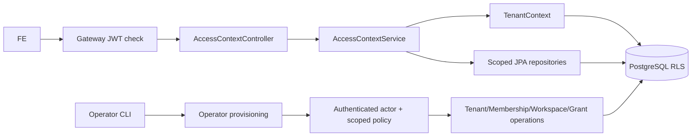

# LIV-138 PR 1 — S01 Authority Foundation

## Bắt đầu ở đây: chọn đúng đường chạy

**Không chạy tuần tự cả tài liệu.** Trước hết xác định database của bạn đang ở trạng thái nào:

| Tình huống | Làm gì | Không chạy lại |
| --- | --- | --- |
| Máy mới, database LivingDocs **chưa có dữ liệu** | Theo [A. Công cụ](#a-clone-công-cụ-và-port) → [B. Database mới](#b-fresh-database-secrets-và-flyway) → [C. Tạo fixture](#c-identity-abc-bootstrap-và-cli) → [D. Kiểm thử](#d-gateway-api-038-và-thứ-tự-test). | Không dùng UUID/password trong ví dụ hoặc evidence của Owner. |
| Đã chạy Flow 1, database và A/B/C vẫn còn | Theo [Khởi động lại database hiện có](#khởi-động-lại-database-hiện-có), sau đó vào [D. Kiểm thử](#d-gateway-api-038-và-thứ-tự-test). | Bỏ qua tạo secrets, `.env`, DB roles, bootstrap, Register và toàn bộ lệnh provision ở B/C. |
| Muốn chạy lại test trên fixture cũ | Khởi động services, kiểm tra C còn membership ACTIVE, chuẩn bị Postman environment mới từ **giá trị hiện có**, rồi chạy các gate ở D. | Không tạo UUID/manifest mới; không revoke C nếu còn cần request 08–09. |
| C đã bị revoke hoặc bootstrap đã dùng | Test 01–07 vẫn chạy được; 08–09 cần **fixture ACTIVE khác** được tạo qua operator policy hiện hành. | Không reset DB, không bootstrap lần hai, không sửa DB bằng SQL ad hoc. |

**Chú giải nhãn trong runbook:** `CHỈ LẦN ĐẦU` tạo dữ liệu/cấu hình; `CHẠY LẠI ĐƯỢC` là start/đọc trạng thái hoặc test không thu hồi fixture; `THAY ĐỔI DỮ LIỆU` tạo hoặc revoke authority và cần kiểm đúng actor/UUID; `KHÔNG CHẠY LẠI` là one-shot hoặc lệnh tạo UUID mới. Các đoạn SQL trong `psql` chỉ chạy tại dấu nhắc `livingdocs=#`; sau `\q` mới trở về Terminal/PowerShell.

**Đường ngắn cho Owner đã hoàn tất Flow 1:** vào mục [Khởi động lại database hiện có](#khởi-động-lại-database-hiện-có), rồi chạy Gate 1–7 ở mục D. Có thể chạy riêng Postman 01–07 nhiều lần vì nó tự đăng ký Identity mới; mỗi lần như vậy **vẫn thêm Identity vào DB**. Request 08–09 cần C còn ACTIVE. Request 12 là kiểm sau revoke, không dùng nó như bước setup thường ngày.

Trước khi nhánh PR 1 được push/merge, clone từ remote chưa có đủ source LIV-138: fresh clone từ remote là `BLOCKED`. Dùng working tree hiện tại để đọc và chạy; không dùng bản ZIP hoặc dữ liệu của Owner để báo PASS.

## Phạm vi và ranh giới

PR 1 triển khai authority PostgreSQL thật, API-038 access context, Flyway V3/V4 và CLI operator. Register/Login không tự cấp membership hay role; JWT chỉ có Identity. S01 không sửa nghiệp vụ S02/S04 hoặc FE. Repository Grant `PENDING` được lưu và audit nhưng không xuất hiện trong quyền hiệu lực. Xác minh binding từ S02 và đánh giá quyền fresh cho mutation S04 thuộc PR tiếp theo; Golden Flow E2E chưa được chứng minh ở PR 1.

## HLD, dữ liệu và trách nhiệm lớp



V3 bổ sung `workspaces`, `workspace_memberships`, `role_catalog`, `permission_catalog`, `role_permissions`, `tenant_role_assignments`, `workspace_role_assignments`, `repository_grants`, `authorization_audit`, `provisioning_operations`; thêm `tenants.authz_revision` và optimistic `row_version`. Catalog chuẩn được seed bằng migration; assignment runtime chỉ được tạo qua CLI. `TENANT_OWNER` chỉ có `TENANT_ADMIN`, không có review/approve/publish. Workspace role có thể nhiều trong đúng workspace. Composite FK chặn membership/assignment khác tenant hoặc workspace; partial unique index chặn một ACTIVE Tenant Membership/Identity, duplicate active workspace member/role/grant.

`AccessContextController` nhận JWT đã được S01 verify độc lập; `AccessContextService` dùng `TenantContext.currentTenant` mở transaction ngắn với `app.identity_id` từ JWT `sub` để tìm tối đa một membership ACTIVE. Transaction kế tiếp đặt `app.tenant_id` trên cùng connection trước JPA lookup. PostgreSQL ghép các permissive SELECT policy bằng OR; bootstrap chỉ đọc row ACTIVE của chính Identity, các bảng tenant khác chỉ mở khi có tenant GUC. Transaction-local `set_config(..., true)` ngăn context rò qua pool. Runtime `ld_s01_app` không là owner/superuser, không `BYPASSRLS` và chỉ có SELECT trên authority trong PR 1; CLI dùng DB role riêng cho mutation. `SECURITY DEFINER` chỉ dùng ở trigger revision/audit và one-shot bootstrap, có search_path cố định, không dynamic SQL và không trả dữ liệu tenant; bootstrap function chỉ được cấp EXECUTE cho role riêng.

Trigger tăng revision theo từng row authority đổi và ghi audit trong cùng transaction. Một operation có thể tăng hơn một đơn vị; rollback trả cả mutation, revision và audit về trạng thái trước đó. Thu hồi membership vô hiệu hóa ngay role/workspace/grant con khi lookup vì truy vấn nối ancestor ACTIVE; không xóa lịch sử. `@Version` và unique constraints phát hiện ghi cạnh tranh; Owner mutations dùng Tenant row lock trước khi đếm, vì row version riêng của mỗi Owner không đủ bảo vệ last-owner invariant. Catalog thay đổi bằng Flyway tương lai phải tăng revision/audit tương ứng trong migration đó.

## Flow runtime và CLI

```mermaid
sequenceDiagram
  participant C as Client
  participant S as S01
  participant D as PostgreSQL
  C->>S: GET /api/v1/users/me/access-context + Bearer JWT
  S->>S: Verify signature, issuer, audience, lifetime, sub
  S->>D: TX1 SET LOCAL app.identity_id; active Identity/Membership
  D-->>S: tenantId hoặc rỗng
  S->>D: TX2 SET LOCAL app.tenant_id; JPA scoped lookup
  D-->>S: active roles, permissions, verified grants, revision
  S-->>C: SuccessResponse<AccessContext> + no-store
```

CLI dùng profile `db,provision`, không có HTTP port. V4 bổ sung Platform assignment và DB login cá nhân → Identity mapping; `ld_s01_provisioner` chỉ là NOLOGIN privilege group. DBA chạy one-shot bootstrap cho Identity ACTIVE đầu tiên bằng named DB login, audit và disable credential sau đó. Mỗi CLI command xác thực `session_user` và mapping ACTIVE; UUID legacy trong manifest chỉ được so khớp, không làm actor authentication. `CREATE_TENANT` yêu cầu Platform permission fresh; Tenant mutations yêu cầu active Tenant Owner đúng scope; `REQUEST_REPOSITORY_GRANT` chỉ cho TECHNICAL_LEAD active tự request PENDING. Operation dùng một transaction, `app.actor_identity_id` và `app.tenant_id` transaction-local; JPA mutation, revision, audit, idempotency commit/rollback cùng nhau. Owner mutations khóa Tenant trước khi đếm owner. Domain operations typed có thể tái sử dụng cho future Admin API với policy riêng.

`REVOKE_REPOSITORY_GRANT` và S02 verification/attestation chưa mở qua CLI vì actor policy chưa được duyệt; PENDING không thành effective permission.

Các `type` được hỗ trợ:

| Type | Trường thêm bắt buộc | Tác động |
| --- | --- | --- |
| `CREATE_TENANT` | `identityId` = requester Initial Owner B, `roleCode=TENANT_OWNER`, `name` | Tenant + Owner membership/assignment tường minh |
| `CREATE_WORKSPACE` | `workspaceId`, `name` | Workspace ACTIVE |
| `ADD_TENANT_MEMBER` | `identityId` | Membership ACTIVE; global unique chặn tenant khác |
| `ADD_WORKSPACE_MEMBER` | `workspaceId`, `identityId` | Cần parent Tenant Membership ACTIVE |
| `ASSIGN_TENANT_ROLE` | `identityId`, `roleCode=TENANT_OWNER` | Tenant Owner assignment trong đúng Tenant |
| `ASSIGN_WORKSPACE_ROLE` | `workspaceId`, `workspaceMembershipId`, `roleCode` | Role phải thuộc catalog WORKSPACE |
| `REQUEST_REPOSITORY_GRANT` | `workspaceId`, `workspaceMembershipId`, `repositoryConnectionId`, `provenance` | TECHNICAL_LEAD active tự request cho chính mình; Grant `PENDING`, không effective |
| `REVOKE_TENANT_MEMBER`, `REVOKE_WORKSPACE_MEMBER`, `REVOKE_TENANT_ROLE`, `REVOKE_WORKSPACE_ROLE` | `targetId` | Revoke có audit; không xóa row; Owner mutations khóa Tenant |

Ví dụ manifest tạo Tenant (UUID/Identity là dữ liệu thật; **không** dùng ví dụ này như seed):

```json
{
  "operationId": "eb4970d0-a0a7-4b66-82ba-811c5e80996a",
  "tenantId": "7e0693e7-4e62-4188-8b2d-e9dd38617199",
  "operatorIdentityId": "bd58a6fd-a6a2-4103-972c-87a2838f4218",
  "type": "CREATE_TENANT",
  "reason": "Approved tenant onboarding request LIV-xxx",
  "identityId": "a3335b40-fbd1-4a8e-ae3f-84ab7ea3f814",
  "roleCode": "TENANT_OWNER",
  "name": "Example Organization"
}
```

## API-038, FE và PR 2/S04

`GET /api/v1/users/me/access-context` yêu cầu `Authorization: Bearer <S01 JWT>`. HTTP 200 `application/json`, `Cache-Control: no-store`:

```json
{
  "code": "ACCESS_CONTEXT_LOADED",
  "message": "Access context loaded",
  "data": {
    "identityId": "bd58a6fd-a6a2-4103-972c-87a2838f4218",
    "tenantId": "7e0693e7-4e62-4188-8b2d-e9dd38617199",
    "authzRevision": 8,
    "evaluatedAt": "2026-11-16T10:00:00Z",
    "tenantRoles": ["TENANT_OWNER"],
    "tenantPermissions": ["TENANT_ADMIN"],
    "workspaceGrants": [{"workspaceId": "7b128ef3-752e-44a3-a419-07dc25920518", "roles": ["STAFF", "MANAGER"], "permissions": ["WORKSPACE_VIEW", "DOCUMENT_READ", "DOCUMENT_STAFF_REVIEW", "DOCUMENT_FINAL_APPROVE", "DOCUMENT_PUBLISH"], "repositoryIds": []}]
  }
}
```

Identity chưa provision nhận `tenantId:null`, revision `0`, các list rỗng. S01: JWT thiếu/hỏng/hết hạn → 401 `UNAUTHENTICATED`; Identity hoặc Tenant inactive → 403 (`IDENTITY_INACTIVE`/`TENANT_INACTIVE`); lỗi có RFC 9457 `application/problem+json`, `code`, `correlationId`. FE LIV-116/119/121 dùng context cho navigation trong workspace, không tự suy quyền từ JWT hay tenant role. FE visibility không thay backend enforcement. S04 sẽ trả `availableActions` theo resource và `ETag`; mutation cần `If-Match`, xử lý 401 bằng đăng nhập lại, 403 bằng refresh context và báo quyền đã đổi, 409/412 bằng reload resource. Không có Active Role switch. API-038 là snapshot; action review/approve/publish phải hỏi S01 fresh trong PR 2 và tự kiểm tra state/guards ở S04. Gateway hiện trả 401 thiếu JWT với `WWW-Authenticate: Bearer` nhưng body rỗng; FE phải xử lý theo HTTP status trước, và Gateway cần Problem Details/stable code ở lát security tiếp theo.

Contract PR 2 dự kiến: S04 truyền user JWT qua `Authorization: Bearer` và service assertion riêng qua `X-LD-Service-Assertion: Bearer`; S01 xác minh đồng thời caller, actor, method/path, `jti`/TTL ngắn, trả `ALLOW`/`DENY`/`UNAVAILABLE`, fail closed. S04 resolve resource dưới RLS trong read transaction, đóng transaction trước HTTP S01, rồi mở write transaction recheck state/scope/ETag trước mutation. PR 1 chưa cung cấp internal endpoint hoặc S04 enforcement.

## Evidence các lượt đã chạy

Đây là lịch sử kiểm chứng của PR 1, **không phải các lệnh cần chạy lại**. Lệnh hiện hành và thứ tự test nằm tại [mục D](#d-gateway-api-038-và-thứ-tự-test). `IdentityOrganizationServiceApplicationTests` dùng Testcontainers; full Maven verify không dùng PostgreSQL cục bộ từ `.env`. Test Java, HTTP/Postman, static OpenAPI và runtime Swagger là các bằng chứng riêng.

Evidence PR 1 tại 2026-11-16: S01 `./mvnw verify` PASS 37 tests; OpenAPI YAML/route validator, Compose config, Swagger tĩnh/runtime PASS; Newman S01 self-contained + provisioned PASS 9 requests/9 assertions, revoke cùng JWT sau CLI PASS 1/1, Gateway + S01 PASS 9/9. Gateway `./mvnw verify` lần đầu FAIL 1/26 (test 503 nhận 504), chạy riêng test đó PASS và full rerun PASS 26/26; xem là timing flake còn cần owner Gateway theo dõi. Không có S02/S04 E2E trong evidence này.

Evidence Flow 1 refactor tại 2026-11-20: `JAVA_HOME=$(/usr/libexec/java_home -v 21) ./mvnw -q verify` PASS **39/39 tests** trên PostgreSQL Testcontainers. Bao gồm A provision Tenant cho B khác Identity, bootstrap one-shot bằng named DB login, operator mapping/Platform role revoke, forged actor, single-active-membership rollback, audit/revision, RLS bằng runtime roles, pending grant và hai revoke Owner đồng thời. `operator-enroll.sql` và `operator-disable.sql` đã chạy bằng `psql` trong container test. `docker compose --profile operator config --quiet`, JSON parse collection, `bash -n` và `git diff --check` PASS. Docker Compose database cục bộ được kiểm tra **read-only**, Flyway history chỉ có V1/V2; không chạy V3/V4 trên database đó. Static OpenAPI validator và Newman **NOT RUN** trong lượt refactor vì local Python thiếu PyYAML và không có binary Newman; runtime Springdoc/Swagger test trong Maven **PASS**. S02/S04 Golden Flow **NOT RUN**.

Evidence vận hành local 2026-11-21: Owner chạy Flyway V3/V4 trên Compose PostgreSQL sau backup; named bootstrap cấp Platform Admin A, CLI A tạo Tenant cho B khác Identity. Tenant Owner B tạo hai Workspace và scoped roles cho C; C tự request Repository Grant `ACTIVE/PENDING`, không xuất hiện trong API-038 `repositoryIds`. DB audit ghi A/B/C đúng DB login; `CREATE_TENANT` lặp cùng manifest trả `ALREADY_APPLIED` và revision không đổi. B bị từ chối Platform provisioning; revoke Tenant Membership C khiến API-038 trả `tenantId:null` với JWT đã cấp trước revoke. S01 `./mvnw -B -ntp clean verify` sau chỉnh Swagger runtime **PASS 39/39**; Postman Runner folder 01–07 và 08–09 **PASS**, toàn collection 01–11 với Gateway **PASS 11 tests**; request 12 trả 200 với context rỗng, request 13 trả 401 `UNAUTHENTICATED`. Newman 01–11 **PASS 11 requests/11 assertions**, folder 12 và 13 **PASS riêng từng folder**. Static S01 OpenAPI validator, route inventory validator (112 APIs/91 exact Gateway entries), Springdoc API-038 và Swagger tĩnh/runtime **PASS**. S02 verification và S04 Golden Flow **NOT RUN** trong PR 1.

## Phần chờ tích hợp

- S02 chưa có verification contract đáng tin cậy cho `repository_connection_id`; TECHNICAL_LEAD active chỉ được tự request `PENDING` cho chính Workspace Membership. Không có operator-attested `VERIFIED` cho tới khi Owner duyệt trust assumption và bằng chứng S02. Revoke Grant actor policy cũng chưa được mở.
- PR 2 cần internal authenticated evaluation, fresh revocation và contract tests S01/S04. PR 3a/3b/3c với Hải cần S04 guard, RLS scope, ETag/concurrency, audit và Golden Flow E2E.
- API-038 không có `availableActions`; đây là response theo resource của S04, do owner S04 bàn giao FE.
- Gateway 401 body rỗng là contract gap ngoài allowlist PR 1; đề nghị chuẩn hóa tại `infrastructure/api-gateway` cùng regression JWT, không thay đổi Gateway trong PR này.

## Khởi động lại database hiện có

Đường này dành cho máy đã chạy Flow 1 và **đã có Flyway V1–V4, Platform Admin, Tenant, Workspace và operator mapping**. Không cần đi qua A/B/C. Các lệnh dưới đây không tạo lại fixture. Chạy từ `infrastructure/docker`; giữ nguyên `.env`, secrets và Docker volume cũ.

**macOS Terminal:**

~~~bash
cd infrastructure/docker  # nếu đang ở repo root
export S01_OPERATOR_DB_LOGIN=ld_operator_config_only
export S01_OPERATOR_DB_PASSWORD=config_only
docker compose config --quiet
docker compose up -d postgres
docker compose ps postgres
docker compose exec -T postgres sh -c 'psql -U "$POSTGRES_USER" -d "$POSTGRES_DB" -c "SELECT version,success FROM identity.flyway_schema_history ORDER BY installed_rank"'
~~~

**Windows PowerShell:**

~~~powershell
Set-Location infrastructure/docker  # nếu đang ở repo root
$env:S01_OPERATOR_DB_LOGIN = 'ld_operator_config_only'
$env:S01_OPERATOR_DB_PASSWORD = 'config_only'
docker compose config --quiet
docker compose up -d postgres
docker compose ps postgres
docker compose exec -T postgres sh -c 'psql -U "$POSTGRES_USER" -d "$POSTGRES_DB" -c "SELECT version,success FROM identity.flyway_schema_history ORDER BY installed_rank"'
~~~

`config_only` chỉ thỏa biến Compose của service CLI **không được khởi chạy** ở đường này; nó không đăng nhập PostgreSQL và không cấp quyền. Kỳ vọng PostgreSQL `healthy`, V1–V4 đều `success=t`. Nếu history chỉ có V1/V2 hoặc có migration lỗi, **dừng trước khi start S01**: S01 tự chạy Flyway, nên đây là lần upgrade DB cần backup và kiểm tra migration riêng. Phần B chỉ dành cho database mới; không dùng nó để sửa DB cũ.

Sau khi đã xác nhận V1–V4, tiếp tục từ cùng `infrastructure/docker`:

~~~bash
docker compose --profile platform up -d redis
docker compose --profile services up -d identity-organization-service
docker compose --profile gateway up -d api-gateway
docker compose ps postgres redis identity-organization-service api-gateway
curl -fsS http://127.0.0.1:8081/actuator/health
curl -i http://127.0.0.1:8080/api/v1/users/me/access-context
~~~

~~~powershell
docker compose --profile platform up -d redis
docker compose --profile services up -d identity-organization-service
docker compose --profile gateway up -d api-gateway
docker compose ps postgres redis identity-organization-service api-gateway
curl.exe -f http://127.0.0.1:8081/actuator/health
curl.exe -i http://127.0.0.1:8080/api/v1/users/me/access-context
~~~

Kỳ vọng S01 health `UP`; Gateway không có JWT trả **401** (đây là PASS cho bước này). Nếu service image cũ hơn code hiện tại, dùng `docker compose --profile services up -d --build identity-organization-service` và `docker compose --profile gateway up -d --build api-gateway` từ chính thư mục này. Sau đó vào [mục D](#d-gateway-api-038-và-thứ-tự-test); Postman provisioned 08–09 chỉ chạy khi C còn ACTIVE. Không chạy lại `bootstrap-platform-admin.sql`, `operator-enroll.sql` hoặc helper tạo UUID ở C.

## Runbook lần đầu trên database mới — macOS và Windows PowerShell

**Chỉ dùng A/B/C khi tạo môi trường mới.** Mỗi mục cho biết lệnh nào đọc trạng thái, lệnh nào thay đổi DB. Không chạy `down -v`, DROP/TRUNCATE hoặc bootstrap lại để sửa lỗi. Dấu nhắc SQL của psql là môi trường khác Terminal/PowerShell: sau lệnh `\q` mới nhập tiếp lệnh shell.

### A. Clone, công cụ và port

**Working directory:** thư mục cha nơi muốn đặt repository. Cài Git, JDK 21, Docker Desktop + Compose v2, PostgreSQL client psql, OpenSSL CLI, Python 3.12 + pip, Node.js + npm/npx, Postman. macOS cần jq cho helper tạo manifest bên dưới; Windows dùng ConvertTo-Json của PowerShell, không cần Bash. Docker phải chạy trước Java integration tests. Không có Maven Wrapper ở repo root; S01/Gateway có wrapper riêng.

~~~bash
git clone https://github.com/huutienSE/LivingDocs.git
cd LivingDocs
git switch develop  # sau khi LIV-138 PR 1 đã merge; trước merge cần branch PR đã được push
java -version
docker compose version
python3 --version
node --version
npx --version
psql --version
openssl version
jq --version
lsof -nP -iTCP:5432 -iTCP:6379 -iTCP:8081 -iTCP:8080 -sTCP:LISTEN
~~~

~~~powershell
git clone https://github.com/huutienSE/LivingDocs.git
Set-Location LivingDocs
git switch develop  # sau khi LIV-138 PR 1 đã merge; trước merge cần branch PR đã được push
java -version
docker compose version
py -3.12 --version
node --version
npx --version
psql --version
openssl version
Get-NetTCPConnection -LocalPort 5432,6379,8081,8080 -State Listen -ErrorAction SilentlyContinue
~~~

Kỳ vọng Java 21, Docker Compose hoạt động và các port chưa bị instance khác chiếm. Nếu port đang dùng, xem process/container trước khi start; không start hai S01 hoặc hai Gateway cùng host port. Windows cần cài OpenSSL và psql vào PATH. Dùng `.\mvnw.cmd` từ module; không cần global Maven.

### B. Fresh database, secrets và Flyway

**CHỈ LẦN ĐẦU trên database mới.** Nếu đã có `.env`, secrets và volume PostgreSQL, bỏ qua toàn bộ B và dùng [đường khởi động lại](#khởi-động-lại-database-hiện-có). Lệnh tạo key ở đây sẽ thay key ký JWT nếu chạy đè; `cp .env.example .env` có thể làm mất mật khẩu đang dùng. Không chạy chúng trên máy đã setup.

| Nhóm lệnh trong B | Nó làm gì | Kỳ vọng |
| --- | --- | --- |
| `openssl` + tạo `livingdocs-secrets` | Tạo private/public JWT key và login-rate pepper **mới** ngoài repo. | Ba file tồn tại; không commit/chia sẻ. |
| `cp .env.example .env`, sửa `.env` | Đặt mật khẩu PostgreSQL/app/Flyway và đường dẫn secrets cho **DB mới**. | Mật khẩu app/migrator sẽ khớp `\password` bên dưới. |
| `docker compose config --quiet` | Chỉ kiểm Compose parse được; **không** kiểm login hay schema. | Exit code 0. |
| `docker compose up -d postgres` | Khởi động PostgreSQL; lần đầu tạo volume/database. | `docker compose ps postgres` báo `healthy`. |
| DBA setup trong `psql` | Tạo role app/migrator và schema `identity`; đặt hai mật khẩu. | Role/schema tồn tại. |
| `up -d ... identity-organization-service` | Khởi động S01; Flyway **ghi V1–V4 vào DB** nếu chưa áp dụng. | History V1–V4 `success=t`, S01 health/JWKS HTTP 200. |

**Working directory:** repo root cho tạo secret; sau đó `infrastructure/docker`. Tạo thư mục secrets **cạnh repo**, không trong repo. File private phải là PKCS#8 PEM; public là SubjectPublicKeyInfo PEM, đúng parser của JwtKeyManager. Đặt password mới vào ba biến `POSTGRES_PASSWORD`, `S01_DB_PASSWORD`, `S01_FLYWAY_PASSWORD` trong Compose .env; password app/migrator phải khớp lệnh psql `\password` bên dưới. Không commit .env/PEM/pepper. Giá trị `config_only` chỉ giúp Compose parse trước khi operator được enroll, **không** dùng chạy s01-provisioner.

~~~bash
mkdir -p ../livingdocs-secrets
openssl genpkey -algorithm RSA -pkeyopt rsa_keygen_bits:3072 -out ../livingdocs-secrets/s01_jwt_private.pem
openssl pkey -in ../livingdocs-secrets/s01_jwt_private.pem -pubout -out ../livingdocs-secrets/s01_jwt_public.pem
openssl rand 32 > ../livingdocs-secrets/s01_login_rate_pepper
chmod 600 ../livingdocs-secrets/s01_jwt_private.pem ../livingdocs-secrets/s01_login_rate_pepper
cd infrastructure/docker
cp .env.example .env
# Mở .env bằng editor, thay password placeholder; S01_JWT_SECRETS_DIR mặc định trỏ tới ../livingdocs-secrets cạnh repo.
export S01_OPERATOR_DB_LOGIN=ld_operator_config_only
export S01_OPERATOR_DB_PASSWORD=config_only
docker compose config --quiet
docker compose up -d postgres
docker compose ps postgres
~~~

~~~powershell
$secretDir = Join-Path (Resolve-Path ..).Path 'livingdocs-secrets'
New-Item -ItemType Directory -Force $secretDir | Out-Null
openssl genpkey -algorithm RSA -pkeyopt rsa_keygen_bits:3072 -out (Join-Path $secretDir 's01_jwt_private.pem')
openssl pkey -in (Join-Path $secretDir 's01_jwt_private.pem') -pubout -out (Join-Path $secretDir 's01_jwt_public.pem')
$pepper = New-Object byte[] 32
[System.Security.Cryptography.RandomNumberGenerator]::Create().GetBytes($pepper)
[System.IO.File]::WriteAllBytes((Join-Path $secretDir 's01_login_rate_pepper'), $pepper)
Set-Location infrastructure/docker
Copy-Item .env.example .env
notepad .env  # thay password placeholder; kiểm tra S01_JWT_SECRETS_DIR trỏ đúng thư mục secrets
$env:S01_OPERATOR_DB_LOGIN = 'ld_operator_config_only'
$env:S01_OPERATOR_DB_PASSWORD = 'config_only'
docker compose config --quiet
docker compose up -d postgres
docker compose ps postgres
~~~

**Điểm dừng 1:** PostgreSQL phải `healthy`. Ở database **mới**, mở psql bằng cùng lệnh trên cả hai OS từ `infrastructure/docker`:

~~~text
docker compose exec postgres sh -c 'psql -U "$POSTGRES_USER" -d "$POSTGRES_DB"'
~~~

Trong dấu nhắc `livingdocs=#`, chạy SQL tạo riêng S01 app/migrator/schema ở [Docker README §3](../../../infrastructure/docker/README.md#3-tạo-database-roles-và-schemas-lần-đầu). Với PR 1 chỉ cần hai role S01, schema identity và GRANT tương ứng; không cần tạo S02/S04. Gõ `\password ld_s01_app`, `\password ld_s01_migrator` để đặt hai mật khẩu đúng .env, rồi `\q`. Đây là DBA setup, **không** dùng superuser làm actor CLI. Không chạy phần tạo role/schema trên DB đã tồn tại.

~~~bash
docker compose --profile platform up -d redis
docker compose --profile services up -d --build identity-organization-service
docker compose --profile services ps
docker compose --profile services logs --tail=80 identity-organization-service
docker compose exec -T postgres sh -c 'psql -U "$POSTGRES_USER" -d "$POSTGRES_DB" -c "SELECT version,description,success FROM identity.flyway_schema_history ORDER BY installed_rank"'
curl -i http://127.0.0.1:8081/actuator/health
curl -i http://127.0.0.1:8081/.well-known/jwks.json
~~~

~~~powershell
docker compose --profile platform up -d redis
docker compose --profile services up -d --build identity-organization-service
docker compose --profile services ps
docker compose --profile services logs --tail=80 identity-organization-service
docker compose exec -T postgres sh -c 'psql -U "$POSTGRES_USER" -d "$POSTGRES_DB" -c "SELECT version,description,success FROM identity.flyway_schema_history ORDER BY installed_rank"'
curl.exe -i http://127.0.0.1:8081/actuator/health
curl.exe -i http://127.0.0.1:8081/.well-known/jwks.json
~~~

**Điểm dừng 2:** V1–V4 đều `success=t`, health 200/UP, JWKS 200 chỉ có public keys. Nếu mount PEM/pepper sai, S01 có thể start nhưng Login/JWKS fail; đối chiếu đúng ba tên file trong `compose.yaml`. Nếu DB đã có dữ liệu thì dùng [đường khởi động lại](#khởi-động-lại-database-hiện-có), không chạy B như cách khắc phục lỗi.

### C. Identity A/B/C, bootstrap và CLI

**CHỈ LẦN ĐẦU cho fixture mới.** Đây là phần **thay đổi dữ liệu thật**: Register, bootstrap, enrol operator, tạo Tenant/Workspace/Role/Grant. Người đã chạy Flow 1 **không chạy lại C**. Nếu cần fixture mới, phải có actor được phép và phải chọn UUID/operation mới một cách có chủ đích; không dùng lại một cách máy móc các lệnh dưới đây.

| Bước C | Actor/quyền | DB thay đổi thế nào | Có chạy lại trên fixture cũ? |
| --- | --- | --- | --- |
| 1. Register A/B/C | HTTP public Register | Tạo ba Identity, **chưa có role**. | Không; email đã đăng ký sẽ bị từ chối. |
| 2. Bootstrap A | DBA setup + **named bootstrap login** | Gán Platform Admin lần đầu, ghi audit rồi khóa bootstrap login. | **Không. One-shot.** |
| 3. Enrol operator | DBA setup | Ánh xạ từng DB login cá nhân tới Identity A/B/C. | Không nếu mapping đang ACTIVE. |
| 4. Tạo manifest và gọi CLI | A provision Tenant; B quản lý Tenant; C tự request PENDING | CLI kiểm `session_user` + permission, rồi transaction ghi authority/revision/audit/idempotency. | Chỉ cùng manifest và actor để kiểm `ALREADY_APPLIED`; manifest mới = operation mới. |
| 5. SELECT đối chiếu | DBA **chỉ đọc** | Không ghi DB. | Có; nhưng DBA SELECT **không** chứng minh RLS runtime. |

**Working directory:** `infrastructure/docker` cho psql/Compose; các ví dụ API dùng S01 trên host 8081. A là Platform Admin và operator tạo Tenant; B là Initial Tenant Owner và operator quản lý Tenant; C là member + TECHNICAL_LEAD chỉ tự request grant PENDING. Password API của Identity **khác** password PostgreSQL login. Register chỉ tạo Identity, chưa có Tenant Membership. Dùng email mới và password mạnh riêng cho từng người.

~~~bash
# Từ infrastructure/docker. Lặp ba lần với email A, B, C; lưu data.identityId trả về.
printf 'Email: '; read -r REG_EMAIL
printf 'Identity password: '; read -r -s REG_PASSWORD; printf '\n'
REG_EMAIL="$REG_EMAIL" REG_PASSWORD="$REG_PASSWORD" python3 -c 'import os,json; print(json.dumps({"email":os.environ["REG_EMAIL"],"password":os.environ["REG_PASSWORD"]}))' |
  curl -fsS -H 'Content-Type: application/json' --data-binary @- http://127.0.0.1:8081/api/v1/auth/register
unset REG_PASSWORD
~~~

~~~powershell
# Từ infrastructure/docker. Lặp ba lần với email A, B, C; lưu data.identityId.
$email = Read-Host 'Email'
$secure = Read-Host 'Identity password' -AsSecureString
$password = [System.Net.NetworkCredential]::new('', $secure).Password
$body = @{ email = $email; password = $password } | ConvertTo-Json
Invoke-RestMethod -Method Post -Uri 'http://127.0.0.1:8081/api/v1/auth/register' -ContentType 'application/json' -Body $body
Remove-Variable password,body,secure
~~~

Kỳ vọng mỗi lần 201 `IDENTITY_REGISTERED` và UUID khác nhau. Đặt biến `ID_A`, `ID_B`, `ID_C` (PowerShell: `$IdA`, `$IdB`, `$IdC`) bằng ba `data.identityId` vừa nhận. Kiểm bootstrap trước khi cấp quyền:

~~~bash
printf 'A identity UUID: '; read -r ID_A
printf 'B identity UUID: '; read -r ID_B
printf 'C identity UUID: '; read -r ID_C
export ID_A ID_B ID_C
~~~

~~~powershell
$IdA = Read-Host 'A identity UUID'
$IdB = Read-Host 'B identity UUID'
$IdC = Read-Host 'C identity UUID'
~~~

~~~bash
export DBA_DSN='host=127.0.0.1 port=5432 dbname=livingdocs user=postgres'
psql -W "$DBA_DSN" -At -c 'SELECT bootstrap_used_at FROM identity.platform_authority_state WHERE singleton'
psql -W "$DBA_DSN" -v ON_ERROR_STOP=1 -f provisioner-role.sql
export BOOT_LOGIN=ld_bootstrap_local_a
psql -W "$DBA_DSN" -v "bootstrap_login=$BOOT_LOGIN" -f bootstrap-login.sql
psql -W "$DBA_DSN"  # ở psql: \password ld_bootstrap_local_a rồi \q
psql -W "host=127.0.0.1 port=5432 dbname=livingdocs user=$BOOT_LOGIN" -v "initial_identity=$ID_A" -v 'reason=LIV-138 approved local bootstrap' -f bootstrap-platform-admin.sql
psql -W "$DBA_DSN" -v "bootstrap_login=$BOOT_LOGIN" -f bootstrap-disable.sql
~~~

~~~powershell
$DbaDsn = 'host=127.0.0.1 port=5432 dbname=livingdocs user=postgres'
psql -W $DbaDsn -At -c 'SELECT bootstrap_used_at FROM identity.platform_authority_state WHERE singleton'
psql -W $DbaDsn -v ON_ERROR_STOP=1 -f provisioner-role.sql
$BootLogin = 'ld_bootstrap_local_a'
psql -W $DbaDsn -v "bootstrap_login=$BootLogin" -f bootstrap-login.sql
psql -W $DbaDsn  # ở psql: \password ld_bootstrap_local_a rồi \q
psql -W "host=127.0.0.1 port=5432 dbname=livingdocs user=$BootLogin" -v "initial_identity=$IdA" -v 'reason=LIV-138 approved local bootstrap' -f bootstrap-platform-admin.sql
psql -W $DbaDsn -v "bootstrap_login=$BootLogin" -f bootstrap-disable.sql
~~~

Nếu `bootstrap_used_at` đã có thời điểm, **dừng phần bootstrap**: xác định Platform Admin hiện hữu; không tạo A mới bằng DBA SQL. Psql `\password` nhập tại prompt psql, không dán shell command vào `livingdocs=#`. Bootstrap named login phải có password trước khi chạy script và bị NOLOGIN sau đó. DBA dùng postgres chỉ để setup roles/scripts; `bootstrap-platform-admin.sql` bắt buộc kết nối bằng named bootstrap login.

Enrol ba login cá nhân sau khi A/B/C đã ACTIVE. Mỗi lần dùng script và đặt password riêng bằng `\password` trong psql DBA; sau đó thoát psql. Tên suffix mẫu tuân regex của script.

~~~bash
for pair in "ld_operator_local_a:$ID_A" "ld_operator_local_b:$ID_B" "ld_operator_local_c:$ID_C"; do
  login=${pair%%:*}; id=${pair#*:}
  psql -W "$DBA_DSN" -v "operator_login=$login" -v "operator_identity_id=$id" -v 'reason=LIV-138 local operator enrollment' -f operator-enroll.sql || break
done
psql -W "$DBA_DSN" # ở psql: \password ld_operator_local_a; \password ld_operator_local_b; \password ld_operator_local_c; \q
~~~

~~~powershell
@(
  @{ login='ld_operator_local_a'; id=$IdA },
  @{ login='ld_operator_local_b'; id=$IdB },
  @{ login='ld_operator_local_c'; id=$IdC }
) | ForEach-Object {
  psql -W $DbaDsn -v "operator_login=$($_.login)" -v "operator_identity_id=$($_.id)" -v 'reason=LIV-138 local operator enrollment' -f operator-enroll.sql
  if ($LASTEXITCODE -ne 0) { throw 'operator enrollment failed' }
}
psql -W $DbaDsn # ở psql: \password từng login trên; \q
~~~

**Điểm dừng 3 — trước khi tạo manifest:** đã lưu `ID_A`, `ID_B`, `ID_C`; bootstrap chỉ có một lần; ba DB login đã được enrol. Đoạn helper dưới đây **chỉ khai báo hàm và sinh UUID/đường dẫn fixture mới**; nó chưa tạo Tenant trong DB. **Không dán lại trên fixture cũ:** nó sinh `TENANT_ID`, hai Workspace ID, Repository ID mới; `make_manifest`/`New-Manifest` còn sinh `operationId` mới mỗi lần gọi. Muốn kiểm idempotency, giữ nguyên file `manifest.json` và gọi CLI cùng actor trước khi tạo manifest kế tiếp.

**Manifest helper, macOS:** cần `jq`, tạo thư mục riêng ngoài repo. `run_op` hỏi DB password của đúng login, không dùng Identity password. Chỉ `run_op` mới thực sự kết nối DB và thực hiện operation trong manifest.

~~~bash
export S01_PROVISION_MANIFEST_DIR="$(mktemp -d)"
export TENANT_ID="$(uuidgen | tr 'A-Z' 'a-z')"
export WS_REVIEW_ID="$(uuidgen | tr 'A-Z' 'a-z')"
export WS_OTHER_ID="$(uuidgen | tr 'A-Z' 'a-z')"
export REPO_PENDING_ID="$(uuidgen | tr 'A-Z' 'a-z')"
make_manifest() {
  jq -n --arg op "$(uuidgen | tr 'A-Z' 'a-z')" --arg tenant "$TENANT_ID" --arg type "$1" --arg reason 'LIV-138 approved local fixture' --argjson fields "$2" '{operationId:$op,tenantId:$tenant,type:$type,reason:$reason} + $fields' > "$S01_PROVISION_MANIFEST_DIR/manifest.json"
}
run_op() {
  export S01_OPERATOR_DB_LOGIN="$1"
  printf 'DB password for %s: ' "$1"; read -r -s S01_OPERATOR_DB_PASSWORD; printf '\n'
  export S01_OPERATOR_DB_PASSWORD
  docker compose --profile operator run --rm --no-deps s01-provisioner
  local result=$?
  export S01_OPERATOR_DB_PASSWORD=config_only
  return "$result"
}
~~~

**Manifest helper, Windows PowerShell:** không dùng Bash. PowerShell ghi UTF-8 không BOM cho Jackson; folder ở TEMP, không trong Git. Chỉ `Invoke-Operator` mới thực sự kết nối DB và thực hiện operation trong manifest.

~~~powershell
$env:S01_PROVISION_MANIFEST_DIR = Join-Path $env:TEMP ([guid]::NewGuid().ToString())
New-Item -ItemType Directory $env:S01_PROVISION_MANIFEST_DIR | Out-Null
$TenantId = [guid]::NewGuid().ToString()
$WsReviewId = [guid]::NewGuid().ToString()
$WsOtherId = [guid]::NewGuid().ToString()
$RepoPendingId = [guid]::NewGuid().ToString()
function New-Manifest([string]$Type, [hashtable]$Fields) {
  $m = @{operationId=[guid]::NewGuid().ToString(); tenantId=$TenantId; type=$Type; reason='LIV-138 approved local fixture'}
  foreach ($key in $Fields.Keys) { $m[$key] = $Fields[$key] }
  $json = $m | ConvertTo-Json -Depth 8
  [System.IO.File]::WriteAllText((Join-Path $env:S01_PROVISION_MANIFEST_DIR 'manifest.json'), $json, [System.Text.UTF8Encoding]::new($false))
}
function Invoke-Operator([string]$Login) {
  $env:S01_OPERATOR_DB_LOGIN = $Login
  $secure = Read-Host "DB password for $Login" -AsSecureString
  $env:S01_OPERATOR_DB_PASSWORD = [System.Net.NetworkCredential]::new('', $secure).Password
  docker compose --profile operator run --rm --no-deps s01-provisioner
  $exit = $LASTEXITCODE
  $env:S01_OPERATOR_DB_PASSWORD = 'config_only'
  if ($exit -ne 0) { throw "Operator failed: $exit" }
}
~~~

**Điểm dừng 4 — mỗi operation:** tạo **một** manifest từ **một** hàng, xem `manifest.json` có đúng `type`, `tenantId`, `identityId`/`workspaceId` và `reason`, sau đó mới gọi `run_op <login>` hoặc `Invoke-Operator <login>`. Kỳ vọng `Provisioning APPLIED operationId=...`; nếu lỗi, dừng và đọc nguyên nhân trước khi làm hàng kế tiếp. `CREATE_TENANT` dùng actor A khác Initial Owner B. Không dùng UUID ví dụ trong tài liệu cũ.

| Thứ tự, actor | macOS: đối số cho make_manifest | PowerShell: đối số cho New-Manifest |
| --- | --- | --- |
| 1 A: Tenant + B Owner | `CREATE_TENANT "$(jq -n --arg id "$ID_B" '{identityId:$id,roleCode:"TENANT_OWNER",name:"LIV-138 local tenant"}')"` | `'CREATE_TENANT' @{identityId=$IdB;roleCode='TENANT_OWNER';name='LIV-138 local tenant'}` |
| 2–3 B: hai Workspace | `CREATE_WORKSPACE "$(jq -n --arg id "$WS_REVIEW_ID" '{workspaceId:$id,name:"Review"}')"`, lặp với `WS_OTHER_ID`/Other | `'CREATE_WORKSPACE' @{workspaceId=$WsReviewId;name='Review'}`, lặp với `$WsOtherId`/Other |
| 4 B: C Tenant Member | `ADD_TENANT_MEMBER "$(jq -n --arg id "$ID_C" '{identityId:$id}')"` | `'ADD_TENANT_MEMBER' @{identityId=$IdC}` |
| 5–7 B: B review, C review, C other Workspace Member | `ADD_WORKSPACE_MEMBER "$(jq -n --arg ws "$WS_REVIEW_ID" --arg id "$ID_B" '{workspaceId:$ws,identityId:$id}')"`; lặp C/review và C/other | `'ADD_WORKSPACE_MEMBER' @{workspaceId=$WsReviewId;identityId=$IdB}`; lặp C/review và C/other |
| 8–13 B: scoped roles | `ASSIGN_WORKSPACE_ROLE "$(jq -n --arg ws "$WS_REVIEW_ID" --arg member "$MEM_C_REVIEW" --arg role STAFF '{workspaceId:$ws,workspaceMembershipId:$member,roleCode:$role}')"`; lặp role/member theo bảng dưới | `'ASSIGN_WORKSPACE_ROLE' @{workspaceId=$WsReviewId;workspaceMembershipId=$MemCReview;roleCode='STAFF'}`; lặp tương ứng |
| 14 C: grant PENDING | `REQUEST_REPOSITORY_GRANT "$(jq -n --arg ws "$WS_REVIEW_ID" --arg member "$MEM_C_REVIEW" --arg repo "$REPO_PENDING_ID" '{workspaceId:$ws,workspaceMembershipId:$member,repositoryConnectionId:$repo,provenance:"LIV-138 local S02 binding pending"}')"` | `'REQUEST_REPOSITORY_GRANT' @{workspaceId=$WsReviewId;workspaceMembershipId=$MemCReview;repositoryConnectionId=$RepoPendingId;provenance='LIV-138 local S02 binding pending'}` |

Ở bước 8–13, cấp B `STAFF` + `MANAGER` trong Review; C `STAFF` + `MANAGER` + `TECHNICAL_LEAD` trong Review; C `STAFF` trong Other. Như vậy B multi-role đúng Workspace; C đáp ứng Postman request 09 và có quyền tự request PENDING. Mỗi role là operation mới; không chạy cả bảng như một manifest. `REPO_PENDING_ID` là candidate logical reference ghi nhận để chờ S02, **không** chứng minh Repository Connection đó tồn tại. Lấy `workspaceMembershipId` B Review, C Review, C Other từ output `ADD_WORKSPACE_MEMBER` rồi đặt `MEM_B_REVIEW`/`MEM_C_REVIEW`/`MEM_C_OTHER` (PowerShell `$MemBReview`/`$MemCReview`/`$MemCOther`). Sau khi tạo manifest, gọi đúng actor:

~~~bash
make_manifest CREATE_TENANT "$(jq -n --arg id "$ID_B" '{identityId:$id,roleCode:"TENANT_OWNER",name:"LIV-138 local tenant"}')"
run_op ld_operator_local_a
# Từng hàng tiếp theo: make_manifest <TYPE> <JSON từ bảng>; run_op ld_operator_local_b
# Hàng grant PENDING: run_op ld_operator_local_c
~~~

~~~powershell
New-Manifest 'CREATE_TENANT' @{identityId=$IdB;roleCode='TENANT_OWNER';name='LIV-138 local tenant'}
Invoke-Operator 'ld_operator_local_a'
# Từng hàng tiếp theo: New-Manifest <TYPE> <hashtable từ bảng>; Invoke-Operator 'ld_operator_local_b'
# Hàng grant PENDING: Invoke-Operator 'ld_operator_local_c'
~~~

Để kiểm `ALREADY_APPLIED`, chạy lại **lệnh CLI** với cùng `manifest.json` và cùng login **trước khi tạo manifest tiếp theo**; **không** gọi lại `make_manifest`/`New-Manifest`. Nếu dùng lại operationId với payload khác, kỳ vọng DENY và rollback. Các query `SELECT` tiếp theo chỉ đọc để đối chiếu; DB role runtime/RLS phải được kiểm bằng Testcontainers, vì DBA có thể bypass RLS:

~~~bash
psql -W "$DBA_DSN" -c "SELECT tenant_id,status,authz_revision FROM identity.tenants WHERE tenant_id='$TENANT_ID'::uuid"
psql -W "$DBA_DSN" -c "SELECT identity_id,status FROM identity.tenant_memberships WHERE tenant_id='$TENANT_ID'::uuid"
psql -W "$DBA_DSN" -c "SELECT m.identity_id,r.role_code,r.status FROM identity.tenant_memberships m JOIN identity.tenant_role_assignments r ON r.tenant_membership_id=m.membership_id WHERE m.tenant_id='$TENANT_ID'::uuid"
psql -W "$DBA_DSN" -c "SELECT workspace_id,identity_id,workspace_membership_id,status FROM identity.workspace_memberships WHERE tenant_id='$TENANT_ID'::uuid ORDER BY workspace_id,identity_id"
psql -W "$DBA_DSN" -c "SELECT verification_status,status,repository_connection_id FROM identity.repository_grants WHERE tenant_id='$TENANT_ID'::uuid"
psql -W "$DBA_DSN" -c "SELECT authz_revision,actor_identity_id,db_actor_name,action,target_table FROM identity.authorization_audit WHERE tenant_id='$TENANT_ID'::uuid ORDER BY authz_revision"
~~~

~~~powershell
psql -W $DbaDsn -c "SELECT tenant_id,status,authz_revision FROM identity.tenants WHERE tenant_id='$TenantId'::uuid"
psql -W $DbaDsn -c "SELECT identity_id,status FROM identity.tenant_memberships WHERE tenant_id='$TenantId'::uuid"
psql -W $DbaDsn -c "SELECT m.identity_id,r.role_code,r.status FROM identity.tenant_memberships m JOIN identity.tenant_role_assignments r ON r.tenant_membership_id=m.membership_id WHERE m.tenant_id='$TenantId'::uuid"
psql -W $DbaDsn -c "SELECT workspace_id,identity_id,workspace_membership_id,status FROM identity.workspace_memberships WHERE tenant_id='$TenantId'::uuid ORDER BY workspace_id,identity_id"
psql -W $DbaDsn -c "SELECT verification_status,status,repository_connection_id FROM identity.repository_grants WHERE tenant_id='$TenantId'::uuid"
psql -W $DbaDsn -c "SELECT authz_revision,actor_identity_id,db_actor_name,action,target_table FROM identity.authorization_audit WHERE tenant_id='$TenantId'::uuid ORDER BY authz_revision"
~~~

Kỳ vọng A không có Tenant Membership tự động; B/C ACTIVE trong Tenant; B có `TENANT_OWNER ACTIVE`; Grant `ACTIVE/PENDING` và **không** effective. Audit actor phải là UUID/login của operator thật, revision tăng theo từng row change (không nhất thiết đúng +1 cho một operation). Không có entry point PR 1 để verify S02 binding hoặc revoke Repository Grant: thử hai flow này là BLOCKED. Sai Tenant/Workspace, forged actor và Last Owner được kiểm bằng `ProvisioningIntegrationTest`; không mutate DB bằng SQL ad hoc để ép kết quả.

### D. Gateway, API-038 và thứ tự test

**CHẠY LẠI ĐƯỢC sau mỗi lần khởi động**, nếu fixture cần cho từng test vẫn hợp lệ. Với database cũ, đã làm [khởi động lại](#khởi-động-lại-database-hiện-có) thì **bỏ qua lệnh start Gateway ngay dưới** và đi thẳng tới kiểm JWT/test gates. Với database mới, S01 phải chạy trước Gateway. `--build` có thể dựng lại image và khởi động container, **không tạo lại Tenant/role**. Gateway Compose dùng issuer `urn:livingdocs:s01`, audience `livingdocs-api` và JWKS URL nội bộ `http://identity-organization-service:8081/.well-known/jwks.json`. Nếu chạy Gateway host bằng Maven Wrapper thì dùng `infrastructure/api-gateway/.env.example` và JWKS host URL, không chạy đồng thời với container Gateway trên port 8080.

**Working directory:** `infrastructure/docker` cho Compose, repo root cho Postman/Python, module riêng cho Maven.

~~~bash
docker compose --profile gateway up -d --build api-gateway
docker compose --profile gateway ps
curl -i http://127.0.0.1:8081/actuator/health
curl -i http://127.0.0.1:8081/.well-known/jwks.json
curl -i http://127.0.0.1:8080/api/v1/users/me/access-context
~~~

~~~powershell
docker compose --profile gateway up -d --build api-gateway
docker compose --profile gateway ps
curl.exe -i http://127.0.0.1:8081/actuator/health
curl.exe -i http://127.0.0.1:8081/.well-known/jwks.json
curl.exe -i http://127.0.0.1:8080/api/v1/users/me/access-context
~~~

Gateway missing JWT kỳ vọng 401 + Bearer challenge (body rỗng hiện tại). Login S01 bằng POST `/api/v1/auth/login` với C Identity password, lấy `data.accessToken`; dùng `Authorization: Bearer <token>` gọi API-038 ở cả 8081 và 8080. Kỳ vọng cùng Identity/Tenant, Review roles STAFF/MANAGER/TECHNICAL_LEAD, Other chỉ STAFF, repositoryIds không có `REPO_PENDING_ID`. Nếu C từng bị revoke thì 200 với `tenantId:null` là đúng; phải dùng fixture ACTIVE khác để kiểm permissions. S01 tự xác minh JWT, không chỉ tin Gateway. Identity mới chưa provision nhận 200 với `tenantId:null`; missing/invalid/expired JWT qua S01 nhận 401 RFC 9457. Không cache JWT trong repo/report.
Gateway management `/actuator/health` trên host 9091 chưa được chứng minh ở Compose: `management.server.address` hiện cố định loopback trong container, xem Docker README §2.5. Dùng `docker compose ps/logs api-gateway` và route HTTP để kiểm trước; ghi health 9091 là BLOCKED nếu không reachable, không suy PASS từ container Up.

Ví dụ login và hai HTTP GET, chạy từ `infrastructure/docker`. Dùng C email và **Identity password**, không phải DB password. Không ghi JWT ra file Git:

~~~bash
printf 'C email: '; read -r C_EMAIL
printf 'C Identity password: '; read -r -s C_PASSWORD; printf '\n'
TOKEN="$(C_EMAIL="$C_EMAIL" C_PASSWORD="$C_PASSWORD" python3 -c 'import os,json;print(json.dumps({"email":os.environ["C_EMAIL"],"password":os.environ["C_PASSWORD"]}))' |
  curl -fsS -H 'Content-Type: application/json' --data-binary @- http://127.0.0.1:8081/api/v1/auth/login |
  python3 -c 'import sys,json;print(json.load(sys.stdin)["data"]["accessToken"])')"
unset C_PASSWORD
curl -i -H "Authorization: Bearer $TOKEN" http://127.0.0.1:8081/api/v1/users/me/access-context
curl -i -H "Authorization: Bearer $TOKEN" http://127.0.0.1:8080/api/v1/users/me/access-context
unset TOKEN
~~~

~~~powershell
$CEmail = Read-Host 'C email'
$secure = Read-Host 'C Identity password' -AsSecureString
$plain = [System.Net.NetworkCredential]::new('', $secure).Password
$body = @{email=$CEmail;password=$plain} | ConvertTo-Json
$Token = (Invoke-RestMethod -Method Post -Uri 'http://127.0.0.1:8081/api/v1/auth/login' -ContentType 'application/json' -Body $body).data.accessToken
Remove-Variable plain,body,secure
curl.exe -i -H "Authorization: Bearer $Token" http://127.0.0.1:8081/api/v1/users/me/access-context
curl.exe -i -H "Authorization: Bearer $Token" http://127.0.0.1:8080/api/v1/users/me/access-context
Remove-Variable Token
~~~

**Thứ tự test sau khi HTTP đã sẵn sàng:** Gate 1 (unit) → Gate 2 (integration/Testcontainers) → Gate 3 (Postman Runner) → Gate 4 (Newman) → Gate 5 (HTTP Gateway/S01) → Gate 6 (static + runtime OpenAPI/Swagger) → Gate 7 (Gateway regression). Mỗi gate có bằng chứng riêng; nếu chỉ muốn kiểm lại API trên fixture hiện có, bắt đầu Gate 3/5 sau khi services UP, không cần provision lại. Maven integration dùng Testcontainers riêng, không sửa fixture trong Compose PostgreSQL.

| Gate | Working directory | macOS | Windows PowerShell | PASS/giới hạn |
| --- | --- | --- | --- | --- |
| 1 Unit | `backend/identity-organization-service` | `./mvnw -B -ntp '-Dtest=RegisterRequestValidationTest,RegistrationServiceImplTest,JwtIssuerTest,RedisLoginRateLimiterTest' test` | `.\mvnw.cmd -B -ntp '-Dtest=RegisterRequestValidationTest,RegistrationServiceImplTest,JwtIssuerTest,RedisLoginRateLimiterTest' test` | Class tests PASS; không chứng minh DB/HTTP E2E. |
| 2 Integration + regression LIV-136/137/138 | cùng module | `./mvnw -B -ntp clean verify` | `.\mvnw.cmd -B -ntp clean verify` | 39 tests trong lượt local đã xác minh; run mới phải xem số thực tế. Docker/Testcontainers PostgreSQL, Redis phải khả dụng. Bao gồm Provisioning/AccessContext/Login/RegistrationIntegrationTest. |
| 3 Postman Runner | repo root | Import `tests/postman/liv138-access-context.postman_collection.json` và environment do setup script tạo | Import cùng collection và private environment JSON tạo theo hướng dẫn dưới | Chạy folder theo fixture; request 01–07 tự chứa. |
| 4 Newman | repo root | `npx --yes newman run tests/postman/liv138-access-context.postman_collection.json -e "$POSTMAN_ENV" --reporters cli` | `npx --yes newman run tests/postman/liv138-access-context.postman_collection.json -e $PostmanEnv --reporters cli` | exit 0 và failed=0; chỉ tính request đã thực chạy. |
| 5 Gateway/API-038 | `infrastructure/docker` | `curl -i http://127.0.0.1:8080/api/v1/users/me/access-context` | `curl.exe -i http://127.0.0.1:8080/api/v1/users/me/access-context` | missing JWT 401; JWT thật kiểm qua Postman 10/11 hoặc gọi HTTP có Bearer. |
| 6 Static OpenAPI/route | repo root | `python3 -m openapi_spec_validator contracts/openapi/s01-identity.yaml`; `python3 scripts/validate_gateway_openapi.py` | `py -3.12 -m openapi_spec_validator contracts/openapi/s01-identity.yaml`; `py -3.12 scripts/validate_gateway_openapi.py` | YAML OK; validator kiểm 112 APIs/91 exact Gateway routes và không public internal route. |
| 6 Runtime Swagger | repo root | `curl -fsS http://127.0.0.1:8081/v3/api-docs`; mở `http://127.0.0.1:8081/swagger-ui.html` | `curl.exe -f http://127.0.0.1:8081/v3/api-docs`; mở URL như macOS | Kiểm paths API-038, bearerAuth, 200/401/403/500 và schema; YAML PASS riêng chưa chứng minh runtime. |
| 7 Gateway regression | `infrastructure/api-gateway` | `./mvnw -B -ntp clean verify` | `.\mvnw.cmd -B -ntp clean verify` | Gateway JWT/routing tests; không gộp với S01 hoặc E2E. |

Trước Gate 6 cài dependency validator tại repo root: macOS `python3 -m pip install openapi-spec-validator==0.7.2 PyYAML==6.0.3`; Windows `py -3.12 -m pip install openapi-spec-validator==0.7.2 PyYAML==6.0.3`. Static Swagger UI: từ repo root chạy `docker compose -f infrastructure/docker/swagger-ui.compose.yaml up -d swagger-ui` (cùng cú pháp trên PowerShell), mở `http://127.0.0.1:8090`; nó đọc YAML, còn runtime Springdoc ở 8081. Postman request 07 kiểm runtime API-038 method, bearerAuth, 200/401/403/500. Chạy Validator và runtime HTTP đều cần để kết luận contract.

**Postman environment:** macOS từ repo root chạy `bash tests/postman/setup-liv138-env.sh --provisioned`, nhập C email/password API, `TENANT_ID`, `WS_REVIEW_ID`, `WS_OTHER_ID`, `REPO_PENDING_ID`; script in path file JSON private ngoài Git. Gán path script vừa in bằng `printf 'Environment path: '; read -r POSTMAN_ENV; export POSTMAN_ENV`, rồi import vào Postman và chọn environment ở góc phải. Windows không chạy .sh: từ repo root, tạo private JSON bằng PowerShell:

~~~powershell
$provisionedEmail = Read-Host 'C email'
$secure = Read-Host 'C Identity password' -AsSecureString
$provisionedPassword = [System.Net.NetworkCredential]::new('', $secure).Password
$PostmanEnv = Join-Path $env:TEMP ('liv138-' + [guid]::NewGuid().ToString() + '.postman_environment.json')
$values = @{
  baseUrl='http://127.0.0.1:8081'; gatewayUrl='http://127.0.0.1:8080'
  runProvisioned='true'; runGateway='false'; runRevoked='false'; runExpired='false'
  provisionedEmail=$provisionedEmail; provisionedPassword=$provisionedPassword
  expectedTenantId=$TenantId; expectedReviewWorkspaceId=$WsReviewId
  expectedOtherWorkspaceId=$WsOtherId; pendingRepositoryId=$RepoPendingId
}
$doc = @{name='LIV-138 Local S01'; _postman_variable_scope='environment'; values=@($values.Keys | ForEach-Object { @{key=$_;value=$values[$_];type='default';enabled=$true} })}
[System.IO.File]::WriteAllText($PostmanEnv, ($doc | ConvertTo-Json -Depth 8), [System.Text.UTF8Encoding]::new($false))
Remove-Variable provisionedPassword,secure
Write-Host "Private environment: $PostmanEnv"
~~~

Trên Windows kiểm ACL file TEMP của user, không đặt environment/report trong repository. **Script setup environment chỉ tạo file JSON ở TEMP, không ghi quyền vào DB**; nó hỏi C Identity password, không hỏi operator DB password. Chọn đúng environment trong Postman trước khi chạy Runner:

| Nhóm request | Điều kiện | Có thay đổi Compose DB? | Chạy lại thế nào |
| --- | --- | --- | --- |
| 01–07 Self-contained | S01 đang chạy; environment baseline | 01 **Register thêm một Identity mới**; các request sau đọc/login, kiểm 200/401. | Có thể chạy lại, nhưng mỗi run thêm Identity; không dùng làm bằng chứng provisioned role. |
| 08–09 Provisioned | C có ACTIVE Tenant/Workspace Membership; `runProvisioned=true`, email/password C và UUID thật | Login + GET, không đổi authority. | Chạy cả folder 08 rồi 09; 09 riêng lẻ không có `provisionedToken`. Nếu C đã revoke, chuẩn bị fixture ACTIVE khác. |
| 10–11 Gateway | Gateway UP, `runGateway=true` | Không đổi authority. | Chạy cùng 01–02 để có JWT run-local. |
| 12 Revoke | C đã bị revoke **bằng CLI riêng**, JWT C trước revoke còn hạn | Bản thân GET không ghi DB; thao tác CLI trước đó **revoke vĩnh viễn fixture**. | Chạy riêng; không dùng lại C cho 08–09. |
| 13 Expired JWT | JWT S01 ký thật nhưng đã hết hạn | Không. | Chạy riêng; thiếu token thật thì `NOT RUN`. |

Khi bốn flag false: 7 request/assertion. Provisioned: 9; thêm Gateway: 11. Collection có 13 requests, 1 assertion mỗi request **được thực thi**; skipped không tính PASS. Newman exit code 0 và failed=0, số executed phải khớp flags; không gọi 7/9/11 là toàn bộ 13.

Revocation là bước **mutate dữ liệu**: sau khi lưu JWT C còn hạn từ request 08, chạy request 09, dùng B tạo manifest `REVOKE_TENANT_MEMBER` với `targetId` là Tenant Membership ID của C (lấy từ query ở C), rồi bật `runRevoked=true`, đặt `provisionedToken` là JWT cũ trong environment private và chạy riêng folder `Revoked access (requires controlled CLI fixture)`. Kỳ vọng request 12 trả 200 context rỗng; sau revoke không dùng C fixture cho 08–09 nữa. Tạo fixture Tenant/C mới nếu cần chạy lại. Expiry: chỉ bật `runExpired=true` khi có JWT S01 **được ký thật** và đã hết hạn; chạy riêng folder `Expired JWT (requires signed expired fixture)`, request 13 trả 401. Không tự dựng token giả rồi gọi là expiry PASS. Nếu không có fixture hợp lệ, đánh dấu NOT RUN; integration test JWT expiry là bằng chứng riêng.

Newman từng folder chạy độc lập bằng `--folder 'Revoked access (requires controlled CLI fixture)'` hoặc `--folder 'Expired JWT (requires signed expired fixture)'`, với flags/token tương ứng trong file environment private. Để lưu JSON report, macOS tạo `REPORT_DIR="$(mktemp -d)"`, thêm `--reporters cli,json --reporter-json-export "$REPORT_DIR/newman.json"`; Windows dùng `$ReportDir=Join-Path $env:TEMP ('liv138-report-'+[guid]::NewGuid().ToString()); New-Item -ItemType Directory $ReportDir | Out-Null` và `--reporter-json-export (Join-Path $ReportDir 'newman.json')`. Report có thể chứa token/password: không commit/chia sẻ nguyên file. Main run, revoke, expiry là **ba kết quả riêng**, không cộng thành một PASS.

### Troubleshooting và báo cáo

| Hiện tượng | Kiểm tra/hành động |
| --- | --- |
| BUILD FAILURE | Xem lỗi compile/assertion hay Docker/Testcontainers chưa chạy; JDK phải 21, không dùng Java 26. |
| PostgreSQL refused | `docker compose ps postgres`, host port 5432 hoặc POSTGRES_HOST_PORT, DB_URL. |
| Flyway failure | schema owner `ld_s01_migrator`, password và `identity.flyway_schema_history`; không xóa schema/volume. |
| API-038 401 | Login JWT thật, issuer/audience, expiry, JWKS; S01 và Gateway tự verify. |
| 403 | Identity/Tenant inactive hoặc authority guard; không sửa role header. |
| Context rỗng | Identity chưa provision hoặc Tenant Membership đã inactive/revoked. |
| Bootstrap already consumed | One-shot đã dùng; không chạy lại, dùng Platform Admin hiện hữu hoặc incident/change control. |
| CLI permission denied | `session_user` named operator, role group, mapping ACTIVE, Platform/Tenant/Workspace permission hiện hành. |
| Gateway 502/503 | S01 health, Compose DNS, JWT issuer/JWKS; Gateway container không được tự khởi động bởi services profile. |
| Newman missing variables | Chọn đúng environment private, flag/fixture, chạy request 08 trước 09 và 01–02 trước Gateway folder. |
| Windows command not found | Kiểm PATH cho psql/OpenSSL/Node/Python, dùng `.\mvnw.cmd` tại module; không giả định có Bash. |

Ghi `PASS` khi có output/assertions của gate tương ứng, `FAIL` khi assertion/build sai, `SKIPPED` khi request bị flag skip, `BLOCKED` khi dependency thật (S02 verification/S04 hoặc PR chưa push) chưa sẵn, `NOT RUN` khi chưa thực thi. Local Java PASS không đồng nghĩa Postman/Gateway/CI PASS. Recovery container dùng `docker compose up -d` với cùng volume/password hiện hữu; không reset dữ liệu.

Regression bổ sung: LIV-136 dùng `tests/postman/liv136-register.postman_collection.json` và `setup-liv136-env.sh`; LIV-137 dùng `tests/postman/liv137-login.postman_collection.json` và `setup-liv137-env.sh` (đều đã có trong working tree). Chuẩn bị environment riêng theo tài liệu Register/Login trước khi chạy Newman, không tái sử dụng secret hoặc số liệu PASS của LIV-138. S01 `RegistrationIntegrationTest` và `LoginIntegrationTest` đã nằm trong Gate 2; Gateway JWT tests nằm trong Gate 7. S02/S04 Golden Flow, S02 verified binding và CI remote không thuộc kết quả PASS của runbook này.

## PR2 — S01 internal authority contract

PR2 thêm Service JWT issuer, API-039 fresh authorization và V5/V6. Mô tả task, contract bàn giao S02/S03/S04, đường chạy lần đầu/chạy lại, macOS/Windows, evidence và giới hạn E2E nằm trong [LIV-138 PR2 — Service JWT và API-039](LIV-138-pr2-service-jwt-fresh-authorization.md).

Runbook PR1 ở trên vẫn là nguồn dựng Identity/Tenant/Workspace và named Operator. Không dùng PR2 để tạo Verified Grant, giả Repository Connection hoặc tuyên bố S01→S02→S04 Golden Flow PASS.
