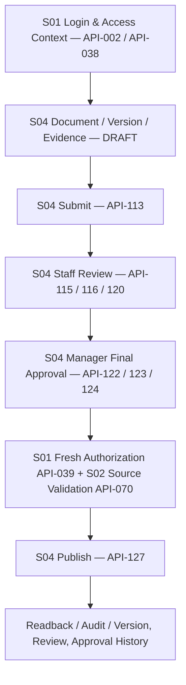

# Flow 1 — Tài liệu tham chiếu và yêu cầu được lưu từ trao đổi

Ngày ghi nhận: **22/11/2026, Asia/Bangkok (UTC+7)**. Người tổng hợp: **Codex**, theo yêu cầu trực tiếp của người dùng lưu tài liệu và các yêu cầu trong ảnh để tham chiếu khi xây Flow 1.

## 1. Nguồn, tác giả và mức độ xác thực

| Nguồn | Xuất xứ / tác giả | Thời gian | Giá trị và giới hạn |
| --- | --- | --- | --- |
| [xay_dung_cac_api_de_hoan_thanh_flow1.md](xay_dung_cac_api_de_hoan_thanh_flow1.md) | Bản sao nguyên byte từ `C:\Users\TP\Downloads\xay_dung_cac_api_de_hoan_thanh_flow1.md`. Ảnh Zalo cho thấy tài khoản hiển thị **Hữu Tiền** gửi file; nội dung file không có tên tác giả hoặc chữ ký phê duyệt. | Người dùng cung cấp trong phiên ngày 22/11/2026. Không coi thời gian tạo file trên máy là ngày tác giả viết. | Người dùng chọn làm tài liệu tham chiếu xây Flow 1. Giữ nguyên cả các đề xuất và điểm chưa được approve trong bản gốc; không biến chúng thành chính sách đã chốt. |
| Các ảnh chụp cuộc trao đổi Zalo người dùng đính kèm | Người gửi hiển thị **Hữu Tiền**, cửa sổ Zalo hiển thị **Nguyễn Hải**. Không suy ra thêm định danh hoặc quyền phê duyệt chỉ từ tên hiển thị. | Một số ảnh có mốc 16:43, 16:46, 16:48, 16:51 và 23:26; giao diện ghi “Hôm nay”. Chưa xác minh ngày lịch của tin nhắn từ dữ liệu Zalo gốc. | Bản ghi nội dung nhìn thấy trong ảnh, không phải bản export hội thoại có thể kiểm chứng độc lập. Chỉ chép/tổng hợp phần đọc được; không suy diễn phần bị cắt. |
| Các yêu cầu trực tiếp trong phiên làm việc | Người dùng yêu cầu một task mỗi API, branch tương ứng, đồng bộ với LIV-118, kiểm tra kỹ và hỏi khi chưa rõ; sau đó yêu cầu lưu tài liệu. | 22/11/2026 | Phạm vi lượt lưu này là lưu nguồn và yêu cầu. Các chỉ dẫn trong ảnh không tự trở thành lệnh chạy Git, sửa code, thay DB, Jira hoặc PR ở lượt này. |

SHA256 của bản Markdown gốc và bản sao phải cùng là:

```text
C124A2F62F35A4ECA84DD5543409A8D8EE9085C418B08C379D09A49EC8A1DBBD
```

Hash xác nhận bản sao giữ nguyên file đã nhận; không chứng minh tác giả, phê duyệt hay tính đúng của nghiệp vụ. Các ảnh hiện được tham chiếu từ hội thoại người dùng; thư mục này lưu bản tổng hợp chữ, **không có bản sao ảnh gốc**.

## 2. Flow cần xây

Theo tài liệu gốc, Flow 1 có hai giai đoạn bắt buộc:

1. **Onboarding & Repository Access:** Tenant/Workspace → Members/Roles → GitHub Connection → Verified Repository Access.
2. **Document Governance:** Developer Draft → Staff Review → Eligible Manager Approval → Current Source Validation → Publish.

Ảnh sơ đồ mô tả phần document governance:



**Cách đọc bắt buộc từ file gốc:** sơ đồ thể hiện thứ tự nghiệp vụ, không phải mọi lần gọi API theo thời gian. Fresh authorization và source guards áp dụng ở các protected actions tương ứng, không chỉ ngay trước Publish. Không dùng vị trí một ô trong ảnh làm căn cứ tự bỏ guard hiện có hoặc thêm remote call vào mọi API. Nếu contract/ảnh/code diễn đạt khác nhau, ghi rõ từng operation và đưa PO xác nhận.

Không tạo vòng lặp onboarding: Developer/Technical Lead kết nối repository bằng Workspace permission và GitHub access hợp lệ; không đòi VERIFIED grant cho chính connection chưa được tạo. Sau connection mới thiết lập quyền repository cho người tham gia.

## 3. Các yêu cầu triển khai đọc được từ ảnh

- Triển khai thêm S04 để hoàn thành flow; API Staff Decision riêng lẻ chỉ là một phần của flow.
- Ưu tiên làm nền `develop` chạy được theo runbook: đọc Markdown setup, cấu hình Docker Compose, thiết lập membership/role/permission S01 trước khi kiểm thử S04.
- Sau khi nền chạy được, cập nhật/hoàn thiện **LIV-118 — API-120 Staff Decision** trên branch/PR cũ; đồng bộ với S01 và phần submit. Staff PASS chuyển sang Manager Review/Approval, chưa phải Final Approval.
- **API-113 Submit** có task và branch riêng; nếu chưa có task thì tạo task mới để Jira cấp key, không dùng chung task API-120. Trong phiên đã có mapping LIV-143, vì vậy không tạo task trùng chỉ từ chỉ dẫn lịch sử trong ảnh.
- Nhóm Staff được yêu cầu làm thêm: **API-115, API-116, API-120, API-121, API-117, API-118, API-119**.
- Mỗi API có một task Jira mô tả đầy đủ phạm vi, yêu cầu nghiệp vụ, đầu ra và ràng buộc PASS; branch gắn đúng Jira key của task.
- Làm API/persistence/integration thật. Mock hoặc fixture trong unit/component tests không thay thế bằng chứng flow hoạt động trên API/service/DB thật.
- Có unit tests happy case và bad case; kiểm tra JWT không hợp lệ, hết hạn hoặc không đúng trust contract, thiếu quyền và sai scope; bổ sung state/evidence/ETag/retry/concurrency theo từng API.
- Tạo scripts Postman/Newman, cập nhật OpenAPI và Swagger, đọc lại DB/audit/history để kiểm chứng kết quả; phân biệt test nào đã chạy, chưa chạy và test phụ thuộc service khác.
- Nếu thiếu capability của service khác, còn quyết định kiến trúc/công nghệ hoặc nghiệp vụ chưa rõ: lập report cho Project Owner review, nêu bằng chứng, ảnh hưởng và câu hỏi cần chốt. Tiếp tục phần độc lập làm được; không tự dựng một policy hoặc upstream giả để báo PASS.
- Ảnh có chỉ dẫn xử lý PR LIV-118 cũ, tạo PR khi xong và nhờ Hữu Tiền review/merge vào `develop`. Lưu làm bối cảnh bàn giao; không phải lệnh đóng/tạo/merge PR hay gửi tin nhắn trong lượt lưu tài liệu này. Trạng thái PR phải kiểm tra lại trước hành động sau này.

## 4. Ranh giới S01 — S04 — S02 theo ảnh kiến trúc

| Thành phần | Trách nhiệm được mô tả |
| --- | --- |
| **S01 — Trusted Authority** | Giữ private key, phát token, cung cấp fresh user authorization; cung cấp JWKS/public key để service xác minh token. S01 là issuer tập trung theo định hướng người gửi trình bày. |
| **S04 — Document Governance** | Kiểm local resource/business guards, điều phối Publish; sử dụng Service JWT khi gọi S02 API-070 theo contract được chốt; chỉ lưu PUBLISHED sau khi các guard và validation evidence hợp lệ. |
| **S02 — Source Authority** | Xác minh Service JWT và caller scope; kiểm tra request/source binding và GitHub SHA qua nghiệp vụ/dữ liệu S02; trả validation evidence cho S04. |

Người gửi cho biết JWT và phân quyền S01 đã đủ để tiếp tục các API, còn xác thực service-to-service đang triển khai. **Đây là thông tin trong tin nhắn tại thời điểm trao đổi, không là xác nhận runtime hiện tại**. Trước tích hợp cần kiểm tra code/contract/runbook mới nhất: human JWT, API-038 access context, API-039 fresh authorization và Service JWT là các capability khác nhau. Không tự phát Service JWT ở S04 hoặc sao chép private key S01 sang S04/S02.

Tách **binding verification** (connection thuộc đúng tenant/workspace và ACTIVE) với **source validation** (bound SHA còn current). API-070 không thay toàn bộ vòng đời Repository Grant.

Runbook cần đọc khi triển khai:

- [S01 authority và kiểm thử LIV-138](../authorization/LIV-138-s01-authority-and-testing.md).
- [Phạm vi và bằng chứng submit LIV-143](../LIV-143-submit-implementation.md).
- [Gitflow của repo](../../gitflow.md).
- [Master Decisions](../../engineering/LivingDocs_Master_Decisions_Technical_Rules_Team_Agent_Handoff_2026-11-13.md).
- [OpenAPI và trạng thái candidate/implemented](../../../contracts/openapi/README.md).

Các runbook/report là nguồn để đọc và xác minh tiếp, không dùng kết quả lịch sử trong đó để báo PASS hiện tại.

## 5. Task, API và branch đã xác định trong phiên

| Jira | API | Branch |
| --- | --- | --- |
| [LIV-118](https://huutiense25.atlassian.net/browse/LIV-118) | API-120 Staff Decision | `feature/LIV-118-s04-review-state-persistence` |
| [LIV-143](https://huutiense25.atlassian.net/browse/LIV-143) | API-113 Submit | `feature/LIV-143-s04-submit-draft-for-staff-review` |
| [LIV-144](https://huutiense25.atlassian.net/browse/LIV-144) | API-115 Review Queue — P0 | `feature/LIV-144-s04-staff-review-queue` |
| [LIV-145](https://huutiense25.atlassian.net/browse/LIV-145) | API-116 Review Context — P0 | `feature/LIV-145-s04-staff-review-context` |
| [LIV-146](https://huutiense25.atlassian.net/browse/LIV-146) | API-121 Review History — P0 | `feature/LIV-146-s04-review-history` |
| [LIV-147](https://huutiense25.atlassian.net/browse/LIV-147) | API-117 Read Comments — P1 | `feature/LIV-147-s04-review-comments-read` |
| [LIV-148](https://huutiense25.atlassian.net/browse/LIV-148) | API-118 Add Comments — P1 | `feature/LIV-148-s04-review-comments-create` |
| [LIV-149](https://huutiense25.atlassian.net/browse/LIV-149) | API-119 Minor Edit — P1 | `feature/LIV-149-s04-staff-minor-edits-editor-history` |
| [LIV-123](https://huutiense25.atlassian.net/browse/LIV-123) | API-127 Publish | `feature/LIV-123-s04-publish-guards-blocked-ui-audit` |

Trong phiên, sáu branch LIV-144–149 đã được tạo từ LIV-118 tại `24fdc3b346095545dd752c5757fbfcc93461f21d`, có cả remote/local tracking. Đây là snapshot lịch sử, không phải đồng bộ tự động khi LIV-118 thay đổi; cần kiểm refs lại trước khi làm. Task hoặc API khác trong file gốc là phạm vi Flow 1 tổng thể, không tự động thành việc đã giao cho Hải hoặc được phép sửa trong mọi task.

## 6. Điểm chưa chốt phải giữ rõ

1. **API-115/116:** API catalog ghi STAFF_SCOPE, trong khi bảng RBAC có quyền đọc queue/evidence của các vai trò khác trong granted scope; cần PO xác nhận mapping quyền cuối cùng.
2. **API-118:** section request change chỉ lưu feedback hay đổi state; không tự đồng nhất với Return for Revision qua API-120.
3. **API-119:** phạm vi minor edit, field/section được sửa, template/source binding và cách giữ section anchor qua các revision; phải lưu editor history và kiểm No Self Final Approval theo Identity.
4. **Repository Grant:** actor được cấp/xác minh/thu hồi grant và contract xác minh S01/S02. File gốc tự ghi một số policy mới là đề xuất, chưa approve; các operation mới chưa có ID/path chính thức.
5. **Protected actions:** thống nhất operation nào dùng access context, fresh authorization và current-source validation; phân biệt yêu cầu đã chốt với khả năng service-to-service đang xây. Chưa có quyết định thì báo PO, không bỏ guard để làm flow chạy.
6. **DTO/contract candidate:** chốt schema cụ thể với owner trước khi coi ổn định; không dùng placeholder làm bằng chứng API đã implement.

## 7. Cách dùng tài liệu ở lượt triển khai sau

Đọc file Flow 1 gốc cùng bản tổng hợp này, task Jira tương ứng, contract và code hiện hành. Áp dụng quyết định trực tiếp mới nhất của Owner trong phạm vi task; giữ riêng đề xuất chưa duyệt, trạng thái lịch sử và bằng chứng runtime mới xác minh. Nếu mâu thuẫn ảnh/tài liệu/contract/code ảnh hưởng hành vi, trình bày mâu thuẫn và hỏi trước khi tự chốt nghiệp vụ.

Việc lưu tài liệu không xác nhận Flow 1 đã hoàn thành và không mở rộng quyền commit/push/merge, chỉnh Jira hoặc vận hành DB. Những việc đó theo yêu cầu trực tiếp trong phiên thực hiện tương ứng.
