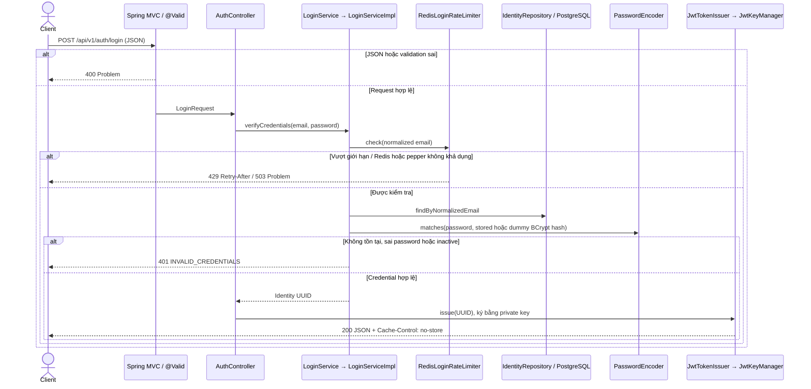

# LIV-137 — Luồng và kiểm thử Login/JWT/JWKS/Gateway

## Phạm vi và hai luồng

API-002 `POST /api/v1/auth/login` xác minh Identity thật trong PostgreSQL, dùng BCrypt và Redis rate limiting. Thành công trả HTTP 200 `SuccessResponse<LoginResponse>` với `accessToken`, `tokenType=Bearer`, `expiresIn=900` và `Cache-Control: no-store`. JWT ký RS256, `sub` là Identity UUID, `iss=urn:livingdocs:s01`, `aud=livingdocs-api`, có `iat/nbf/exp/kid`. Không phát refresh token/cookie hoặc tự cấp tenant, role, permission.



`JwksController` công bố **chỉ public keys** tại `GET /.well-known/jwks.json`. Private key và pepper không nằm trong Git.

```mermaid
sequenceDiagram
    actor Client
    participant G as Gateway Security + header filter
    participant JWKS as S01 JWKS
    participant S01 as S01 candidate route
    Client->>G: GET protected route + Bearer token
    G->>JWKS: Lấy public keys khi cần
    JWKS-->>G: RSA public JWKS
    G->>G: Verify signature, kid, iss, aud, exp, nbf; strip identity headers
    alt Thiếu/sai/hết hạn token
        G-->>Client: 401
    else Đường internal bị cấm
        G-->>Client: 403
    else Token hợp lệ đến /api/v1/users/me
        G->>S01: Forward request
        S01-->>Client: 404 NOT_FOUND (endpoint chưa triển khai)
    end
```

Request 21 chứng minh JWT qua Gateway và S01 trả `NOT_FOUND`; **chưa phải domain business E2E PASS**. Domain JWT verification, membership và business 403 cần endpoint nghiệp vụ thật trong LIV-138/S04.

## Chuỗi kiểm thử local

Luôn theo thứ tự: **môi trường → Compose → smoke → Maven → Postman/Newman → OpenAPI/Swagger → evidence**. Chạy từ root repository, dùng Java 21, Docker Desktop, Node/npm và Python 3. Không lập lịch hoặc chạy tải collection functional.

### 1. Chuẩn bị .env và secrets

Compose đọc `infrastructure/docker/.env`. Maven S01 trên host đọc `backend/identity-organization-service/.env`; Gateway `.env` riêng chỉ dùng khi chạy Gateway trực tiếp trên host. Không ghi đè `.env` đã có. Mật khẩu PostgreSQL/S01 phải khớp database roles hiện hành; sửa `.env` không đổi mật khẩu trong volume cũ.

**macOS (từ root):**

```bash
test -f infrastructure/docker/.env || cp infrastructure/docker/.env.example infrastructure/docker/.env
test -f backend/identity-organization-service/.env || cp backend/identity-organization-service/.env.example backend/identity-organization-service/.env
open -e infrastructure/docker/.env
open -e backend/identity-organization-service/.env
```

**Windows PowerShell (từ root):**

```powershell
if (-not (Test-Path infrastructure/docker/.env)) { Copy-Item infrastructure/docker/.env.example infrastructure/docker/.env }
if (-not (Test-Path backend/identity-organization-service/.env)) { Copy-Item backend/identity-organization-service/.env.example backend/identity-organization-service/.env }
notepad infrastructure/docker/.env
notepad backend/identity-organization-service/.env
```

Trong Compose `.env`, kiểm tra `POSTGRES_PASSWORD`, `S01_DB_PASSWORD`, `S01_FLYWAY_PASSWORD`, `S01_JWT_SECRETS_DIR`, `JWT_ISSUER_URI=urn:livingdocs:s01` và `JWT_AUDIENCE=livingdocs-api`. `S01_JWT_SECRETS_DIR` là đường dẫn host tới thư mục **ngoài repository**; mặc định `../../../livingdocs-secrets` tính từ `infrastructure/docker`. Thư mục phải có ba file `s01_jwt_private.pem`, `s01_jwt_public.pem` cùng RSA key pair và `s01_login_rate_pepper`. Với S01 chạy trên host, đặt các `JWT_*_PATH` và `LOGIN_RATE_LIMIT_PEPPER_PATH` trong S01 `.env` thành **đường dẫn tuyệt đối của máy đó**, không dùng `/run/secrets`.

Chỉ tạo key/pepper **một lần nếu chưa có**. Nếu đã có một trong hai PEM nhưng thiếu file kia, dừng và khôi phục key pair; không ghi đè private key đang dùng vì JWT cũ sẽ mất hiệu lực.

**macOS (từ root; đổi `secret_dir` nếu Compose `.env` dùng path khác):**

```bash
(
  set -e
  cd infrastructure/docker
  secret_dir=../../../livingdocs-secrets
  mkdir -p "$secret_dir"
  chmod 700 "$secret_dir"
  umask 077
  if [ -e "$secret_dir/s01_jwt_private.pem" ] || [ -e "$secret_dir/s01_jwt_public.pem" ]; then
    if [ ! -f "$secret_dir/s01_jwt_private.pem" ] || [ ! -f "$secret_dir/s01_jwt_public.pem" ]; then
      printf 'Thiếu một PEM; khôi phục key pair, không tạo đè.\n' >&2
      exit 1
    fi
  else
    openssl genpkey -algorithm RSA -pkeyopt rsa_keygen_bits:3072 -out "$secret_dir/s01_jwt_private.pem"
    openssl pkey -in "$secret_dir/s01_jwt_private.pem" -pubout -out "$secret_dir/s01_jwt_public.pem"
  fi
  if [ ! -e "$secret_dir/s01_login_rate_pepper" ]; then
    openssl rand -hex 32 > "$secret_dir/s01_login_rate_pepper"
  fi
  test -f "$secret_dir/s01_login_rate_pepper"
  test "$(wc -c < "$secret_dir/s01_login_rate_pepper")" -ge 32
  openssl pkey -in "$secret_dir/s01_jwt_private.pem" -noout >/dev/null
  openssl pkey -pubin -in "$secret_dir/s01_jwt_public.pem" -noout >/dev/null
  diff -q <(openssl pkey -in "$secret_dir/s01_jwt_private.pem" -pubout) \
    <(openssl pkey -pubin -in "$secret_dir/s01_jwt_public.pem" -pubout) >/dev/null
  printf 'Secrets và JWT key pair: OK\n'
)
```

**Windows PowerShell (từ root; cần `openssl` trong PATH; đổi `$secretDir` nếu Compose `.env` dùng path khác):**

```powershell
Get-Command openssl -ErrorAction Stop
$secretDir = Join-Path (Resolve-Path ..).Path "livingdocs-secrets"
New-Item -ItemType Directory -Force -Path $secretDir | Out-Null
$private = Join-Path $secretDir "s01_jwt_private.pem"
$public = Join-Path $secretDir "s01_jwt_public.pem"
$pepper = Join-Path $secretDir "s01_login_rate_pepper"
if (-not (Test-Path $private) -and -not (Test-Path $public)) {
  openssl genpkey -algorithm RSA -pkeyopt rsa_keygen_bits:3072 -out $private
  if ($LASTEXITCODE -ne 0) { throw "Không tạo được private key" }
  openssl pkey -in $private -pubout -out $public
  if ($LASTEXITCODE -ne 0) { throw "Không tạo được public key" }
}
if (-not ((Test-Path $private) -and (Test-Path $public))) { throw "Thiếu một PEM; không ghi đè key pair đang dùng" }
$derivedPublic = @(openssl pkey -in $private -pubout)
if ($LASTEXITCODE -ne 0) { throw "Không đọc được private key" }
$storedPublic = @(openssl pkey -pubin -in $public -pubout)
if ($LASTEXITCODE -ne 0 -or ($derivedPublic -join "`n") -ne ($storedPublic -join "`n")) { throw "Public key không khớp private key" }
if (-not (Test-Path $pepper)) {
  $hex = openssl rand -hex 32
  if ($LASTEXITCODE -ne 0) { throw "Không tạo được pepper" }
  [System.IO.File]::WriteAllText($pepper, "$hex$([Environment]::NewLine)", [System.Text.Encoding]::ASCII)
}
if ((Get-Item $pepper).Length -lt 32) { throw "Pepper quá ngắn" }
Get-Item $private, $public, $pepper | Select-Object Name, Length
Write-Host "Secrets và JWT key pair: OK"
```

Trên Windows, giới hạn quyền đọc thư mục secrets cho tài khoản được phép và kiểm tra ACL bằng `icacls $secretDir`. Không in nội dung private key/pepper, không commit `.env`, PEM, pepper hoặc JWT thật.

### 2. Kiểm tra Compose và build/restart

Từ root, lệnh giống nhau trên macOS và PowerShell:

```bash
cd infrastructure/docker
docker compose --profile services --profile gateway config --quiet
docker compose --profile services --profile gateway up -d --build identity-organization-service api-gateway
docker compose --profile services --profile gateway ps
cd ../..
```

Compose tự khởi động PostgreSQL và Redis là dependency của S01. Nếu S01/Gateway đã chạy trực tiếp trên host, không chạy thêm container cùng port `8081/8080`.

### 3. Smoke test trước khi chạy suite

**macOS:**

```bash
curl -fsS http://127.0.0.1:8081/actuator/health
curl -fsS -o /dev/null -w 'JWKS: %{http_code}\n' http://127.0.0.1:8081/.well-known/jwks.json
curl -sS -o /dev/null -w 'Gateway protected: %{http_code}\n' http://127.0.0.1:8080/api/v1/users/me
curl -sS -o /dev/null -w 'Gateway to S01: %{http_code}\n' -H 'Content-Type: application/json' -d '{}' http://127.0.0.1:8080/api/v1/auth/login
```

**Windows PowerShell:**

```powershell
curl.exe -fsS http://127.0.0.1:8081/actuator/health
curl.exe -fsS -o NUL -w "JWKS: %{http_code}`n" http://127.0.0.1:8081/.well-known/jwks.json
curl.exe -sS -o NUL -w "Gateway protected: %{http_code}`n" http://127.0.0.1:8080/api/v1/users/me
curl.exe -sS -o NUL -w "Gateway to S01: %{http_code}`n" -H "Content-Type: application/json" -d "{}" http://127.0.0.1:8080/api/v1/auth/login
```

Kỳ vọng: S01 healthy, JWKS `200`, protected route thiếu token `401`, Login body `{}` qua Gateway `400`. Lệnh cuối chứng minh Gateway liên lạc được S01 mà không dùng credential thật.

### 4. Maven

**macOS (từ root):**

```bash
export JAVA_HOME="$(/usr/libexec/java_home -v 21)"
export PATH="$JAVA_HOME/bin:$PATH"
(cd backend/identity-organization-service && ./mvnw -B -ntp verify)
(cd infrastructure/api-gateway && ./mvnw -B -ntp verify)
```

**Windows PowerShell (từ root):**

```powershell
java -version # Phải là Java 21
Push-Location backend/identity-organization-service
.\mvnw.cmd -B -ntp verify
Pop-Location
Push-Location infrastructure/api-gateway
.\mvnw.cmd -B -ntp verify
Pop-Location
```

### 5. Postman, rồi Newman

Import [collection](../../../tests/postman/liv137-login.postman_collection.json). Environment cần `baseUrl=http://127.0.0.1:8081` và `gatewayUrl=http://127.0.0.1:8080`. Chạy **33 requests đúng thứ tự, 1 iteration**, kỳ vọng 0 failed assertions. Request 21 với Bearer hợp lệ nhận `404 NOT_FOUND` từ S01 vì endpoint chưa triển khai.

**macOS (từ root):**

```bash
env_file="$(bash tests/postman/setup-liv137-env.sh | sed -n 's/^Postman environment: //p')"
npx --yes newman run tests/postman/liv137-login.postman_collection.json -e "$env_file" --reporters cli
```

**Windows PowerShell (từ root):**

```powershell
npx.cmd --yes newman run tests/postman/liv137-login.postman_collection.json --env-var "baseUrl=http://127.0.0.1:8081" --env-var "gatewayUrl=http://127.0.0.1:8080" --reporters cli
```

Token chỉ nằm trong biến của lần chạy; không export response/token vào Git. Chạy lặp nhanh nhiều iteration có thể chạm Redis global limit và làm lệch functional suite.

### 6. OpenAPI, Gateway validator và Swagger

**macOS (từ root):**

```bash
python3 -m venv /tmp/liv137-openapi
/tmp/liv137-openapi/bin/python -m pip install openapi-spec-validator==0.7.2 PyYAML==6.0.3
/tmp/liv137-openapi/bin/python -m openapi_spec_validator contracts/openapi/s01-identity.yaml
/tmp/liv137-openapi/bin/python scripts/validate_gateway_openapi.py
```

**Windows PowerShell (từ root):**

```powershell
$venv = Join-Path $env:TEMP "liv137-openapi"
py -3 -m venv $venv
$python = Join-Path $venv "Scripts\python.exe"
& $python -m pip install openapi-spec-validator==0.7.2 PyYAML==6.0.3
& $python -m openapi_spec_validator contracts/openapi/s01-identity.yaml
& $python scripts/validate_gateway_openapi.py
```

Từ `infrastructure/docker`, chạy `docker compose -f swagger-ui.compose.yaml up -d swagger-ui`. Swagger tĩnh: <http://127.0.0.1:8090> (S01 - Identity); Springdoc runtime S01: <http://127.0.0.1:8081/v3/api-docs>. Validator chỉ kiểm tra contract tĩnh; HTTP/Postman chứng minh runtime.

## Evidence và follow-up

Ghi riêng Maven, Postman, Newman, OpenAPI và CI; chỉ ghi CI PASS sau khi workflow của PR chạy. LIV-137 chưa chứng minh domain business E2E/permission 403.

| Hạng mục ngoài LIV-137 | Dependency / owner đề xuất |
| --- | --- |
| Refresh rotation, logout/revocation, session management | Session Lifecycle; S01 owner |
| Password reset/change, email verification | Credential lifecycle; S01 owner |
| Domain JWT verification, membership và business 403 | LIV-138/S04 owners; endpoint nghiệp vụ thật |
